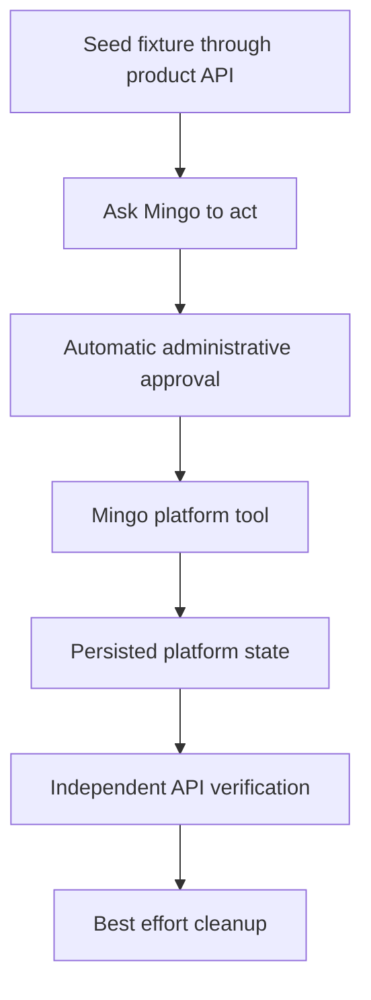

# Platform Entities and MDM

Platform Entities and MDM documents the `MingoEntityQueryTest`, `MingoEntityMutationTest`, `MingoMdmTest`, and `MingoTicketingTest` coverage. These tests validate assistant tool delegation and persisted platform changes through independent APIs.

## Read and Research Workflows

Directory tests compare Mingo results with organization, user, and online Windows-machine APIs. They also require the relevant tool invocation, such as organization search, user search, machine search, or web research, where tool use itself is the contract. This prevents a plausible answer from model memory being accepted as current system data.

## Entity Mutation Workflows

Mingo creates, updates, and deletes scripts; creates knowledge-base articles; creates and updates Fleet MDM policies; assigns one online host; manages scheduled queries; creates workspace tickets; and transitions ticket status. Setup data is created directly by APIs, then retrieved after Mingo acts. Delete tests seed a control entity and verify it survives, making resource scope explicit.

## Target Selection

Policy, scheduled-query, and script-update prompts name an online Windows device because Mingo validates candidate SQL or script bodies on a real machine before saving them. Naming the device avoids ambiguous machine selection and exercises the intended workflow. Ticket mutation prompts use wording that directs the assistant to workspace ticketing, avoiding ambiguity with OpenFrame support requests.
