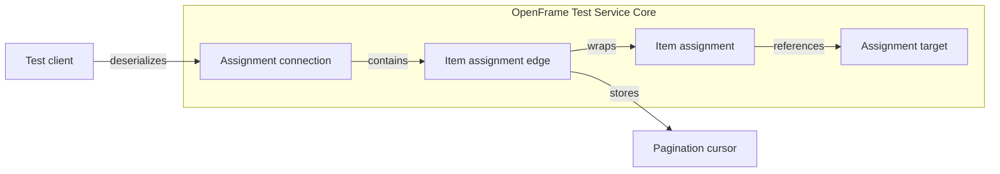
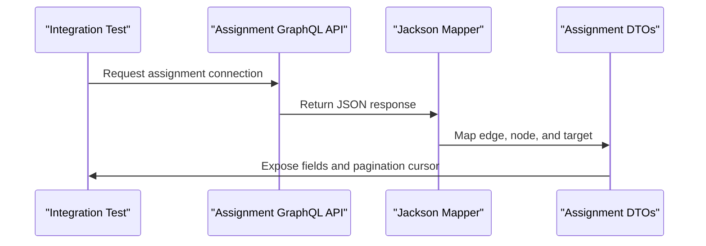

# Assignment Dto

## Purpose

Assignment Dto is a compact test-data contract module in the `com.openframe.oss:openframe-test-service-core` library. It represents assignment results returned by the assignment GraphQL surface so integration tests can deserialize, inspect, and paginate assigned items without depending on transport-specific JSON trees.

This repository runs the library through its OpenFrame test service and pins `com.openframe.oss:openframe-test-service-core` at version `7.0.11`. The implementation is supplied by the OpenFrame OSS Library, rather than by a source file in this repository.

## Architecture Overview

The module models three layers of an assignment response:

1. An **assignment target** identifies the resource an assignment points to and carries fields appropriate to ticket- and device-like targets.
2. An **item assignment** associates an item and target type with a target and a display name.
3. An **edge** wraps an assignment with its cursor, preserving GraphQL connection pagination metadata.

## Core Components

### Assignment Target

[`AssignmentTarget`](https://github.com/flamingo-stack/openframe-oss-lib/blob/7a766f00e4f58b5d89db007b878ac8d6e0c344f4/openframe-test-service-core/src/main/java/com/openframe/test/data/dto/assignment/AssignmentTarget.java) is the polymorphic target representation. Its `typename` property is explicitly mapped from GraphQL's `__typename` discriminator, which lets tests determine the concrete target shape without custom deserialization.

The class provides common identity and display data:

| Field | Purpose |
|---|---|
| `typename` | GraphQL runtime type name, deserialized from `__typename`. |
| `id` | Target identifier. |
| `ticketNumber`, `title`, `statusKind` | Ticket-oriented details when the target is a ticket. |
| `name`, `machineId`, `hostname` | Device- or machine-oriented details when supplied by the target type. |

The DTO ignores unknown JSON properties, making test deserialization tolerant when the API adds fields. Lombok supplies data accessors, a builder, and no-argument and all-argument constructors.

### Item Assignment Edge

[`ItemAssignmentEdge`](https://github.com/flamingo-stack/openframe-oss-lib/blob/7a766f00e4f58b5d89db007b878ac8d6e0c344f4/openframe-test-service-core/src/main/java/com/openframe/test/data/dto/assignment/ItemAssignmentEdge.java) is the GraphQL connection edge DTO. It contains:

- `node`: an `ItemAssignment`, the assignment record for this edge.
- `cursor`: the cursor used to continue a paginated traversal.

Like the target DTO, it ignores unrecognized JSON properties and uses Lombok-generated boilerplate. The associated `ItemAssignment` record holds its identifier, item and target types, display name, creation timestamp, and an `AssignmentTarget`. `ItemAssignmentConnection` groups edges with page information and a filtered count; its helpers derive assignment nodes and target identifiers from the edge list.

## Data Flow

A test requesting assignments receives a GraphQL connection. Jackson maps each response edge to `ItemAssignmentEdge`, maps the edge node to `ItemAssignment`, and maps the nested target to `AssignmentTarget`. Tests can then assert both assignment metadata and target-specific attributes while retaining the cursor for the next page.

## Maintenance Notes

- Treat `typename` as the discriminator for polymorphic targets. A ticket is specifically documented in the source as the trimmed assignment GraphQL ticket type, not the AI-agent ticket type.
- Assertions should only rely on fields expected for the target type. The DTO intentionally combines ticket and machine attributes in one permissive representation.
- Preserve the `cursor` when a test validates connection pagination; the node alone does not capture pagination position.
- Additive API fields do not break these DTOs because both supplied classes use `JsonIgnoreProperties(ignoreUnknown = true)`. Changes to existing field names or JSON shapes remain compatibility-sensitive.

## System Placement

Assignment Dto belongs to the test-support layer, not the production assignment persistence or API implementation. It is packaged by the OpenFrame OSS Library and assembled into this repository's OpenFrame test artifact. Tests such as `AssignmentsTest` use the broader test-service-core suite to exercise assignment workflows; this module provides the deserialization types those workflows need.