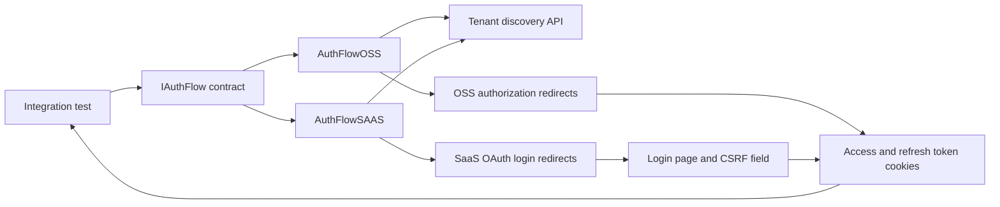
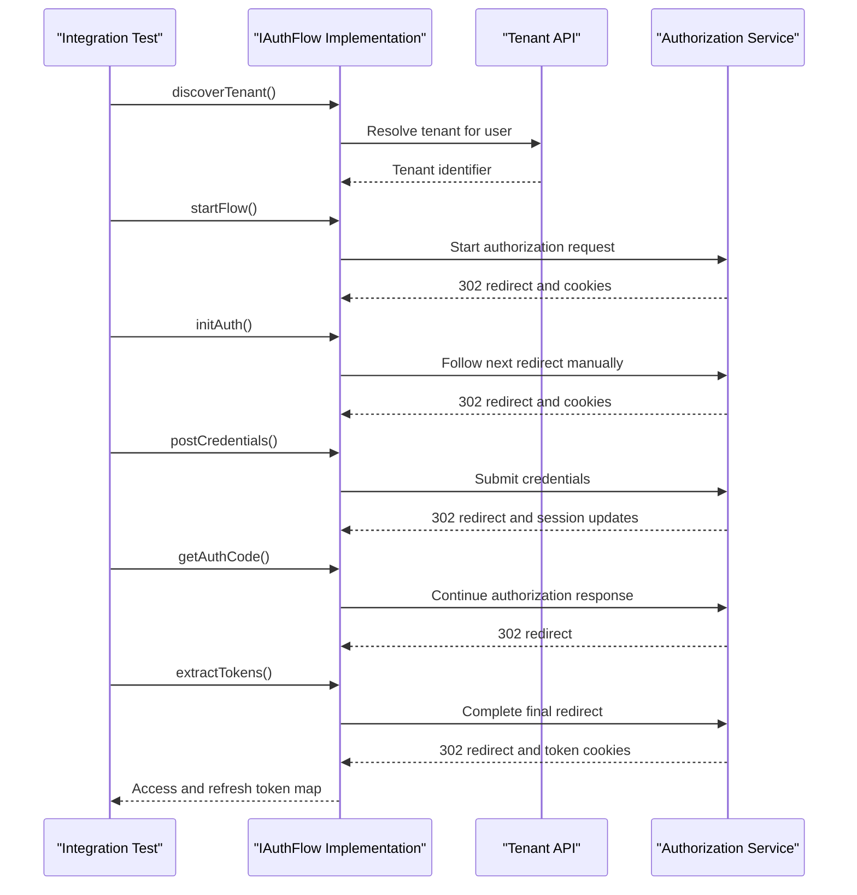
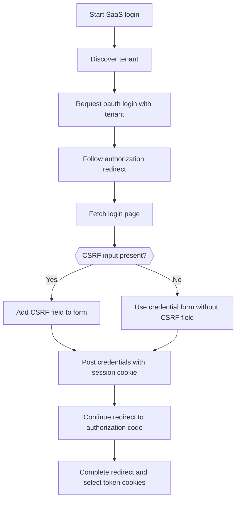

# Auth Flow

Auth Flow is the authentication harness used by the OpenFrame integration-test service. It gives tests one fluent sequence for obtaining browser cookies containing an access token and refresh token, while hiding the differences between OpenFrame OSS and SaaS deployments.

The implementation belongs to the `com.openframe.oss:openframe-test-service-core` library at version `7.0.11`, consumed by this repository's OpenFrame test service. It is test-support code: it drives real HTTP redirects and validates each expected status, rather than implementing the production authorization server.

## Responsibilities

- Discover the tenant associated with the test user before beginning authentication.
- Start a deployment-specific OAuth authorization journey without automatically following redirects.
- Carry state across redirect hops: tenant information, OAuth values, authorization code, and cookies as appropriate to the deployment mode.
- Submit user credentials through the authorization-service login flow.
- Obtain the authorization code and perform the final redirect that issues token cookies.
- Return only the `access_token` and `refresh_token` cookies to the calling test.

## Architecture

`IAuthFlow` defines the common ordered protocol. `AuthFlowOSS` stores protocol values in an `AuthParts` object generated after tenant discovery. `AuthFlowSAAS` instead keeps the discovered tenant identifier, the next redirect location, and a cumulative cookie map as explicit fields. Both implementations use Rest Assured responses and require a `302` status for redirect-oriented stages.

## Common Contract

The [`IAuthFlow`](https://github.com/flamingo-stack/openframe-oss-lib/blob/7a766f00e4f58b5d89db007b878ac8d6e0c344f4/openframe-test-service-core/src/main/java/com/openframe/test/api/auth/IAuthFlow.java) interface defines six operations. The first five return the flow instance so tests can compose a complete journey fluently; the final operation returns the selected token cookies.

| Stage | Contract method | Required result |
|---|---|---|
| Tenant resolution | `discoverTenant()` | A tenant is resolved for the test user. |
| Flow initiation | `startFlow()` | The initial authorization endpoint redirects. |
| Authorization initialization | `initAuth()` | The next authorization hop redirects. |
| Credential submission | `postCredentials()` | The login submission redirects after processing the credentials. |
| Code retrieval | `getAuthCode()` | The authorization response redirects with the next location or code. |
| Token extraction | `extractTokens()` | The terminal redirect is checked and token cookies are filtered from its response. |

The expected order is fixed. In particular, credentials are submitted only after the authorization flow has established the state required by the target deployment.

## OSS Flow

[`AuthFlowOSS`](https://github.com/flamingo-stack/openframe-oss-lib/blob/7a766f00e4f58b5d89db007b878ac8d6e0c344f4/openframe-test-service-core/src/main/java/com/openframe/test/api/auth/AuthFlowOSS.java) is the OpenFrame OSS-specific implementation.

1. It calls `TenantApi.discoverTenant(user)` and builds `AuthParts` using the user and resolved tenant.
2. It starts the OAuth flow through the test `AuthApi`. From the returned `Location` header, it extracts server-provided `state` and `code_challenge` query parameters and records the response cookies.
3. It delegates the authorization initialization and credential submission requests to `AuthApi`, merging cookies received at each redirect into the stored cookie map.
4. It continues the authorization exchange, extracts the `code` query parameter from the redirect location, and stores it as the authorization code.
5. It delegates the code exchange to `AuthApi`, requires a redirect response, and returns a new map containing only `access_token` and `refresh_token` when present.

The implementation intentionally does not return every cookie received during the journey. Session and intermediary cookies remain internal to `AuthParts`; callers receive only the two authentication cookies relevant to authenticated test requests.

## SaaS Flow

[`AuthFlowSAAS`](https://github.com/flamingo-stack/openframe-oss-lib/blob/7a766f00e4f58b5d89db007b878ac8d6e0c344f4/openframe-test-service-core/src/main/java/com/openframe/test/api/auth/AuthFlowSAAS.java) follows the same contract but performs each HTTP request directly with Rest Assured.

### Redirect and Cookie Handling

The flow begins with a non-followed request to `oauth/login` at the configured authorization URL, passing the discovered `tenantId` as a query parameter. Every redirect location becomes `nextLocation`; all response cookies are merged into `allCookies`. Automatic redirect following is disabled so the test harness can inspect and control every transition.

For redirect URLs, URL encoding is disabled. The credential form submission is deliberately different: it keeps encoding enabled because a CSRF token may include characters that must be encoded in a form body.

### CSRF-Compatible Login

Before posting credentials, the SaaS flow fetches the login page at `nextLocation` and requires an HTTP `200` response. It then:

1. Merges cookies from that page, preserving the session that the form token is bound to.
2. Builds form parameters from the user's email and password.
3. Searches the page HTML for a hidden `_csrf` input, accepting either order of the `name` and `value` attributes.
4. Adds `_csrf` only when the page supplied a token.
5. Posts the form using the stored `JSESSIONID`, requires a `302` response, and updates the redirect location and cookies.

A missing CSRF input is intentionally tolerated. This preserves compatibility with authorization-service deployments that do not yet render the token, while deployments that enforce CSRF receive the token associated with the fetched login page. The flow therefore must not skip the login-page GET or post credentials directly to its redirect target.

## Token Output and Failure Semantics

Both implementations assert HTTP status codes at each stage. A non-redirect response where `302` is required, or a non-successful login page where `200` is required by the SaaS path, fails at the step that produced it. This localizes authentication failures to the relevant redirect or credential action.

`extractTokens()` does not assert that either token cookie exists; it conditionally copies them from the final response. Tests using this output should therefore treat missing values as a failed authentication outcome in their own context rather than assuming the returned map is complete.

## Relationship to the Platform

Auth Flow exercises the platform through the tenant discovery API and the authorization service. In the tenant deployment, the gateway route configuration exposes the authorization server under the `/sas/**` path, while the authorization server application assembles the authorization-service core library. The test harness itself is supplied by OpenFrame OSS Library; this repository runs it as part of its OpenFrame test service.

Production authorization behavior, including authorization-server security configuration, login controllers, tenant filtering, and token issuance, is outside this module. Auth Flow's role is to reproduce the externally visible redirect and cookie behavior needed to authenticate integration tests consistently across OSS and SaaS environments.

## Maintenance Notes

- Preserve the fluent method order in `IAuthFlow`; callers rely on it to model the login sequence.
- Keep redirect assertions and manual redirect handling. Following redirects automatically would hide locations, codes, and intermediate cookies needed by the flow.
- Preserve the SaaS login-page fetch and optional-CSRF behavior when changing authorization-service security settings.
- Do not broaden the token result map with session cookies unless test callers explicitly need them; its current output is purposefully limited to access and refresh tokens.
- When an authorization flow changes, update the implementation matching the deployment mode rather than forcing deployment-specific state into the shared interface.
