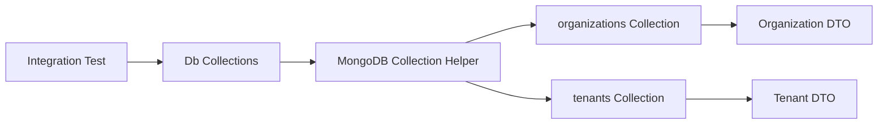
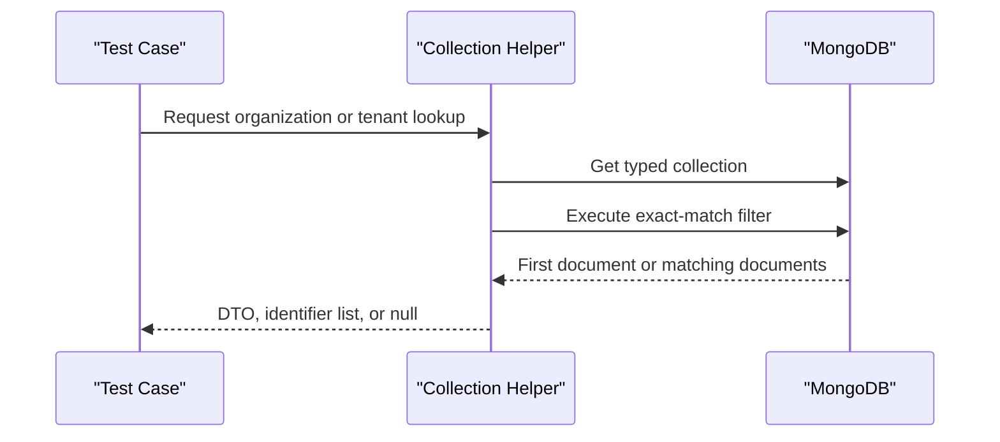

# Db Collections

Db Collections is a small test-support module from the `com.openframe.oss:openframe-test-service-core` library. It gives integration tests focused access to the MongoDB `organizations` and `tenants` collections without repeating collection lookup, BSON filter construction, or DTO mapping.

The code runs with this repository's OpenFrame test service. Its implementation is supplied by [OpenFrame OSS Library](https://github.com/flamingo-stack/openframe-oss-lib/tree/7a766f00e4f58b5d89db007b878ac8d6e0c344f4/openframe-test-service-core).

## Purpose and Scope

The module provides static query helpers for test setup and assertions:

- **Organizations Collection** locates an organization by MongoDB identifier, selects an organization by its deletion and default flags, and returns identifiers for organizations matching a deletion state.
- **Tenants Collection** locates tenant records by domain or by an arbitrary string field and value.

These helpers are read-only. They do not create, update, or remove collection documents, and they do not define production persistence behavior.

## Architecture

`MongoDB.getCollection` supplies a typed MongoDB collection. Each helper applies MongoDB `Filters` and materializes the first matching document, except the organization identifier query, which collects all matching records before mapping them to identifiers.

## Components

### Organizations Collection

Source: [OrganizationsCollection.java](https://github.com/flamingo-stack/openframe-oss-lib/blob/7a766f00e4f58b5d89db007b878ac8d6e0c344f4/openframe-test-service-core/src/main/java/com/openframe/test/data/db/collections/OrganizationsCollection.java)

`OrganizationsCollection` centralizes queries against `organizations`:

| Helper | Query behavior | Result |
|---|---|---|
| `findOrganization(String id)` | Converts the supplied string to `ObjectId` and filters on `_id`. | First matching `Organization`, or `null` when none is found. |
| `findOrganization(boolean deleted, boolean isDefault)` | Combines exact matches for `deleted` and `isDefault`. | First matching `Organization`, or `null`. |
| `findOrganizationIds(boolean deleted)` | Finds every organization with the requested `deleted` flag and maps each result through `Organization.getId()`. | List of matching identifier strings. |

The identifier lookup expects a value accepted by MongoDB's `ObjectId` constructor. Tests should only pass valid Mongo-style identifier strings to this overload.

### Tenants Collection

Source: [TenantsCollection.java](https://github.com/flamingo-stack/openframe-oss-lib/blob/7a766f00e4f58b5d89db007b878ac8d6e0c344f4/openframe-test-service-core/src/main/java/com/openframe/test/data/db/collections/TenantsCollection.java)

`TenantsCollection` provides two exact-match lookups against `tenants`:

| Helper | Query behavior | Result |
|---|---|---|
| `findTenantByDomain(String domain)` | Delegates to the generic lookup with `domain` as the field. | First matching `Tenant`, or `null`. |
| `findTenant(String field, String value)` | Filters the named field for an exact string value. | First matching `Tenant`, or `null`. |

The generic lookup is useful for test-only checks of other string-valued tenant fields. Callers are responsible for selecting a valid persisted field name.

## Query Flow

## Design Notes

- The classes use static methods, so tests can issue direct queries without constructing a repository or service object.
- The helpers intentionally return Mongo driver's first-match behavior. Tests requiring uniqueness should assert it at the scenario level or query a uniquely constrained field.
- Organization filtering is explicit for lifecycle-oriented test cases: soft-deleted records and the default organization can be selected independently.
- The collection names are fixed as `organizations` and `tenants`; changing either persisted collection name requires updating these helpers.

## Relationship to the Test Service

Db Collections belongs to the test-service support library and is intended to validate observable persisted state after platform workflows run. It complements API and UI tests by allowing assertions on organization and tenant records directly, while leaving workflow execution and MongoDB connection setup to the surrounding test infrastructure.
