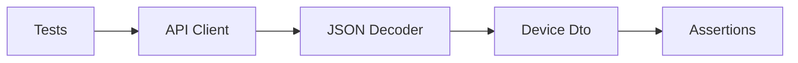
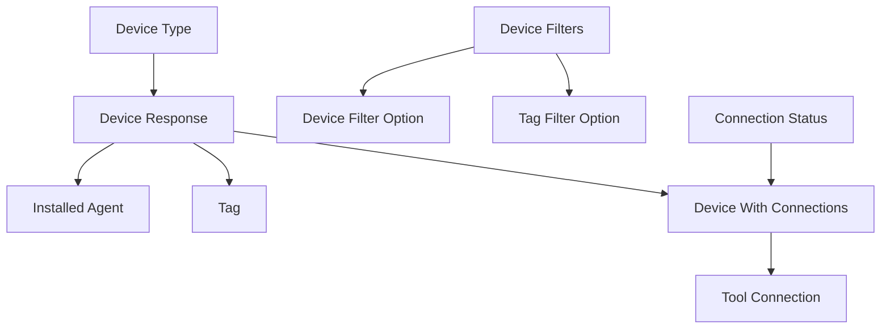
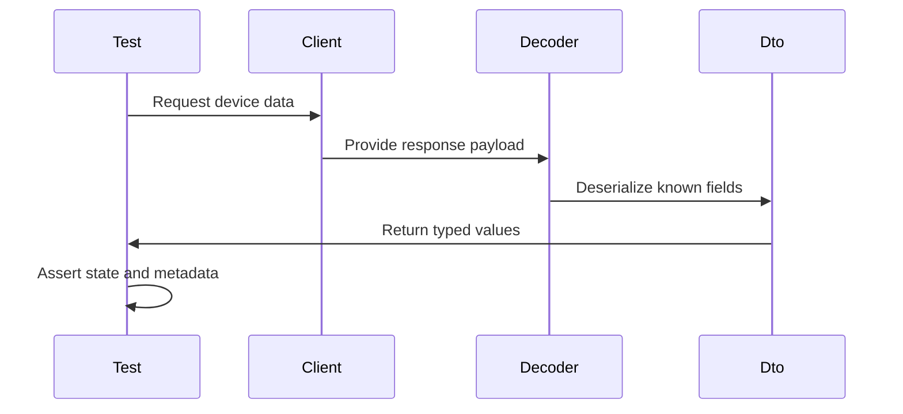

# Device Dto

## Purpose

Device Dto is the device-focused data-transfer-object layer used by the OpenFrame test service. It is supplied by the OpenFrame OSS Library through the `com.openframe.oss:openframe-test-service-core` artifact, pinned for this repository at version `7.0.11`.

The module gives API tests typed representations of device classifications, connection state, installed agents, tags, and filter facets. It contains no transport, persistence, or business workflow code. Test clients deserialize responses into these values and assert their contents.

## Architecture

Object DTOs are forward compatible at the JSON boundary. Jackson ignores unrecognized properties, so a response can gain fields without breaking an existing test-service library. Tests must explicitly assert a new field once it becomes contractually significant.

## Component Relationships

`ToolConnection` is the element type held by `DeviceWithConnections`. Its source definition was not included among the supplied Device Dto components, therefore this documentation only records the association and does not describe its fields.

## Components

| Component | Responsibility | Contract |
|---|---|---|
| [`ConnectionStatus`](https://github.com/flamingo-stack/openframe-oss-lib/blob/7a766f00e4f58b5d89db007b878ac8d6e0c344f4/openframe-test-service-core/src/main/java/com/openframe/test/data/dto/device/ConnectionStatus.java) | Connection state vocabulary. | `CONNECTED`, `DISCONNECTED`, and `ERROR`. |
| [`DeviceType`](https://github.com/flamingo-stack/openframe-oss-lib/blob/7a766f00e4f58b5d89db007b878ac8d6e0c344f4/openframe-test-service-core/src/main/java/com/openframe/test/data/dto/device/DeviceType.java) | Managed-device classification. | Desktop, laptop, server, mobile device, tablet, network device, IoT device, virtual machine, container host, and other. |
| [`DeviceWithConnections`](https://github.com/flamingo-stack/openframe-oss-lib/blob/7a766f00e4f58b5d89db007b878ac8d6e0c344f4/openframe-test-service-core/src/main/java/com/openframe/test/data/dto/device/DeviceWithConnections.java) | Connection projection of a device. | Holds `toolConnections` as a list of `ToolConnection` values. |
| [`InstalledAgent`](https://github.com/flamingo-stack/openframe-oss-lib/blob/7a766f00e4f58b5d89db007b878ac8d6e0c344f4/openframe-test-service-core/src/main/java/com/openframe/test/data/dto/device/InstalledAgent.java) | Agent installation metadata. | `id`, `machineId`, `agentType`, `version`, `createdAt`, and `updatedAt`. |
| [`Tag`](https://github.com/flamingo-stack/openframe-oss-lib/blob/7a766f00e4f58b5d89db007b878ac8d6e0c344f4/openframe-test-service-core/src/main/java/com/openframe/test/data/dto/device/Tag.java) | API representation of a device tag. | An `id`, a `key`, a list of `values`, presentation metadata, and `createdAt`. |
| [`DeviceFilterOption`](https://github.com/flamingo-stack/openframe-oss-lib/blob/7a766f00e4f58b5d89db007b878ac8d6e0c344f4/openframe-test-service-core/src/main/java/com/openframe/test/data/dto/device/DeviceFilterOption.java) | Aggregate option for a device filter. | `value`, display `label`, and matching-device `count`. |
| [`TagFilterOption`](https://github.com/flamingo-stack/openframe-oss-lib/blob/7a766f00e4f58b5d89db007b878ac8d6e0c344f4/openframe-test-service-core/src/main/java/com/openframe/test/data/dto/device/TagFilterOption.java) | Aggregate option for tag filtering. | Tag `key`, tag `value`, and matching-device `count`. |

## Serialization and Fixture Conventions

`DeviceWithConnections`, `InstalledAgent`, `Tag`, `DeviceFilterOption`, and `TagFilterOption` are annotated with `JsonIgnoreProperties(ignoreUnknown = true)`. They also use Lombok `Data`, `Builder`, `NoArgsConstructor`, and `AllArgsConstructor`, supporting both builder-based test fixtures and framework-oriented no-argument construction. `ConnectionStatus` and `DeviceType` are fixed enum vocabularies.

The tag representation is intentionally not flat: a `Tag` contains one `key` and a list of `values`. `TagFilterOption` retains separate `key` and `value` fields. Tests should assert both fields to distinguish identical values used under different keys.

Timestamp properties in `InstalledAgent` and `Tag` are strings. Device Dto preserves the API representation rather than parsing, normalizing, or validating time values; tests requiring date semantics should perform that work explicitly.

## Typical Test Flow

A device-details scenario can deserialize `DeviceWithConnections` and `InstalledAgent`, then assert the expected connection relationship and agent version. A filter scenario can decode `DeviceFilterOption` or `TagFilterOption` and assert the returned option identity and aggregate count.

## Maintenance Boundaries

- Device Dto is library code from the OpenFrame OSS Library, not a local implementation in this repository.
- Keep Java field names aligned with JSON property names unless an explicit Jackson mapping is introduced.
- Add enum members only after the upstream service contract supports them; exhaustive enum handling in test consumers must be updated at the same time.
- Preserve `Tag.values` as a list so fixture shape remains consistent with the API model.
- Treat filter counts as query-dependent aggregates, never as stable identifiers.

## System Role

Within the OpenFrame test service, Device Dto isolates device-oriented assertions from raw JSON traversal. Server-side device controllers, data fetchers, and persistence components produce and manage the underlying data, while this module provides a focused test-facing contract for consuming it.
