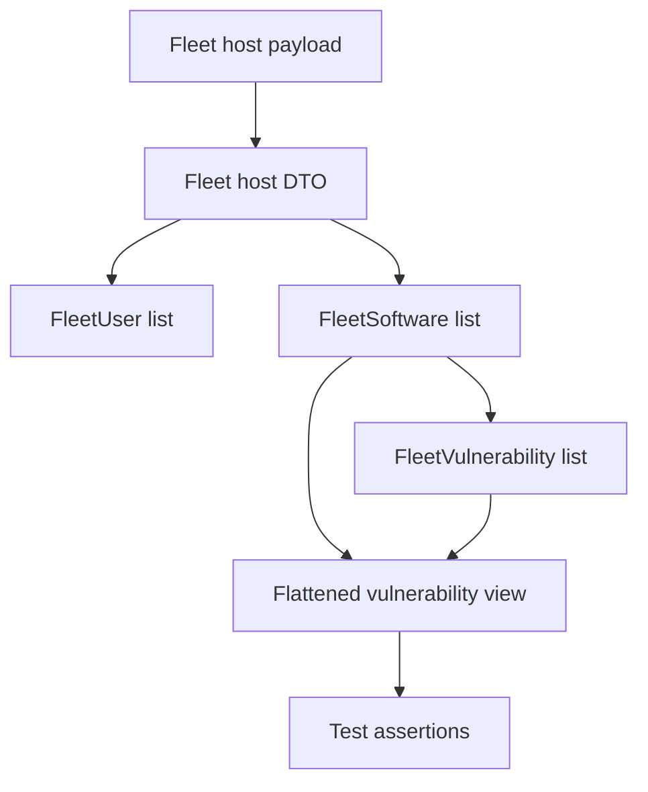
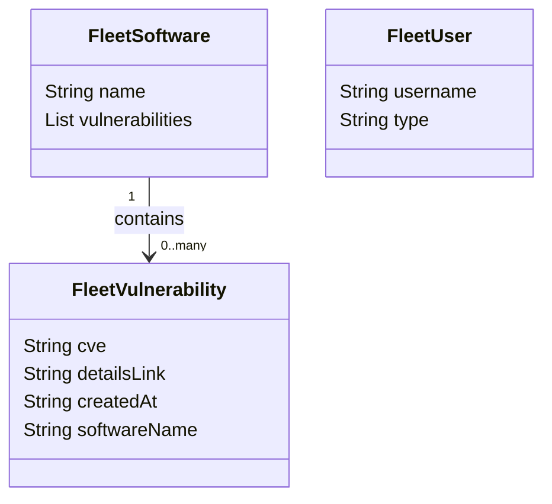
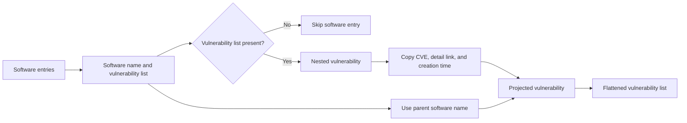

# Device Fleet Dto

Device Fleet Dto provides lightweight Java data-transfer objects used by the OpenFrame test-service-core library to deserialize Fleet device inventory data. The contracts model three related views of a Fleet host: installed software, host users, and software vulnerabilities.

This repository runs the library as part of its `openframe-test` service. The implementation belongs to the OpenFrame OSS Library artifact `com.openframe.oss:openframe-test-service-core`, pinned by this repository at version `7.0.11`.

## Purpose and Boundaries

The module is a deserialization boundary rather than a service layer. It has no network, storage, validation, or business-operation code. Each class is a mutable Lombok data object with:

- generated accessors, equality, hash-code, and string methods through `@Data`;
- builder and no-argument/all-argument construction through Lombok; and
- `@JsonIgnoreProperties(ignoreUnknown = true)` so additional properties in Fleet payloads do not make test parsing fail.

The contract is consumed by the broader Fleet host DTO. That host aggregates users and software, then derives a flattened vulnerability view from the vulnerabilities nested beneath each software item.

## Architecture Overview

`FleetSoftware` is the only containment relationship inside this module: its `vulnerabilities` property holds zero or more `FleetVulnerability` objects. `FleetUser` is a sibling DTO associated with the Fleet host, not with software.

## Contract Components

| Component | Responsibility | JSON compatibility behavior |
|---|---|---|
| [Fleet Software](https://github.com/flamingo-stack/openframe-oss-lib/blob/7a766f00e4f58b5d89db007b878ac8d6e0c344f4/openframe-test-service-core/src/main/java/com/openframe/test/data/dto/device/fleet/FleetSoftware.java) | Represents one named software entry and its vulnerability collection. | Ignores unmodeled properties. |
| [Fleet User](https://github.com/flamingo-stack/openframe-oss-lib/blob/7a766f00e4f58b5d89db007b878ac8d6e0c344f4/openframe-test-service-core/src/main/java/com/openframe/test/data/dto/device/fleet/FleetUser.java) | Represents a user associated with a Fleet host through `username` and `type`. | Ignores unmodeled properties. |
| [Fleet Vulnerability](https://github.com/flamingo-stack/openframe-oss-lib/blob/7a766f00e4f58b5d89db007b878ac8d6e0c344f4/openframe-test-service-core/src/main/java/com/openframe/test/data/dto/device/fleet/FleetVulnerability.java) | Captures a vulnerability identifier, detail URL, creation time, and optional derived software name. | Maps selected snake-case payload fields and ignores unmodeled properties. |

The module is intentionally cohesive and consists solely of these three closely coupled contracts; it does not have independently deployable or complex child sub-modules.

## Data Model

### Fleet Software

`FleetSoftware` has two properties:

- `name` identifies the software item as supplied by Fleet.
- `vulnerabilities` holds the vulnerabilities associated with that item. The list itself may be absent when the source payload omits it, so consumers must distinguish a missing list from an empty list if that distinction matters.

### Fleet User

`FleetUser` provides the minimal user projection required by the Fleet host representation:

- `username` identifies the user.
- `type` carries the source-provided user category.

No enum or validation constrains `type`; test code should treat it as an external string contract.

### Fleet Vulnerability

`FleetVulnerability` models vulnerability information using these fields:

| Java field | JSON property | Meaning |
|---|---|---|
| `cve` | `cve` | Vulnerability identifier. |
| `detailsLink` | `details_link` | Link supplied by Fleet for vulnerability details. |
| `createdAt` | `created_at` | Source-provided creation timestamp represented as a string. |
| `softwareName` | `softwareName` | Name of affected software when populated by the consuming host DTO. |

`detailsLink` and `createdAt` use explicit `@JsonProperty` mappings because their wire names are snake case. `softwareName` has no explicit mapping in this class. The Fleet host DTO populates it while flattening vulnerabilities from each software entry, preserving the originating software name alongside each vulnerability.

## Vulnerability Projection Flow

The Fleet host DTO consumes `FleetSoftware` and `FleetUser`. Its vulnerability projection is null-safe at both collection levels: no software list yields no vulnerabilities, and software entries with no vulnerability list contribute nothing. For every nested vulnerability, the projection creates a new vulnerability DTO carrying the original CVE, detail link, and creation time together with its parent software name.

## Usage Considerations

- Treat these classes as external-data contracts. Tolerant JSON parsing improves forward compatibility but can also hide unexpected source-field additions.
- Do not assume non-null collection properties. In particular, `FleetSoftware.vulnerabilities` is not initialized by the DTO.
- Preserve the explicit wire-name mappings when refactoring `FleetVulnerability`, otherwise existing Fleet payloads will no longer bind `details_link` or `created_at`.
- The data classes expose setters through Lombok. Builders are convenient for fixtures, while Jackson requires the no-argument constructor for ordinary object binding.
- `softwareName` is contextual information in flattened output, not an intrinsic nested-field requirement. Populate it from the enclosing software object when constructing flattened vulnerabilities.

## System Placement

The test-service-core artifact supplies shared test models for this repository's `openframe-test` service. Device Fleet Dto sits on the test-data side of the device-management flow: Fleet host payloads are converted into DTOs, and tests can assert user, software, and vulnerability state without directly depending on raw JSON structures.

The module does not replace the production Fleet SDK or production device read models. Its responsibility is limited to the stable, test-oriented projection used by the test-service-core library.
