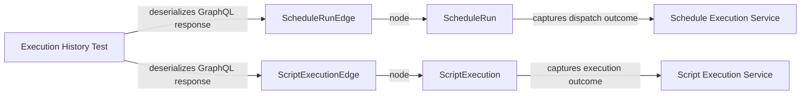
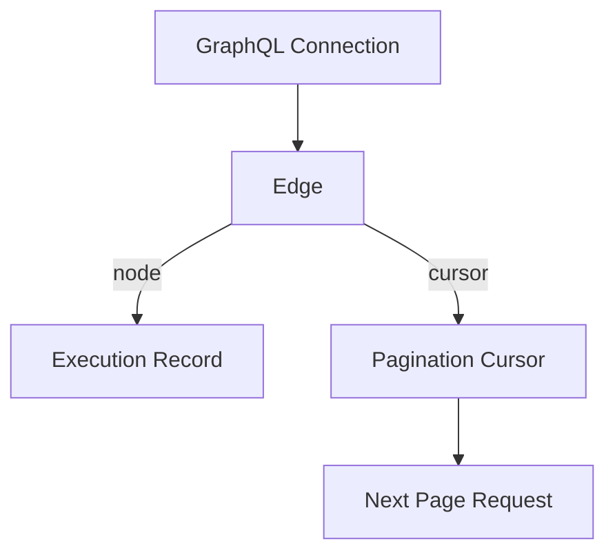
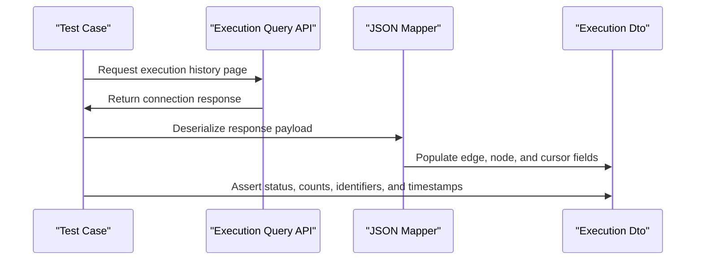

# Execution Dto

Execution Dto provides small, deserialization-tolerant Java data transfer objects for execution-history assertions in the OpenFrame test service. The types model two GraphQL connection edges and the schedule-run record carried by one of those edges. They are supplied by the `com.openframe.oss:openframe-test-service-core` library, version `7.0.11`, which this repository consumes at run time.

The module is intentionally a test-facing contract layer: it holds response data, not execution logic. Production services create and process script and schedule executions; test code deserializes their GraphQL responses into these DTOs and asserts on stable identifiers, lifecycle timestamps, status, and pagination cursors.

## Scope and Responsibilities

| Type | Responsibility |
|---|---|
| `ScheduleRun` | Represents a single dispatch of a script schedule to its assigned devices, including identity, lifecycle, status, and aggregate device-response counts. |
| `ScheduleRunEdge` | Represents one cursor-paginated connection item whose node is a `ScheduleRun`. |
| `ScriptExecutionEdge` | Represents one cursor-paginated connection item whose node is a `ScriptExecution`. The `ScriptExecution` DTO declaration is outside the supplied component set. |

All three types use Lombok to provide accessors, builders, and no-argument and all-argument constructors. `@JsonIgnoreProperties(ignoreUnknown = true)` permits clients to deserialize compatible server responses when extra fields are present, making test fixtures more resilient to additive API changes.

## Architecture

The last two nodes describe the broader platform boundary rather than dependencies declared by these DTOs. Execution Dto itself does not call services, persistence layers, or agents.

## Data Model

### Schedule Run

`ScheduleRun` describes one fire of a schedule and exposes these fields:

| Field | Meaning |
|---|---|
| `id` | Identifier for the schedule-run record. |
| `executionId` | Identifier that associates this run with its execution. |
| `scheduleId` | Identifier of the originating schedule. |
| `status` | Server-provided run lifecycle status. This DTO deliberately preserves it as a string. |
| `totalMachineCount` | Number of machines targeted by the run. |
| `respondedMachineCount` | Number of targeted machines that have responded. |
| `dispatchedAt` | Server-provided dispatch timestamp. |
| `finishedAt` | Server-provided completion timestamp. |

The count fields support assertions about dispatch coverage and completion progress. The timestamp fields remain strings, so the DTO mirrors the response representation without imposing a date parsing policy on test consumers.

### Cursor Edges

Both edge types follow the same connection pattern:

`ScheduleRunEdge` binds the record to `ScheduleRun`. `ScriptExecutionEdge` binds it to `ScriptExecution`. Each has a `cursor` that allows a test client to traverse server-provided pages without deriving its own offset.

## Response Processing Flow

Unknown response fields are ignored during the mapping step. Missing known fields remain unset according to normal Java object deserialization behavior, so tests that require a field should assert it explicitly.

## Component Details

### `ScheduleRun`

The [ScheduleRun source](https://github.com/flamingo-stack/openframe-oss-lib/blob/7a766f00e4f58b5d89db007b878ac8d6e0c344f4/openframe-test-service-core/src/main/java/com/openframe/test/data/dto/execution/ScheduleRun.java) is the concrete schedule-execution projection. It is annotated with `@Data` and `@Builder`, allowing test fixtures to either deserialize server data or construct expected values concisely.

### `ScheduleRunEdge`

The [ScheduleRunEdge source](https://github.com/flamingo-stack/openframe-oss-lib/blob/7a766f00e4f58b5d89db007b878ac8d6e0c344f4/openframe-test-service-core/src/main/java/com/openframe/test/data/dto/execution/ScheduleRunEdge.java) wraps a schedule-run node with its opaque pagination cursor. It contains no paging policy: cursor interpretation and the next-request construction belong to the API client or test workflow.

### `ScriptExecutionEdge`

The [ScriptExecutionEdge source](https://github.com/flamingo-stack/openframe-oss-lib/blob/7a766f00e4f58b5d89db007b878ac8d6e0c344f4/openframe-test-service-core/src/main/java/com/openframe/test/data/dto/execution/ScriptExecutionEdge.java) provides the same wrapper structure for script-execution results. Its `node` field references `ScriptExecution`; that model is not among the supplied files, so its fields and lifecycle semantics are intentionally not documented here.

## Documentation Organization

Execution Dto has no child documentation pages because its three supplied files form a single, compact response-model contract. This page documents all of its components.

## Integration Boundaries

Execution Dto belongs to the test service support library rather than the tenant application source tree. The tenant repository supplies the surrounding service deployment, while the library supplies the DTO implementation. In the wider system, execution-related tests can observe results that originate from script execution and schedule orchestration, but this module remains transport-only:

- It does not issue GraphQL requests.
- It does not validate statuses, timestamps, or machine counts.
- It does not execute scripts or schedule work.
- It does not persist data or manage pagination state.

Maintainers should preserve the edge shape and Jackson compatibility behavior when evolving these classes. Adding fields is generally backward compatible for consumers using the current ignore-unknown configuration; renaming or changing the meaning of existing fields requires coordinated updates to the corresponding GraphQL contract and test assertions.
