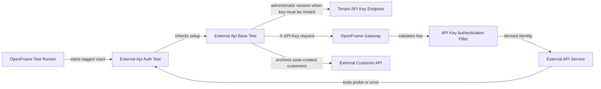
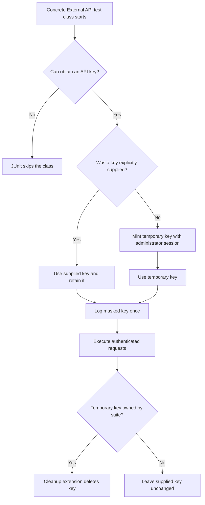
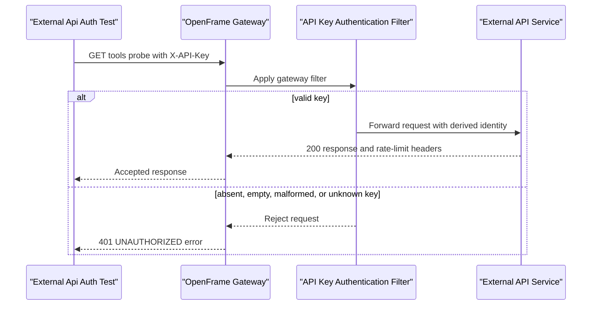
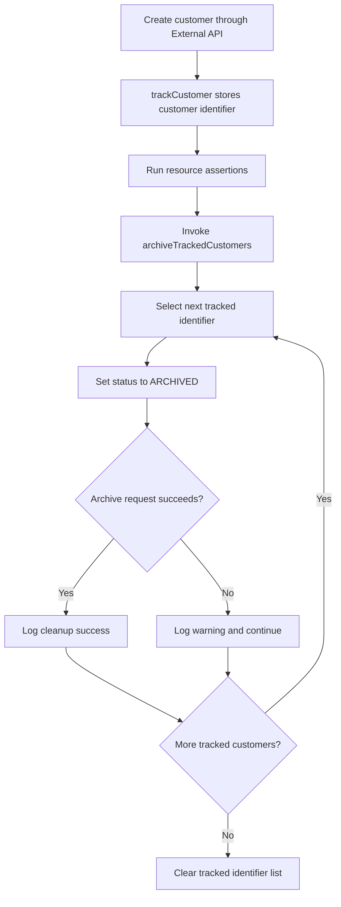

# Authentication And Fixture Lifecycle

Authentication And Fixture Lifecycle documents the shared foundation for the External API integration tests: it proves the gateway API-key boundary and supplies tenant-safe setup and customer-fixture cleanup conventions for concrete test classes. The tests execute in this tenant through the `openframe-test` service, while their implementation comes from version `7.0.11` of the `com.openframe.oss:openframe-test-service-core` library.

This module is part of [External Api Tests](external-api-tests.md). It concentrates on authorization behavior and lifecycle hygiene rather than resource-specific API contracts.

## Responsibilities

The module has two complementary responsibilities:

- **Gateway authentication contract.** `ExternalApiAuthTest` uses the inexpensive tools read probe to establish that a valid `X-API-Key` is accepted, while absent, empty, malformed, and well-formed-but-unknown keys receive a `401` response with the `UNAUTHORIZED` error code.
- **Identity-header safety.** The suite sends spoofed `X-User-Id` and `X-API-Key-Id` headers without a valid key and expects rejection. This confirms that caller identity is derived only after the gateway validates the API key.
- **Rate-limit metadata.** A successful probe must include per-minute, hourly, and daily limit headers. The assertions ensure remaining per-minute quota is within the advertised limit and that longer-period limits are not smaller than shorter-period limits.
- **Credential lifecycle.** `ExternalApiBaseTest` centralizes API-key readiness. A runner-provided key, including one supplied through `TEST_EXTERNAL_API_KEY`, is used without deletion. Otherwise, the test support provisions a temporary key through the administrator-authenticated API-key endpoint and its cleanup extension removes that temporary credential when the run finishes.
- **Fixture lifecycle.** The base class tracks identifiers of customers created by a test class. Its cleanup helper archives every tracked customer best-effort and then clears the in-memory list. Archival is the strongest cleanup operation available to this API and removes the fixture from default active-customer listings without deleting it.

## Architecture And Dependencies

The gateway is deliberately the authentication authority for the public External API surface. The test comments identify the API-key filter as the effective guard for that surface: standard Spring Security matching permits the path, so a change that weakens the filter would expose the endpoint. The spoofing test protects the associated trust boundary by ensuring externally supplied identity-like headers cannot substitute for a validated key.

## Component Roles

| Component | Role in the lifecycle | Important behavior |
| --- | --- | --- |
| `ExternalApiBaseTest` | Abstract shared base class | Registers the API-key cleanup extension, exposes the availability condition, tracks customers, performs best-effort archival, and logs only a masked credential representation. |
| `ExternalApiAuthTest` | Ordered API-key gate test class | Runs seven authentication and rate-limit cases against a read-only tools probe. |
| `ExternalApiKeyExtension` | Test infrastructure referenced by the base class | Coordinates temporary-key deletion at the end of a run; explicitly supplied keys are not owned by the suite and therefore are retained. |
| `ExternalApiConfig` | Test configuration dependency | Determines whether a key can be obtained, retrieves it before tests run, and returns a masked value for logging. |
| `ExternalCustomerApi` | Fixture cleanup dependency | Changes the status of suite-owned customers to `ARCHIVED`; cleanup continues even if an individual archive request fails. |

## Execution Gate And Credential Ownership

Every concrete External API test class must declare the `@EnabledIf` condition named by `EXTERNAL_API_KEY_CONDITION`. The condition is intentionally not placed on the base class because JUnit does not inherit `@EnabledIf`; placing it only on the base would leave subclasses ungated. In contrast, the extension annotation is inherited, allowing cleanup behavior to remain centralized.

The key is obtained in `logActor()` before the first assertion. This ordering makes key minting and the masked key identity visible in the test log at the start of a class rather than during an arbitrary request. No raw API secret is written to the log.

## Authentication Contract Flow

The class uses `api/v1/tools` as a cheap, unpaginated read probe. The probe is intentionally not a tool-resource contract test: it serves only to exercise the gateway boundary.

### Assertions

| Order | Scenario | Expected result |
| --- | --- | --- |
| 1 | Valid configured or temporary key | `200` response from the probe. |
| 2 | No API-key header | `401`, `UNAUTHORIZED`, and an error message that identifies the protected External API path prefix. |
| 3 | Malformed key | `401` and `UNAUTHORIZED`. |
| 4 | Correctly shaped but unrecognized key | `401` and `UNAUTHORIZED`; this exercises lookup rejection after format validation. |
| 5 | Empty API-key header | `401` and `UNAUTHORIZED`. |
| 6 | Spoofed identity headers without a valid key | `401`; injected identity headers alone cannot authenticate a request. |
| 7 | Successful authenticated request | Positive minute, hour, and day limits, with a valid remaining-minute range and nondecreasing period limits. |

The test class is ordered so authentication cases and observability checks have a stable reporting sequence. Its `external-api` tag identifies the suite, while individual cases use `feature`, `read`, `injection`, or `safety` tags to express their intent.

## Customer Fixture Lifecycle

`ExternalApiBaseTest` provides a narrowly scoped fixture registry for customers. A concrete test class calls `trackCustomer()` immediately after it creates a customer. The helper stores the identifier and returns the original response so test setup can remain fluent. At teardown, the concrete class can invoke `archiveTrackedCustomers()` to archive each registered record.

This cleanup design preserves the primary failure: an archival error is logged but does not mask a failed test assertion or prevent cleanup of later fixtures. It also enforces ownership boundaries. Tests should only archive customers they registered through `trackCustomer()` and should not mutate shared tenant data. Since archival is reversible, it is suitable for the shared QA tenant used by the External API suite.

## Operational Guidance

- Treat an unavailable API key as an environment-readiness condition, not a functional failure. The enabled condition skips affected test classes when no credential can be obtained.
- Do not copy the masked value from logs into configuration. It is diagnostic output, not a reusable credential.
- Keep the authentication probe read-only and inexpensive. Resource behavior belongs in the relevant External API test area.
- Register a customer immediately after creation, before assertions that could fail, so teardown still knows about the fixture.
- Use best-effort archival only for suite-owned customer records. Do not use cleanup helpers to alter pre-existing tenant records.
- When changing gateway key validation, test both the syntactic rejection path and the valid-format lookup rejection path. They are distinct branches protected by this suite.

## Source Implementation

The tenant executes the implementation from the OpenFrame OSS Library. These are the authoritative source files for this module:

- [External Api Auth Test](https://github.com/flamingo-stack/openframe-oss-lib/blob/7a766f00e4f58b5d89db007b878ac8d6e0c344f4/openframe-test-service-core/src/main/java/com/openframe/test/tests/external/ExternalApiAuthTest.java)
- [External Api Base Test](https://github.com/flamingo-stack/openframe-oss-lib/blob/7a766f00e4f58b5d89db007b878ac8d6e0c344f4/openframe-test-service-core/src/main/java/com/openframe/test/tests/external/ExternalApiBaseTest.java)
