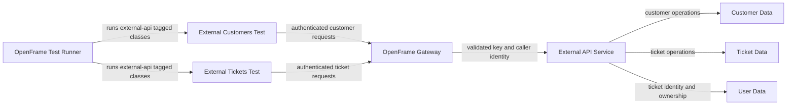
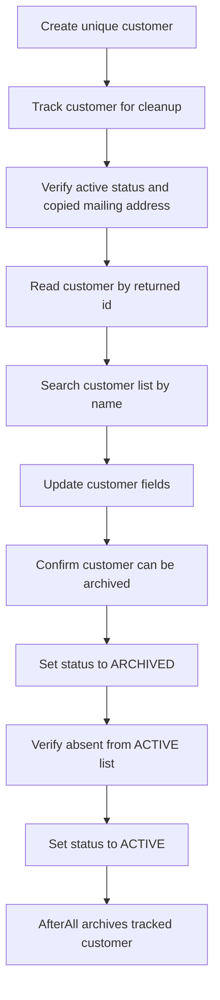
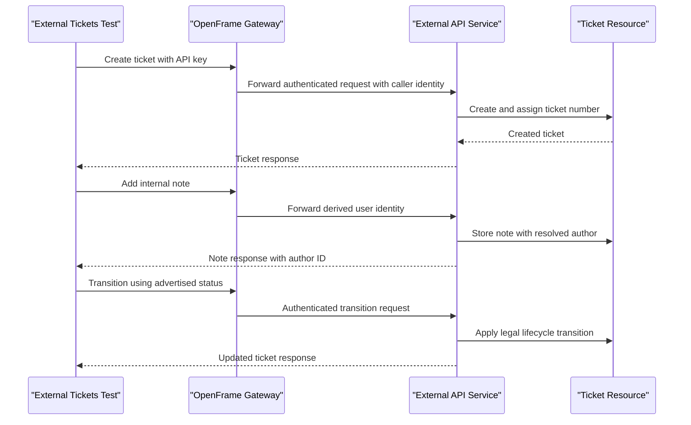
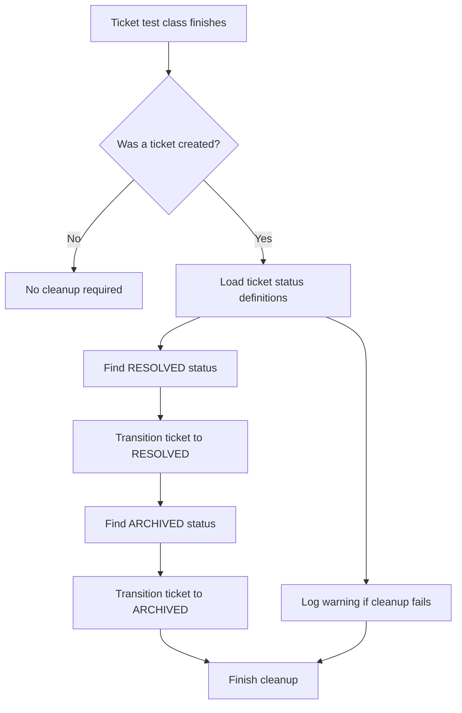

# Customers And Tickets

Customers And Tickets documents the External API contract tests for customer and ticket resources. The tenant runs these tests through the `openframe-test` service; their implementation is provided by version `7.0.11` of the `com.openframe.oss:openframe-test-service-core` library. Together, `ExternalCustomersTest` and `ExternalTicketsTest` verify ordered, API-key-authenticated workflows against `/api/v1/customers` and `/api/v1/tickets`.

This module is part of [External Api Tests](external-api-tests.md). It relies on the API-key gate and fixture ownership conventions described in [Authentication And Fixture Lifecycle](authentication_and_fixture_lifecycle.md).

## Purpose And Scope

The tests protect two related public-resource contracts:

- **Customers** validates creation, retrieval by business UUID, searching, updates, active and archived status behavior, reversible archival, unknown-resource handling, and required-name validation.
- **Tickets** validates creation, single and list reads, editing, lifecycle reference data, filters and statistics, tags, assignment, author-scoped notes, advertised status transitions, device and customer unlinking, and validation failures.

Both suites are ordered because later assertions consume the fixture created by the first operation. They create unique test data and use the strongest cleanup permitted by the respective API instead of deleting tenant data.

## Architecture And Dependencies

The gateway authenticates the API key before requests reach the External API service. Ticket calls additionally depend on the caller identity derived from that key: the service resolves the ticket principal from the gateway-provided `X-User-Id`, rather than accepting an author supplied by a note request.

### Component Responsibilities

| Component | Responsibility | Key contract protected |
| --- | --- | --- |
| `ExternalCustomersTest` | Runs the customer lifecycle using a single suite-owned customer fixture. | The `id` returned by create is the business UUID used for reads and updates. |
| `ExternalTicketsTest` | Runs ticket lifecycle, reference-data, association, note, and transition checks using a single suite-owned ticket. | Ticket actions run as the API-key-derived user and follow server-advertised lifecycle rules. |
| `ExternalCustomerApi` | Test-side client used to invoke customer operations and inspect expected error responses. | Customer listing, status changes, and archival cleanup. |
| `ExternalTicketApi` | Test-side client used to invoke ticket, note, assignment, tag, and transition operations. | Resource operations, reference data, and cleanup transitions. |
| `ExternalCustomerGenerator` | Produces create and update payloads, including address variations. | Request-to-response mapping and name validation. |
| `ExternalTicketGenerator` | Produces ticket payloads, note content, and an over-limit title. | Ticket field validation and title-length enforcement. |

## Customer Lifecycle

`ExternalCustomersTest` stores the create response in class state and registers it with `trackCustomer()` immediately. If creation fails, dependent calls use a JUnit assumption and are reported as skipped rather than failing repeatedly with null dereferences. `@AfterAll` invokes the shared best-effort archival helper.

### Customer Assertions

| Order | Scenario | Expected behavior |
| --- | --- | --- |
| 1 | Create | Returns an ID, active status, timestamps, contact information, and a non-default customer. A mailing address is copied from the physical address when requested. |
| 2 | Read by ID | The create response ID round-trips through the customer route. Timestamp comparison is normalized to millisecond precision because create serializes the in-memory instant while reads reflect MongoDB precision. |
| 3 | Search list | Searching for the fixture name returns the customer and a non-null pagination descriptor. |
| 4 | Update | The identifier remains stable while mutable request fields are reflected in the response. |
| 5 to 8 | Archive and restore | A customer with no devices is archivable, becomes archived, disappears from an active-only query, and can return to active status. |
| 9 | Unknown ID | A non-existent UUID produces a `404` error response with a code. |
| 10 | Missing name | A create request without `name` produces a `400` error response. When field errors are present, one identifies `name`. |

The test codifies a breaking resource rename: the public resource is `customers`, not `organizations`. It also verifies that the public `id` is the one accepted by the route, replacing the earlier distinction between storage and business identifiers.

## Ticket Contract

The ticket suite executes 19 ordered cases. A created ticket supplies the shared fixture, then the suite verifies resource representation, reference data, mutable associations, notes, lifecycle transitions, and invalid inputs. It conditionally skips tag, assignment, or transition assertions when the tenant legitimately advertises no applicable data or next transition.

### Ticket Behavior By Area

| Area | Operations exercised | Expected behavior |
| --- | --- | --- |
| Core lifecycle | Create, get, list, update | A new ticket has an ID, number, status information, and timestamp. Reads preserve identity and title. Single-ticket reads materialize tags, notes, and attachments. Updates retain ID and ticket number. |
| Reference data | Statuses, tags, filters, statistics | Statuses expose ID, name, and kind. Tags expose ID and key. Filter option collections may be empty but every present option has a value. Statistics contain non-negative totals and status-definition counts whose sum does not exceed the total. |
| Tags | Add and remove | When tags exist, adding one makes it visible on the ticket and removal makes it absent. |
| Assignment | Assign and unassign | When an assignable user is advertised, assignment records that user ID and unassignment clears it. |
| Notes | Create, update, list, delete | A note retains its ID and ticket ID, records server-resolved author identity, reflects updates, appears on the ticket, and disappears after deletion. |
| Lifecycle | Transition | The test selects only from `availableTransitions`, then confirms the returned status definition is the requested one. |
| Associations | Unlink device and customer | Each unlink operation clears the corresponding ID on the ticket. |
| Negative cases | Unknown read, missing title, over-long title | An unknown ticket produces `404`; invalid creation payloads produce `400` with an error code. |

## Cleanup And Transition Rules

Tickets have no delete operation. Teardown therefore takes the suite-created ticket through the terminal archival path. The suite fetches status definitions, transitions to the status whose kind is `RESOLVED`, and then to `ARCHIVED`. This two-step flow is intentional: only resolved tickets may move to archived status, whereas a fresh ticket is not resolved.

This cleanup is best effort so it does not conceal the assertion failure that caused a run to fail. It is also limited to the ticket instance created by the suite. The resulting archived fixture is retained because the public contract exposes archival rather than deletion.

## Maintenance Guidance

- Keep fixture-dependent tests ordered and update the shared fixture after every operation that returns its new canonical representation.
- Register customers for cleanup before assertions that can fail. Do not archive pre-existing tenant customers.
- Compare customer instants at milliseconds when comparing create and read paths; exact nanosecond equality is not meaningful across the API's serialization paths.
- Select ticket transition targets from `availableTransitions`; do not hard-code a transition that a tenant configuration might prohibit.
- Treat empty tags, empty assignable-user choices, and absent available transitions as valid tenant states. Skip only the dependent optional behavior, not the rest of the suite.
- Preserve the resolved-then-archived teardown path unless the server lifecycle contract changes. A direct archival request from a new ticket violates the currently asserted transition rule.
- Maintain the negative assertions when changing validation: the tests require an error code for missing customer name, missing ticket title, and an over-limit ticket title.

## Source Implementation

The authoritative implementation is supplied by the OpenFrame OSS Library artifact used by this tenant:

- [External Customers Test](https://github.com/flamingo-stack/openframe-oss-lib/blob/7a766f00e4f58b5d89db007b878ac8d6e0c344f4/openframe-test-service-core/src/main/java/com/openframe/test/tests/external/ExternalCustomersTest.java)
- [External Tickets Test](https://github.com/flamingo-stack/openframe-oss-lib/blob/7a766f00e4f58b5d89db007b878ac8d6e0c344f4/openframe-test-service-core/src/main/java/com/openframe/test/tests/external/ExternalTicketsTest.java)
