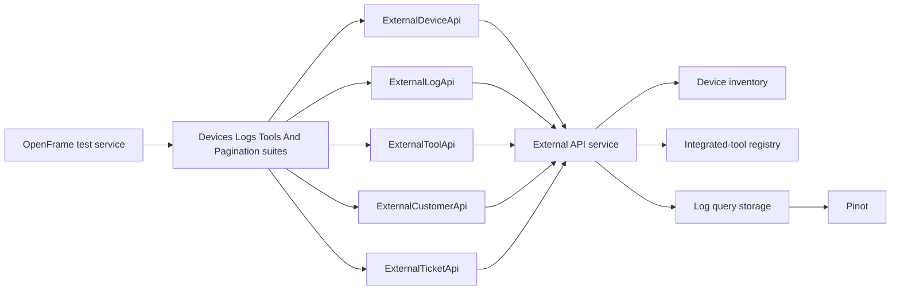
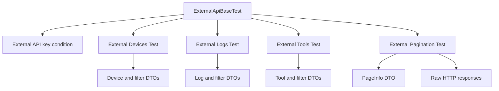
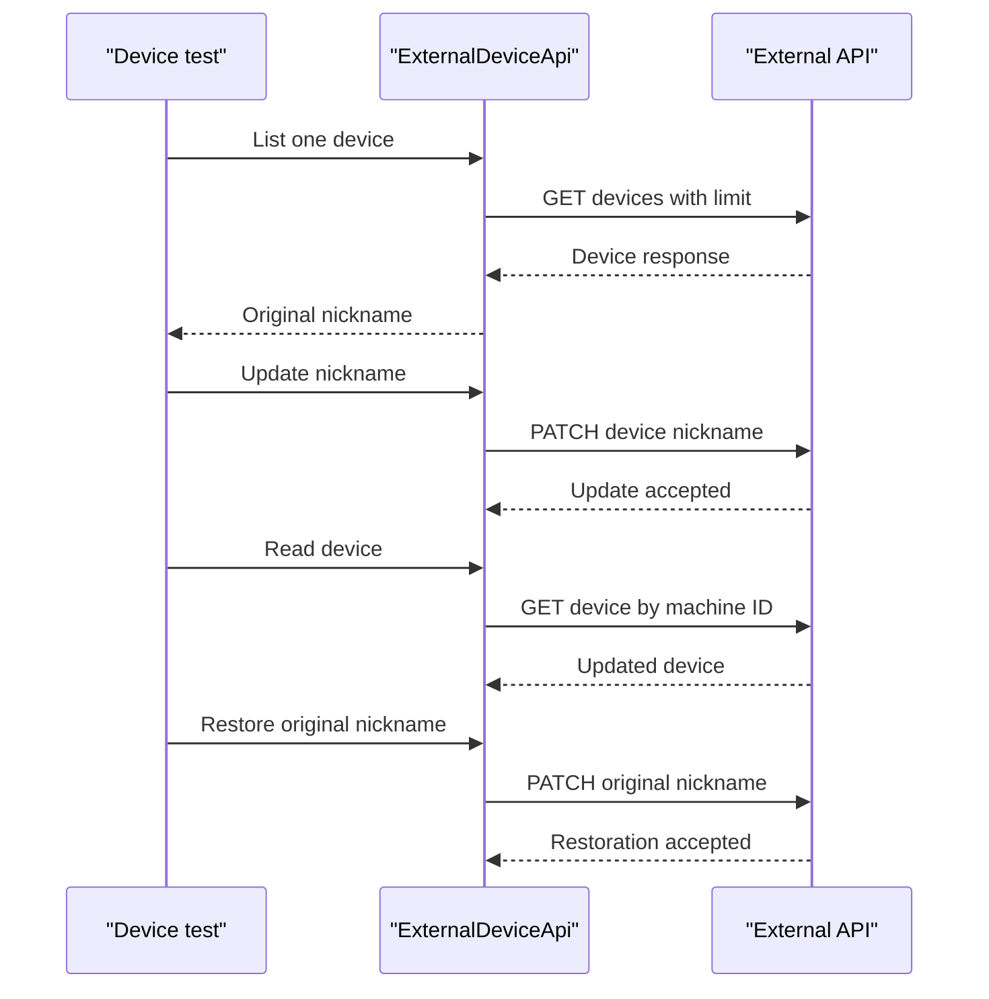
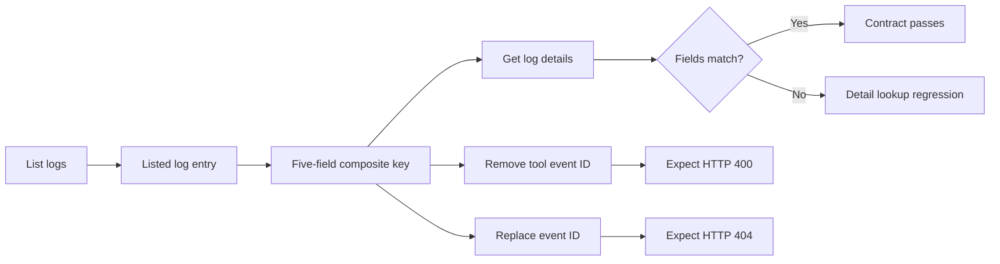
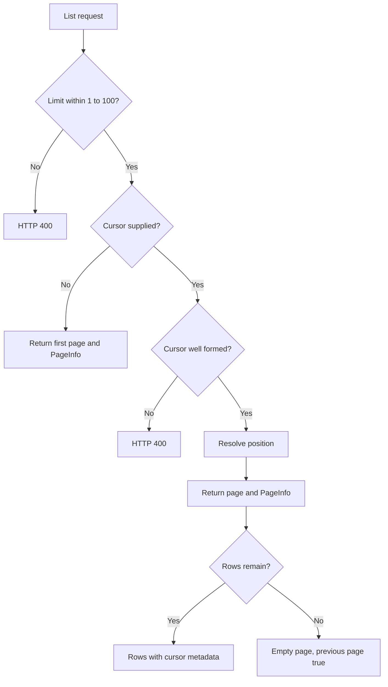

# Devices Logs Tools And Pagination

Devices Logs Tools And Pagination is the External API integration-test module for device inventory, event logs, integrated tools, and the cursor-pagination contract. It is implemented by the `openframe-test-service-core` library from [OpenFrame OSS Library](https://github.com/flamingo-stack/openframe-oss-lib) and is run by this repository's OpenFrame test service. The tests use an External API key and validate a live tenant rather than creating an isolated fixture, so they favour read-only checks, conditional assertions for empty data, and explicit cleanup for the single safe mutation.

The module covers these API surfaces:

- `/api/v1/devices`: list, retrieve by machine ID, filter, tag projection, and nickname update with restoration.
- `/api/v1/logs`: paginated tool and audit-event queries, filter metadata, and composite-key detail lookup.
- `/api/v1/tools`: integrated-tool registry queries and filter round trips.
- Shared pagination behaviour for customers, devices, tickets, and logs.

## Scope and Execution Model

Every suite is tagged `external-api`, guarded by `ExternalApiBaseTest.EXTERNAL_API_KEY_CONDITION`, and ordered with JUnit. The condition prevents execution when the External API key prerequisite is absent. Feature tests are additionally tagged `read`; the nickname round trip is tagged `update`; and the irreversible device-status case is separately tagged `destructive` so it is not part of the default run.

| Test class | Responsibility | Tenant data assumptions | Notable safety behaviour |
|---|---|---|---|
| [External Devices Test](https://github.com/flamingo-stack/openframe-oss-lib/blob/7a766f00e4f58b5d89db007b878ac8d6e0c344f4/openframe-test-service-core/src/main/java/com/openframe/test/tests/external/ExternalDevicesTest.java) | Verifies device resources, filtering, tags, reads, and nickname persistence. | Most cases require at least one device. | Restores the original nickname in `finally`; terminal-status update is opt-in only. |
| [External Logs Test](https://github.com/flamingo-stack/openframe-oss-lib/blob/7a766f00e4f58b5d89db007b878ac8d6e0c344f4/openframe-test-service-core/src/main/java/com/openframe/test/tests/external/ExternalLogsTest.java) | Verifies log listing, filter metadata, and detail lookup. | An empty log tenant is valid. | Detail and negative-detail checks skip when no row exists to supply a valid composite key. |
| [External Pagination Test](https://github.com/flamingo-stack/openframe-oss-lib/blob/7a766f00e4f58b5d89db007b878ac8d6e0c344f4/openframe-test-service-core/src/main/java/com/openframe/test/tests/external/ExternalPaginationTest.java) | Applies common limit and cursor assertions to four list controllers. | No rows are required for boundary status checks. | Leaves a known `hasNextPage` defect test disabled pending a fix. |
| [External Tools Test](https://github.com/flamingo-stack/openframe-oss-lib/blob/7a766f00e4f58b5d89db007b878ac8d6e0c344f4/openframe-test-service-core/src/main/java/com/openframe/test/tests/external/ExternalToolsTest.java) | Verifies integrated-tool listings and filters. | Expects the tenant to expose integrated tools. | Read-only. |

## Architecture

The tests are client-side contract checks. They call API wrapper classes such as `ExternalDeviceApi`, deserialize responses into test DTOs, and assert the externally observable contract. The implementation under test is delivered by this repository's External API service and its dependencies; the test classes themselves originate in OpenFrame OSS Library artifact `com.openframe.oss:openframe-test-service-core` at version `7.0.11`.

### Dependency Boundaries

The test module intentionally validates the public HTTP boundary instead of directly inspecting persistence. This makes it a useful regression layer across the service-side modules that expose device, log, tool, customer, and ticket resources.

Related verified documentation is available for [Authentication And Fixture Lifecycle](authentication_and_fixture_lifecycle.md), [Customers And Tickets](customers_and_tickets.md), [Knowledge Base Lifecycle](knowledge_base_lifecycle.md), and the parent [External API Tests](external-api-tests.md). Those modules cover the shared test setup and the other external-resource suites rather than duplicating them here.

## Device Contract Coverage

`ExternalDevicesTest` treats the existing tenant inventory as authoritative. `firstDevice()` obtains a real device from a limit-one list response and fails with a clear message when no device exists. This avoids manufacturing device records through an API that does not support creation.

### List, Projection, and Filters

The list test requests `limit=10`, requires `pageInfo` and a non-null collection, asserts the size does not exceed the requested limit, and checks that each returned device has an ID, machine ID, and status. A separate call with `includeTags=true` establishes the projection rule: tags must be materialized as a list when explicitly requested, even if that list is empty.

The filters test validates that the response is present, that the aggregate filtered count is not negative, and that any status option has a non-null value and non-negative count. The status round trip selects an advertised status with a positive count, preferring `ONLINE`; it then verifies that every list result carries the requested status. This avoids relying on transient statuses that can be advertised with zero usable rows.

### Single-Device Reads and Errors

A read by `machineId` must resolve to the device returned by the list projection. Recursive comparison excludes `tags`, `lastSeen`, and `updatedAt` because tags were not requested and the time fields may advance while a live agent reports. The advancing timestamps are still asserted to be monotonic. An all-zero unknown machine ID verifies the not-found path returns HTTP 404 and an error code.

### Safe and Destructive Updates

The nickname test is the only normal mutation. It records the existing value, applies a unique nickname, verifies persistence, and always restores the original nickname in a `finally` block. A status endpoint accepts only terminal values such as `DELETED` and `ARCHIVED`; since the API offers no transition back to active, the test only touches an already archived device and is selected exclusively with the `destructive` tag.

## Log Contract Coverage

`ExternalLogsTest` validates tool and audit events through `/api/v1/logs`. Unlike device reads, log queries are backed by Pinot, so empty results are acceptable and the surrounding test environment may surface the documented `503 PINOT_QUERY_ERROR` condition. A successful list response must always contain `pageInfo` and a non-null logs collection. Every returned record must expose `toolEventId`, `eventType`, `toolType`, `ingestDay`, and `timestamp`.

Filter metadata must not contain null event types, tool types, or severities. Any returned customer option must include both an ID and a name. When severities are advertised, the suite uses one to query logs and asserts that returned entries all match it.

### Composite Detail Key

The detail endpoint is addressed using five list fields: ingest day, tool type, event type, timestamp, and tool event ID. The test feeds those fields back into `ExternalLogApi.getDetails` and verifies that the returned record identifies the same event. Two negative paths protect the parameter contract:

1. Removing `toolEventId` from an otherwise valid parameter map must return HTTP 400 and an error code.
2. Replacing only the event ID with a well-formed unknown UUID must return HTTP 404 and an error code.

## Tool Registry Coverage

The tool suite covers the unpaginated integrated-tool registry. The baseline list must be non-empty, and each tool must provide an ID, a non-empty name, and a non-null enabled flag. Filter metadata can have nullable lists in the contract; when lists are present, their values must not be null.

Two round trips test list filtering:

- `enabled=true` must return at least one result, and every result must have `enabled=true`.
- When a category is advertised by the filters endpoint, querying that category must return at least one tool and every returned tool must have that category.

This verifies that filter metadata is actionable, not merely descriptive.

## Shared Pagination Contract

Pagination is tested centrally because customers, devices, tickets, and logs are independently implemented controllers with the same advertised interface. The test keeps raw response access for boundary assertions and typed DTO access for response-body checks.

| Rule | Collections checked | Expected outcome |
|---|---|---|
| `limit=0` | Customers, devices, tickets, logs | HTTP 400 |
| `limit=101` | Customers, devices, tickets, logs | HTTP 400 |
| `limit=1` and `limit=100` | Customers, devices, tickets, logs | HTTP 200 |
| `limit=1` response | Customers | At most one row and non-null `pageInfo` |
| Malformed cursor | Customers | HTTP 400, never a silent restart at the first page |
| Well-formed cursor past the end | Customers | Empty rows, `hasNextPage=false`, `hasPreviousPage=true` |

The configured bounds are inclusive: a caller may request from 1 through 100 rows, and omission defaults to 20. Cursors are opaque to clients. The past-end test uses a syntactically valid Base64 cursor to distinguish a valid but exhausted position from malformed input.

The next-page disjointness test is deliberately disabled. It documents a known defect in which `hasNextPage` is set for an exactly full final page, producing an end cursor that has no next row. Keep the test disabled until the controller contract is corrected, then re-enable it to verify that cursor traversal never repeats records and that cursor-reached pages report `hasPreviousPage=true`.

## Maintenance Guidance

- Preserve the live-tenant posture: do not add resource creation or irreversible state transitions to the default suite.
- When a test needs existing data, either fail with a clear fixture message, as device tests do, or explicitly skip an optional round trip when an empty tenant is valid, as log tests do.
- Derive filter test inputs from filter endpoints instead of hard-coding catalog values. Prefer options with positive counts when the response includes counts.
- Keep mutation cleanup in `finally` blocks so a failed assertion cannot leave tenant data changed.
- For pagination work, exercise all four mapped raw list calls for status-code validation; do not infer controller consistency from a single resource.
- Retain the disabled cursor traversal test as a regression specification until the known `hasNextPage` issue is fixed.
