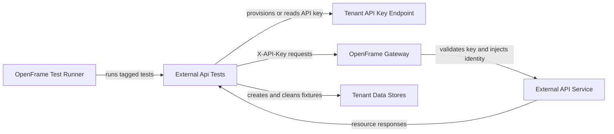
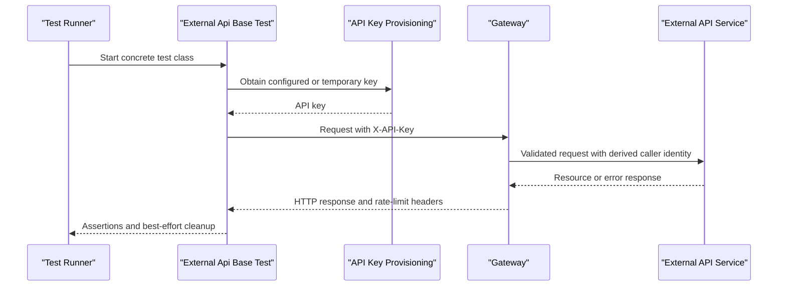

# External Api Tests

External Api Tests is the end-to-end contract suite for the API-key-protected External API. It runs from the tenant repository through the `openframe-test` service, while its test implementation is supplied by the `com.openframe.oss:openframe-test-service-core` library. The suite exercises the public resource surface through HTTP, validating successful operations, validation and not-found behavior, gateway authentication, rate-limit metadata, pagination, and safe cleanup of records it creates.

The covered API implementation is delivered by the External API service. In the deployed tenant topology, the gateway routes `/api-docs/**` to the External API service; its public External API routes are protected by the gateway API-key filter.

## Scope and Design Principles

Each concrete class is tagged `external-api` and is enabled only when the runner can obtain an API key. The shared base provisions a temporary key using the administrator session when needed, logs only a masked representation, and uses the supplied key without deleting it when a runner or `TEST_EXTERNAL_API_KEY` provides one.

The tests are deliberately tenant-safe:

- Ordered lifecycle tests retain fixtures in class state and skip dependent cases if their setup failed.
- Customer, ticket, and knowledge-base records are created with unique data and cleaned up using the strongest non-destructive operation exposed by the API.
- Device tests work with existing tenant devices, restore a nickname after testing it, and reserve terminal status changes for the opt-in `destructive` tag.
- Empty but valid tenant datasets cause applicable read checks to be skipped rather than manufacture invalid assumptions.

## Architecture

The suite verifies a boundary that is important to the deployment: the gateway is the authority for API-key authentication. Requests without a valid key must not become authenticated merely because they include identity-looking headers.

## Test Areas

Detailed documentation is organized by the test responsibilities generated with this module:

- [Authentication And Fixture Lifecycle](authentication_and_fixture_lifecycle.md) validates API-key acceptance and rejection paths, verifies rate-limit headers, gates execution on key availability, and manages customer cleanup.
- [Customers And Tickets](customers_and_tickets.md) validates customer lifecycle operations and the largest public resource surface: tickets, notes, tags, assignment, transitions, filters, statistics, and archival cleanup.
- [Knowledge Base Lifecycle](knowledge_base_lifecycle.md) validates folder and article state transitions, tag attachment, binary attachment upload and download, and folder deletion semantics.
- [Devices Logs Tools And Pagination](devices_logs_tools_and_pagination.md) validates read-heavy resource APIs, reversible device nickname updates, analytical log reads, tool filtering, and shared cursor-limit behavior.

## Execution Model

## Contract Coverage

| Area | Primary behavior asserted | Safety approach |
| --- | --- | --- |
| Authentication | Valid, absent, malformed, unknown, empty, and spoofed-identity-header key paths; rate-limit header consistency | Read-only probe against tools |
| Customers | Create, read, list, update, archive, restore, validation, and unknown-ID handling | Archives records created by the suite |
| Devices | Lists, filters, single-device consistency, unknown IDs, and nickname round trip | Restores original nickname; destructive status case is opt-in |
| Knowledge base | Folders, articles, tags, lifecycle, attachments, and deletion behavior | Removes attachments and tags; archives or deletes suite-owned content |
| Logs | Lists, filter metadata, detail composite key, missing parameter, and unknown-event paths | Read-only; tolerates empty log datasets |
| Tickets | Lifecycle, reference data, tags, assignment, notes, transitions, unlinking, and validation | Transitions suite-created tickets through resolved to archived |
| Tools | Registry listing and enabled or advertised-category filtering | Read-only |
| Pagination | Limits, malformed and past-end cursors across customers, devices, tickets, and logs | Read-only; known cursor progression defect remains disabled |

## Source Implementation

The library implementation is pinned with the tenant and is the authoritative source for the test classes. The following source files define the suite:

- [External Api Auth Test](https://github.com/flamingo-stack/openframe-oss-lib/blob/7a766f00e4f58b5d89db007b878ac8d6e0c344f4/openframe-test-service-core/src/main/java/com/openframe/test/tests/external/ExternalApiAuthTest.java)
- [External Api Base Test](https://github.com/flamingo-stack/openframe-oss-lib/blob/7a766f00e4f58b5d89db007b878ac8d6e0c344f4/openframe-test-service-core/src/main/java/com/openframe/test/tests/external/ExternalApiBaseTest.java)
- [External Customers Test](https://github.com/flamingo-stack/openframe-oss-lib/blob/7a766f00e4f58b5d89db007b878ac8d6e0c344f4/openframe-test-service-core/src/main/java/com/openframe/test/tests/external/ExternalCustomersTest.java)
- [External Devices Test](https://github.com/flamingo-stack/openframe-oss-lib/blob/7a766f00e4f58b5d89db007b878ac8d6e0c344f4/openframe-test-service-core/src/main/java/com/openframe/test/tests/external/ExternalDevicesTest.java)
- [External Knowledge Base Test](https://github.com/flamingo-stack/openframe-oss-lib/blob/7a766f00e4f58b5d89db007b878ac8d6e0c344f4/openframe-test-service-core/src/main/java/com/openframe/test/tests/external/ExternalKnowledgeBaseTest.java)
- [External Logs Test](https://github.com/flamingo-stack/openframe-oss-lib/blob/7a766f00e4f58b5d89db007b878ac8d6e0c344f4/openframe-test-service-core/src/main/java/com/openframe/test/tests/external/ExternalLogsTest.java)
- [External Pagination Test](https://github.com/flamingo-stack/openframe-oss-lib/blob/7a766f00e4f58b5d89db007b878ac8d6e0c344f4/openframe-test-service-core/src/main/java/com/openframe/test/tests/external/ExternalPaginationTest.java)
- [External Tickets Test](https://github.com/flamingo-stack/openframe-oss-lib/blob/7a766f00e4f58b5d89db007b878ac8d6e0c344f4/openframe-test-service-core/src/main/java/com/openframe/test/tests/external/ExternalTicketsTest.java)
- [External Tools Test](https://github.com/flamingo-stack/openframe-oss-lib/blob/7a766f00e4f58b5d89db007b878ac8d6e0c344f4/openframe-test-service-core/src/main/java/com/openframe/test/tests/external/ExternalToolsTest.java)
