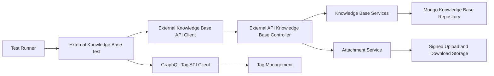
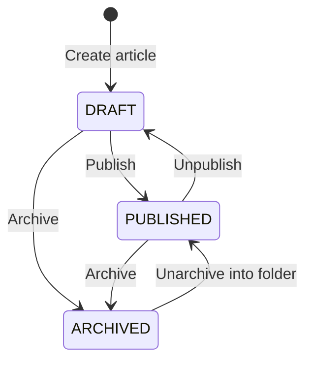
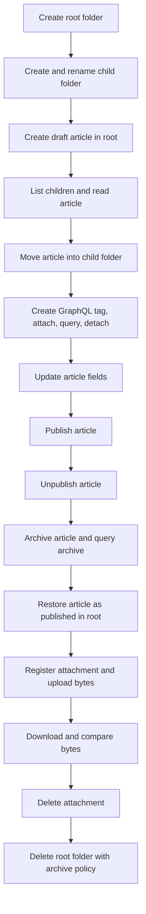
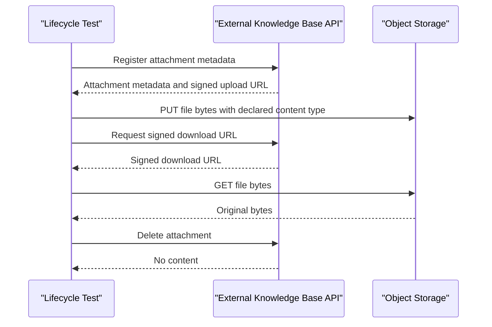

# Knowledge Base Lifecycle

Knowledge Base Lifecycle is the ordered external-API integration test for knowledge-base folders, articles, tags, and file attachments. It proves that a caller authenticated with an external API key can create isolated fixtures, progress an article through its supported states, and clean up durable records even after a partially failed run.

The test implementation belongs to the `openframe-test-service-core` library, consumed by this repository at version `7.0.11` and run by its OpenFrame test service. Its primary source is [External Knowledge Base Test](https://github.com/flamingo-stack/openframe-oss-lib/blob/7a766f00e4f58b5d89db007b878ac8d6e0c344f4/openframe-test-service-core/src/main/java/com/openframe/test/tests/external/ExternalKnowledgeBaseTest.java). The externally exposed behavior is implemented by the library's [Knowledge Base Controller](https://github.com/flamingo-stack/openframe-oss-lib/blob/7a766f00e4f58b5d89db007b878ac8d6e0c344f4/openframe-external-api-service-core/src/main/java/com/openframe/external/controller/KnowledgeBaseController.java).

## Scope and Role

The ordered JUnit class is enabled only when the external API key condition supplied by its base test passes. It creates all of the knowledge-base data it needs: a root folder, a child folder, an article, a unique tag, and a temporary attachment file. This makes the test suitable for a shared tenant because it does not depend on pre-existing knowledge-base content.

The lifecycle exercises two feature areas:

- **Folder and item management:** create, nest, rename, list, fetch, move, tag, untag, and delete folders with an explicit child policy.
- **Article management:** create a draft, edit it, publish, unpublish, archive, locate it in the archive, restore it, and attach, download, and delete a file.

The module is one focused part of the verified [External API Tests](external-api-tests.md) suite. It verifies behavior through the public REST surface rather than internal services.

## System Placement

The test combines REST and GraphQL deliberately. The external API can assign and remove tags from an article and list tags in use, but the fixture tag is created through the GraphQL tag API. GraphQL returns a Relay global identifier, so the test converts it to the raw identifier accepted by the external REST API.

## Public API Surface Under Test

The controller is rooted at `/api/v1/knowledge-base`. The table lists only routes verified from the controller implementation and used by the lifecycle test.

| Capability | Route and method | Verified behavior |
|---|---|---|
| List items | `GET /items` | Cursor-paginated items at a parent or root. Folders precede articles, archived articles are excluded, and article content is omitted from list entries. |
| Read item | `GET /items/{id}` | Returns one folder or article, including article content, tags, and attachment metadata. |
| Move item | `POST /items/{id}/move` | Reparents an item to a folder, with safeguards against invalid folder relationships. |
| List folders | `GET /folders` | Returns a flat, name-ordered folder list; callers construct the hierarchy from parent identifiers. |
| Create or rename folder | `POST /folders`, `PATCH /folders/{id}` | Creates root or nested folders and changes a folder name without moving it. |
| Delete folder | `DELETE /folders/{id}` | Deletes a folder. Non-empty folders require `MOVE` or `ARCHIVE` handling. |
| Create or update article | `POST /articles`, `PATCH /articles/{id}` | Creates an article as a draft unless a status is supplied, then partially edits name, parent, content, or summary. |
| Change article state | `POST /articles/{id}/publish`, `/unpublish`, `/archive`, `/unarchive` | Publishes, returns to draft, archives, or restores an article. |
| Query archives | `GET /articles/archived` | Cursor-paginated archived articles, optionally filtered by search or tag identifiers. |
| Manage item tags | `POST` or `DELETE /items/{id}/tags/{tagId}` | Adds or removes a pre-existing tag. |
| Attachment lifecycle | `POST /articles/{id}/attachments`, `GET /attachments/{attachmentId}/download-url`, `DELETE /attachments/{attachmentId}` | Registers metadata and returns a signed upload URL, obtains a signed download URL, and removes the stored file and metadata. |

Requests are attributed to the API-key owner. The test verifies that article authors, article editors, and attachment uploaders are resolved server-side rather than trusted from request data.

## Article State Model

An archived article is not included in the normal item list and is retrieved through the archived-articles route. The controller describes archiving as non-destructive for articles, while folder deletion is destructive for folder records and requires an explicit policy for children.

Publishing has a timestamp invariant. The `KnowledgeBasePublishLifecycleListener` from `openframe-api-lib` stamps `publishedAt` only when an item first becomes published and that value is absent. The lifecycle test captures that first timestamp, unpublishes the article, and verifies that it remains unchanged. Timestamp comparisons truncate to milliseconds because the REST representation has millisecond precision.

## Ordered Scenario Flow

### Folder and Item Rules

The test first proves that a root folder has no parent and that a child folder records its parent. Renaming preserves both the folder identifier and parent. Listing folders returns folders only, while listing the root folder's children returns exactly the child folder followed by the article, demonstrating the folders-first ordering contract.

It then verifies the item read and move paths, including a missing item response. The suite expects a `404` for an unknown item and verifies that an article retains its identifier after moving. It also makes the invalid request that would move the root folder under its descendant. The test expects `400`; however, the controller's declared API responses list descendant placement as `409`. Maintainers should treat this as a contract-consistency point when modifying either error mapping or the test expectation.

Deletion protects hierarchical data. A non-empty folder without `childrenAction` is expected to fail with `400`. The successful branch uses `ARCHIVE`: it removes the folder hierarchy, archives articles in the subtree, and leaves those articles detached at the root level.

### Tag Rules

Tag assignment requires an existing tag and a valid item. The test creates a unique `KNOWLEDGE_ARTICLE` tag through GraphQL, decodes the Relay identifier, and assigns the raw identifier to the article through REST. It proves both tenant-wide tags-in-use and subtree tags-in-use, including a nested article found from its ancestor folder. Removing the tag removes it from the article response. Assigning the all-zero unknown identifier must return `404`.

### Attachment Rules

Attachment creation is a two-stage operation:

The module verifies item ownership, file name, content type, size, uploader attribution, and that URLs are HTTP(S). Downloaded bytes must exactly match the generated fixture file. After deletion, resolving a download URL is expected to return `404`.

## Persistence and Query Semantics

Knowledge-base data is persisted through the Mongo-backed repository contract in `openframe-data-mongo-sync`. Its custom item repository defines the query behavior the controller relies on:

- Folder queries are ordered by name with case-insensitive, numeric-aware comparison and use the item identifier as a tie-breaker.
- Article queries are ordered by most recently updated first, with identifier tie-breaking.
- Normal article queries exclude archived articles unless statuses are supplied.
- Subtree resolution loads folder identifiers and parent identifiers, which supports folder-scoped search and tag discovery.
- Archived articles have dedicated query and count operations.

The test uses the response-level consequences of these rules rather than repository internals: folders appear before articles in an item listing, active and archived content are queried separately, and a folder-scoped tag query sees nested descendants.

## Failure Isolation and Cleanup

Because methods are explicitly ordered and share static fixture references, dependent cases use JUnit assumptions. If an earlier fixture was not created, the affected case is skipped with a reason instead of failing against a null identifier. A publish timestamp, created tag, and attachment each have additional preconditions before their dependent assertions run.

The `AfterAll` cleanup is intentionally best-effort:

1. Delete an attachment if it was registered but not already deleted.
2. Delete the root folder with the archive policy if it remains.
3. Archive the article if it remains active.
4. Attempt to delete the unique GraphQL-created tag.

Raw cleanup calls return status information instead of throwing. This lets later cleanup continue if an earlier folder deletion already archived the article or if the ordered run stopped midway.

## Maintenance Guidance

- Preserve the ordered test design or replace shared static state with a fixture strategy that offers equivalent dependency handling and cleanup.
- Keep generated folder names and tags unique per run. Shared tags are unsafe to delete during cleanup.
- When changing error mapping, update both the controller documentation and the lifecycle assertion, especially for invalid recursive folder moves.
- Retain byte-for-byte attachment verification. A successful metadata response does not prove signed upload or download storage behavior.
- Preserve the distinction between normal-list and archived-list queries, and the invariant that unpublishing does not erase the first-publication timestamp.
