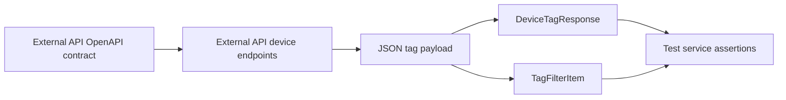
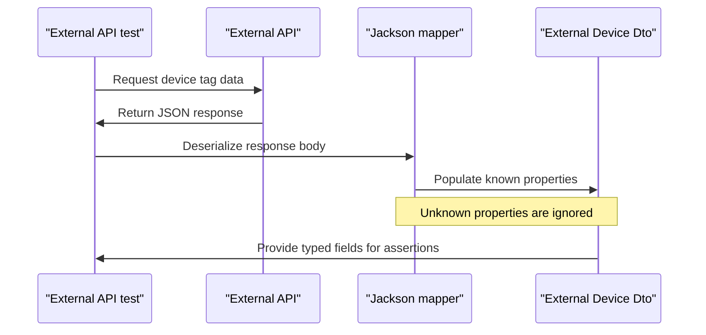

# External Device Dto

External Device Dto provides two Java data-transfer objects used by the OpenFrame test service when it consumes device-tag data from the External API. The types model the External API contract version 1.1.0 and are deliberately small: they preserve tag metadata, assigned values, and aggregate counts without embedding endpoint, persistence, or filtering logic.

Both classes are supplied by the `com.openframe.oss:openframe-test-service-core` library at version `7.0.11`, which this repository consumes. Their source lives in the OpenFrame OSS Library, rather than in this repository:

- [`DeviceTagResponse`](https://github.com/flamingo-stack/openframe-oss-lib/blob/7a766f00e4f58b5d89db007b878ac8d6e0c344f4/openframe-test-service-core/src/main/java/com/openframe/test/data/dto/external/device/DeviceTagResponse.java)
- [`TagFilterItem`](https://github.com/flamingo-stack/openframe-oss-lib/blob/7a766f00e4f58b5d89db007b878ac8d6e0c344f4/openframe-test-service-core/src/main/java/com/openframe/test/data/dto/external/device/TagFilterItem.java)

## Purpose and Scope

The module is a client-side representation of two related External API payload shapes:

- A **device tag** is a tag definition and its device-associated values, including display and audit metadata.
- A **tag filter item** is a compact filter or aggregation value paired with the number of matching devices.

The classes are contract models for test code. They do not validate data, call the API, or resolve tag assignments. Jackson maps received JSON into the objects, and Lombok generates standard accessors, mutators, builders, constructors, and value-oriented methods.

## Architecture Overview

The module belongs to the test-service data model layer. It follows the external contract rather than the server's internal device persistence model, allowing external API tests to assert against the public response format.

## Component Responsibilities

### DeviceTagResponse

`DeviceTagResponse` represents a complete tag entry returned for device-oriented External API workflows.

| Field | Type | Meaning |
|---|---|---|
| `tagId` | `String` | Identifier of the tag. |
| `key` | `String` | Tag key or name used to classify the tag. |
| `description` | `String` | Optional human-readable explanation. |
| `color` | `String` | Display color associated with the tag. |
| `values` | `List<String>` | Values associated with the tag in the response. |
| `createdAt` | `Instant` | Creation timestamp represented as an instant in time. |
| `createdBy` | `String` | Identifier of the actor that created the tag. |

This type is appropriate where tests need to verify both a tag's identity and presentation or audit metadata. The `values` collection keeps a tag's value set distinct from the filter aggregation count represented by `TagFilterItem`.

### TagFilterItem

`TagFilterItem` represents one selectable key-value entry and the number of matching records.

| Field | Type | Meaning |
|---|---|---|
| `key` | `String` | Tag key used by the filter. |
| `value` | `String` | Specific value for that key. |
| `count` | `Integer` | Number of devices represented by the key-value pair. |

Use this type when a test consumes a tag-filter response or validates result counts. It intentionally does not repeat definition metadata such as a tag identifier, description, color, or creation information.

## Serialization and Compatibility

Both models use `@JsonIgnoreProperties(ignoreUnknown = true)`. Consequently, test deserialization tolerates additional JSON fields introduced by the External API, provided the expected fields retain compatible names and types. This forward-compatible behavior is useful when a server returns a newer revision of the contract than the test library knows.

The models also provide:

- A no-argument constructor for Jackson object creation.
- An all-argument constructor for direct fixture construction.
- A builder for readable test setup.
- Generated getters and setters for assertions and deserialization.

`createdAt` is an `Instant`, so consumers should compare timestamps as instants rather than formatting-dependent strings.

## Data Flow

## Contract Boundaries

External Device Dto is intentionally limited to response representation:

- It has no HTTP client dependency and does not define request paths.
- It contains no business rules for tag matching, count calculation, or authorization.
- It does not persist tags or map them to internal database entities.
- It is generated from the External API OpenAPI contract indicated by the source documentation, so contract changes should be reviewed alongside the API specification and external API test expectations.

## Maintenance Guidance

When the External API changes a device-tag payload, update this module only for fields that tests must deserialize or assert. Keep JSON property names aligned with the published contract. Adding a field is generally compatible because unknown fields are already tolerated on input; changing an existing field's name or Java type can break deserialization and downstream assertions.

For fixture creation, prefer the generated builders. This keeps test intent explicit and avoids coupling callers to constructor parameter order.
