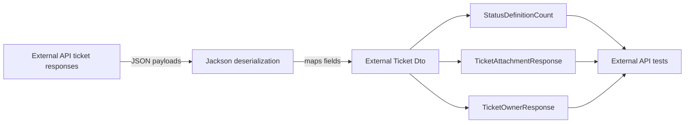
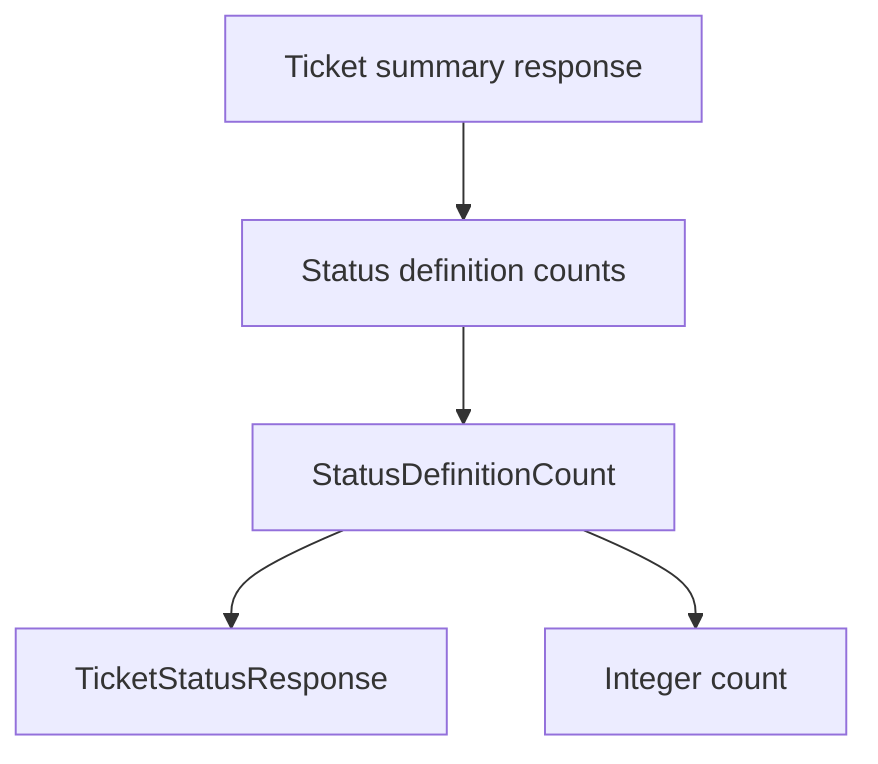
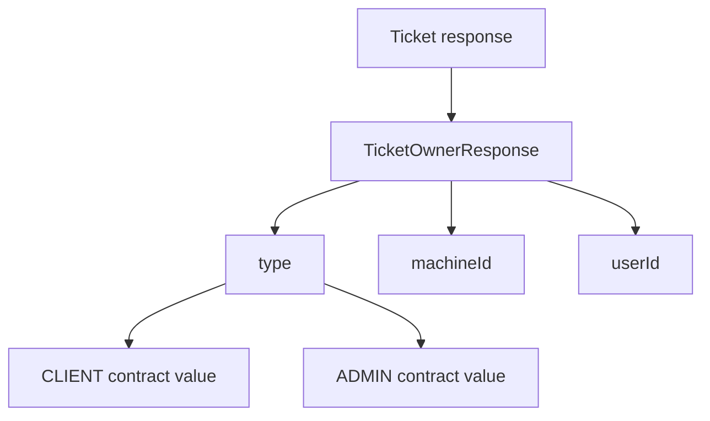
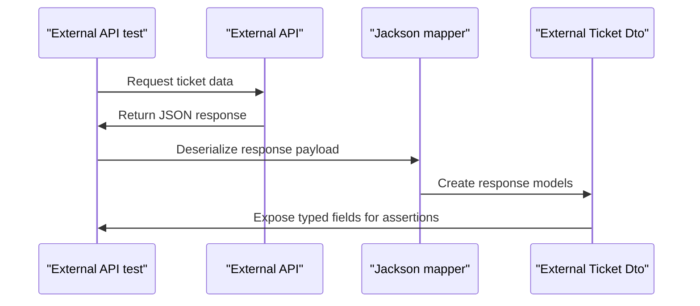

# External Ticket Dto

External Ticket Dto is the small collection of Java response models used by the OpenFrame test service when it consumes ticket-related responses from the External API. The models are supplied by the **OpenFrame OSS Library** artifact `com.openframe.oss:openframe-test-service-core`, which this repository runs as part of its test-service workload.

The classes are generated from version 1.1.0 of the External API OpenAPI contract exposed at the verified `GET /api-docs` route. They provide a stable, deserialization-friendly boundary for ticket-status aggregates, attachment metadata, and ticket ownership data used by external API tests.

## Scope and Design

Each model uses Lombok to provide accessors, constructors, and a builder. All three use Jackson `JsonIgnoreProperties(ignoreUnknown = true)`, so additive fields returned by a newer API version do not cause existing test clients to fail during JSON deserialization. This makes the module intentionally tolerant of backward-compatible API evolution.

The module contains DTOs only. It does not call endpoints, persist data, or enforce ticket business rules. Endpoint implementation belongs to the External API service, while these classes represent selected response fragments in the test-service client.

## Component Responsibilities

| Component | Responsibility | Primary fields |
| --- | --- | --- |
| [StatusDefinitionCount](https://github.com/flamingo-stack/openframe-oss-lib/blob/7a766f00e4f58b5d89db007b878ac8d6e0c344f4/openframe-test-service-core/src/main/java/com/openframe/test/data/dto/external/ticket/StatusDefinitionCount.java) | Represents an aggregate count for a ticket lifecycle status. The result can be empty when ticket lifecycle support is disabled. | `status`, `count` |
| [TicketAttachmentResponse](https://github.com/flamingo-stack/openframe-oss-lib/blob/7a766f00e4f58b5d89db007b878ac8d6e0c344f4/openframe-test-service-core/src/main/java/com/openframe/test/data/dto/external/ticket/TicketAttachmentResponse.java) | Represents metadata for one ticket attachment; it deliberately carries metadata rather than attachment bytes. | `id`, `ticketId`, `fileName`, `contentType`, `fileSize`, `uploadedAt`, `uploadedBy` |
| [TicketOwnerResponse](https://github.com/flamingo-stack/openframe-oss-lib/blob/7a766f00e4f58b5d89db007b878ac8d6e0c344f4/openframe-test-service-core/src/main/java/com/openframe/test/data/dto/external/ticket/TicketOwnerResponse.java) | Identifies the entity that owns a ticket. | `type`, `machineId`, `userId` |

## Response Shapes

### Status Definition Count

`StatusDefinitionCount` couples a `TicketStatusResponse` with an integer count. It is used for lifecycle-oriented ticket summaries. The nested status response supplies the status definition, while `count` states how many tickets currently match it.

The DTO does not constrain missing or zero values itself. Consumers should interpret the surrounding endpoint contract, especially the documented case where lifecycle functionality is disabled and status counts are empty.

### Ticket Attachment Response

`TicketAttachmentResponse` exposes the metadata necessary to identify, display, and audit an attachment associated with a ticket:

- `id` identifies the attachment record.
- `ticketId` links the attachment to its ticket.
- `fileName`, `contentType`, and `fileSize` describe the file.
- `uploadedAt` is an `Instant`, preserving an absolute upload timestamp.
- `uploadedBy` identifies the uploader as represented by the API.

Because content is not part of this DTO, attachment retrieval and binary transfer remain separate API concerns. Tests using this class can validate attachment listing metadata without handling file payloads.

### Ticket Owner Response

`TicketOwnerResponse` represents ticket ownership through a type discriminator and optional identifiers:

- `type` currently accepts the contract values `CLIENT` and `ADMIN`.
- `machineId` associates client ownership with a managed machine when applicable.
- `userId` associates administrative ownership with a user when applicable.

The discriminator is intentionally a `String` rather than a Java enum. This is a compatibility choice: a newly introduced backend value can still deserialize, allowing tests or callers to inspect it rather than failing at parsing time.

## Data Flow

The module participates in an external API test flow rather than in server-side ticket processing. A test invokes an External API ticket operation, Jackson maps the returned JSON to these response DTOs, and assertions inspect the resulting values.

## Compatibility and Maintenance Notes

- Preserve `JsonIgnoreProperties(ignoreUnknown = true)` when regenerating or revising these models; it supports additive evolution of the External API contract.
- Keep `uploadedAt` as `Instant` to retain timezone-independent timestamps.
- Do not replace `TicketOwnerResponse.type` with a closed enum unless the API’s forward-compatibility policy changes and all consumers can tolerate unknown values being rejected.
- Changes to field names, types, or nullability must be synchronized with the External API OpenAPI contract and the tests that deserialize its responses.
- These source files come from the OpenFrame OSS Library. Maintain their provenance through the source links above rather than treating them as implementation files owned by this repository.

## Relationship to the Platform

External Ticket Dto supports the repository’s test-service integration surface. It mirrors ticket response fragments exposed by the External API service: lifecycle summary data, attachment metadata, and ownership information. The models keep test code strongly typed while allowing the server-side API and its contract to evolve compatibly.
