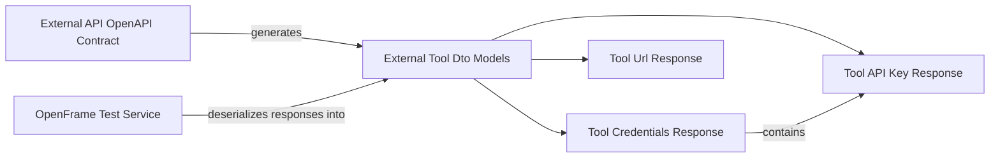
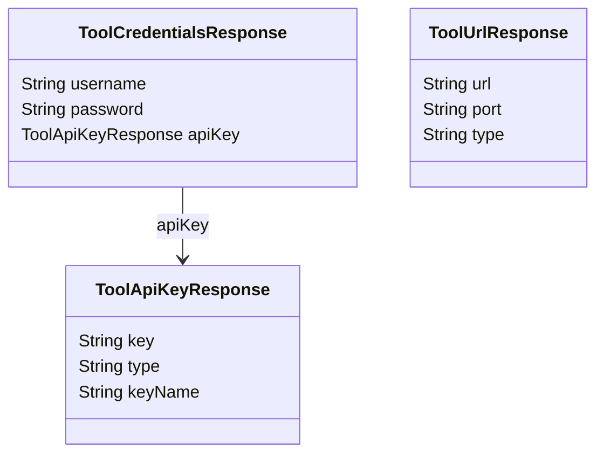
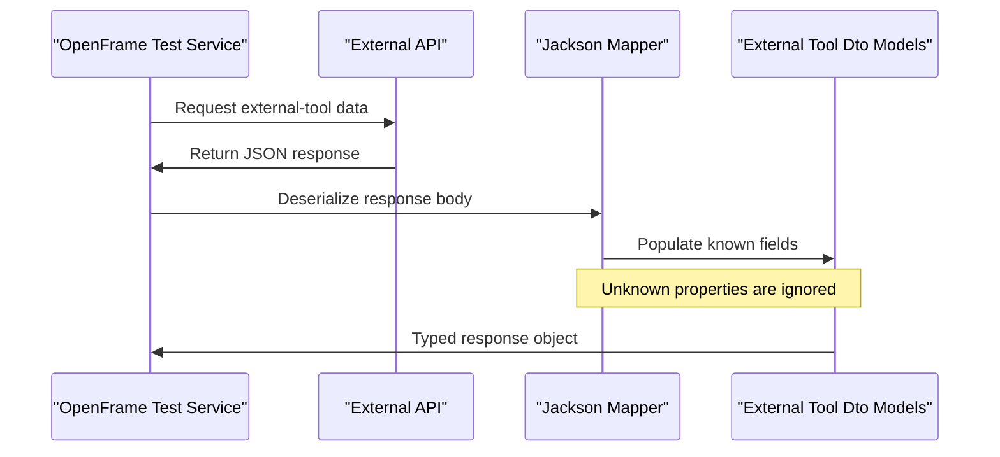

# External Tool Dto

External Tool Dto defines the small set of Java response models used by the OpenFrame test service when it reads external-tool configuration from the External API contract. The models are supplied by the `com.openframe.oss:openframe-test-service-core` library, version `7.0.11`, which this repository consumes at run time.

The classes are generated from the External API OpenAPI contract, identified in the source as version `1.1.0`. They represent configuration values rather than tool lifecycle operations: endpoint location, optional username/password credentials, and an optional API-key configuration.

## Scope and Design

All three models are plain Jackson-deserialized DTOs with Lombok-generated accessors, constructors, and builders:

- `@JsonIgnoreProperties(ignoreUnknown = true)` makes response parsing forward-compatible when the API adds fields.
- `@Data` supplies getters, setters, equality, hash code, and a string representation.
- `@Builder`, no-argument, and all-argument constructors support concise fixture construction as well as Jackson deserialization.
- The DTOs do not validate content, redact secrets, initiate network calls, or persist data. Those responsibilities belong to callers and the external API.

## Architecture Overview

The External API is the producer of response payloads. The test service uses the DTOs as a stable, tolerant boundary while exercising external-tool behavior. An unknown JSON property is ignored; known fields are mapped directly by their Java property names.

## Data Model

### Tool Api Key Response

[`ToolApiKeyResponse`](https://github.com/flamingo-stack/openframe-oss-lib/blob/7a766f00e4f58b5d89db007b878ac8d6e0c344f4/openframe-test-service-core/src/main/java/com/openframe/test/data/dto/external/tool/ToolApiKeyResponse.java) describes API-key authentication material associated with a tool.

| Field | Type | Meaning |
|---|---|---|
| `key` | `String` | API-key value returned by the API. |
| `type` | `String` | API-key authentication type. |
| `keyName` | `String` | Name under which the API key is presented. |

### Tool Credentials Response

[`ToolCredentialsResponse`](https://github.com/flamingo-stack/openframe-oss-lib/blob/7a766f00e4f58b5d89db007b878ac8d6e0c344f4/openframe-test-service-core/src/main/java/com/openframe/test/data/dto/external/tool/ToolCredentialsResponse.java) groups basic credentials and an optional nested API-key description for a tool.

| Field | Type | Meaning |
|---|---|---|
| `username` | `String` | User name returned for tool authentication. |
| `password` | `String` | Password returned for tool authentication. |
| `apiKey` | `ToolApiKeyResponse` | Nested API-key configuration when supplied. |

### Tool Url Response

[`ToolUrlResponse`](https://github.com/flamingo-stack/openframe-oss-lib/blob/7a766f00e4f58b5d89db007b878ac8d6e0c344f4/openframe-test-service-core/src/main/java/com/openframe/test/data/dto/external/tool/ToolUrlResponse.java) represents an endpoint exposed by an integrated external tool.

| Field | Type | Meaning |
|---|---|---|
| `url` | `String` | Endpoint URL returned for the tool. |
| `port` | `String` | Port represented as a string by the contract. |
| `type` | `String` | Endpoint or connection type. |

## Response Composition

`ToolCredentialsResponse` is the only model relationship in this module: it embeds `ToolApiKeyResponse`. `ToolUrlResponse` is independent and can be returned alongside credentials when an external-tool workflow requires both connection details and authentication data.

## Typical Deserialization Flow

## Security Considerations

`password` and `key` can carry secret material. Treat populated DTO instances as sensitive:

- Do not include them in logs, diagnostics, assertion failure messages, or support exports.
- Prefer assertions on presence, type, or a controlled fixture value instead of printing an entire DTO. Lombok `@Data` generates `toString()`, so interpolating an instance into a log message may expose fields.
- Keep test fixtures and captured responses out of source control unless they use non-production values.
- Preserve the declared `String` types when maintaining contract compatibility; validation and secret-handling policy belong at the client or API boundary, not in these generated response models.

## Maintenance Notes

When the External API contract changes, regenerate or update these DTOs together with the corresponding external-tool tests. Additive response fields are generally safe for existing consumers because Jackson ignores them. Renaming or changing the type of `key`, `type`, `keyName`, `username`, `password`, `url`, or `port` is a contract-breaking change for this module.

The module intentionally contains no behavior beyond serialization shape and object construction. Test orchestration, HTTP behavior, authentication policy, and tool installation management are outside External Tool Dto.