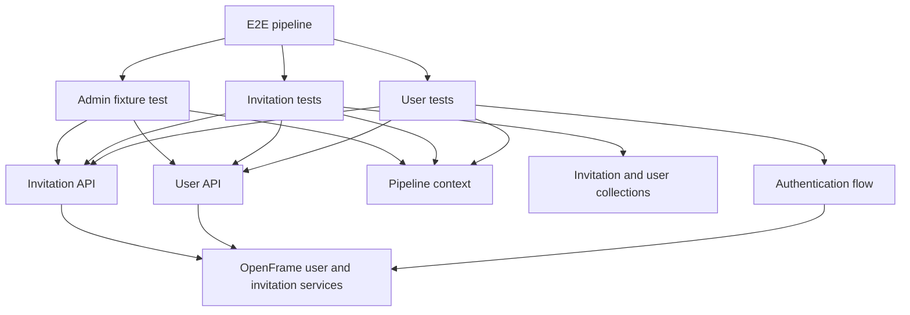
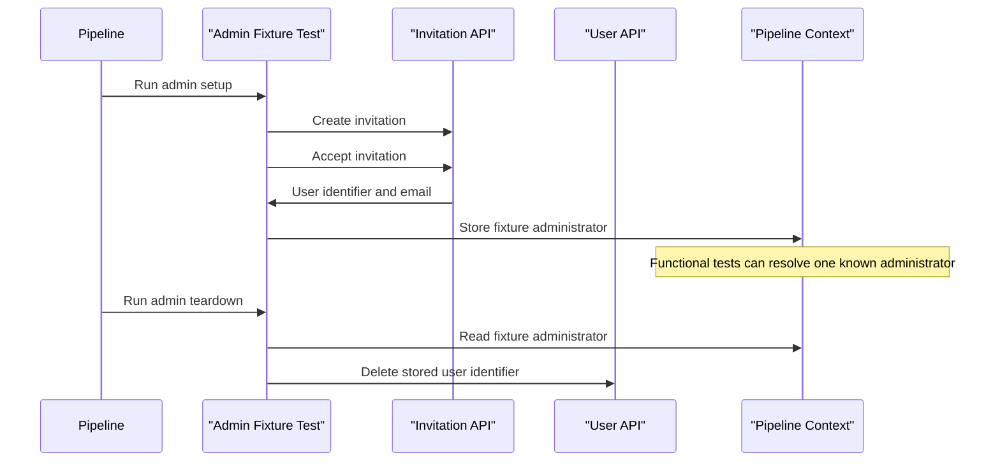
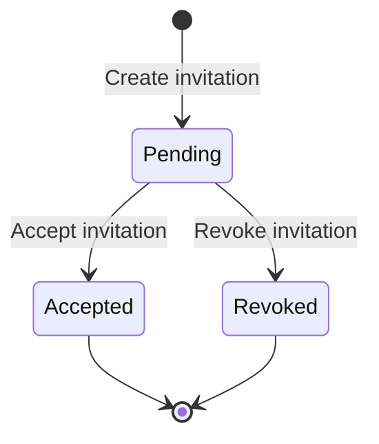
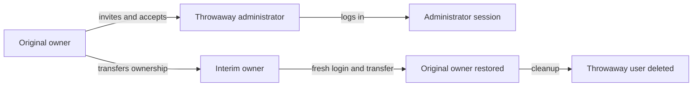

# Admin Fixture And User Management

Admin Fixture And User Management documents the OpenFrame end-to-end test coverage that establishes a reusable administrator, verifies invitation and user-management behavior, and protects shared tenant data from test cleanup. The tests are supplied by the `openframe-test-service-core` library from OpenFrame OSS Library and are run by this repository's OpenFrame test service.

The module is deliberately stateful. Each test class uses ordered JUnit execution and shared static state only for resources it created, while `PipelineContext` carries pipeline-scoped identities across test phases. This lets functional tests rely on one known administrator without deleting a pre-existing administrator account.

## Scope

The module covers three complementary contracts:

- **Pipeline administrator fixture:** creates one invited-and-accepted administrator before functional tests and removes that exact account during teardown.
- **Invitation and user lifecycle:** validates invitation creation, acceptance, refusal rules, revocation, pagination, deletion, re-invitation, and editable user-name limits.
- **Tenant ownership controls:** verifies user reads and ownership-transfer authorization, including no-op, invalid-target, pending-target, non-owner, and deleted-target behavior.

It does not implement the production endpoints. It exercises them through the test library's `InvitationApi`, `UserApi`, and authentication flow, with selected persistence checks through invitation and user collections.

## Architecture Overview

The fixture is tagged for a setup phase and stores the resulting identifier and email in `PipelineContext`. The invitation tests publish only the invited user they accepted, so their delete case is self-cleaning. The ownership tests create a separate throwaway administrator, authenticate it, and restore ownership if a failure leaves the transfer in progress.

## Component Responsibilities

| Component | Responsibility | Source |
|---|---|---|
| `AdminFixtureTest` | Provides a pipeline-wide administrator by inviting and accepting a user, then records and deletes that fixture account. | [Source](https://github.com/flamingo-stack/openframe-oss-lib/blob/7a766f00e4f58b5d89db007b878ac8d6e0c344f4/openframe-test-service-core/src/main/java/com/openframe/test/tests/AdminFixtureTest.java) |
| `UserInvitationsTest` | Exercises invitation state transitions, user deletion and re-invitation, profile-name editing, pending-invitation listing, resend restrictions, and cleanup. | [Source](https://github.com/flamingo-stack/openframe-oss-lib/blob/7a766f00e4f58b5d89db007b878ac8d6e0c344f4/openframe-test-service-core/src/main/java/com/openframe/test/tests/UserInvitationsTest.java) |
| `UserTest` | Verifies user retrieval and the authorization and lifecycle rules around transferring tenant ownership. | [Source](https://github.com/flamingo-stack/openframe-oss-lib/blob/7a766f00e4f58b5d89db007b878ac8d6e0c344f4/openframe-test-service-core/src/main/java/com/openframe/test/tests/UserTest.java) |

## Pipeline Administrator Fixture

`AdminFixtureTest` exists because a newly registered tenant initially has an `OWNER`, which is distinct from `ADMIN`. Tests that select administrators would otherwise have no stable administrator member. The `admin-setup` test creates one through the same public invitation path used by the product:

Teardown first checks whether the context contains a fixture administrator. This makes the teardown harmless when setup did not complete and ensures deletion targets the account created by this pipeline, rather than any shared tenant user.

## Invitation And User Lifecycle Coverage

`UserInvitationsTest` is order-sensitive because later assertions consume state created earlier. It validates both API-visible behavior and key persisted state.

### Invitation State Model

The test suite asserts the following behavior:

- Creating an invitation persists a matching invitation record; creation and expiry timestamps are allowed a one-second comparison tolerance.
- Accepting a pending invitation creates a user with the invitation email and publishes that exact user to `PipelineContext` for later deletion.
- A second acceptance of an accepted invitation returns the expected conflict response.
- Revoked invitations cannot be accepted. The invitation record is retained with `REVOKED` status, while listing excludes revoked and accepted invitations.
- Inviting the authenticated, already-active tenant member is rejected. The test intentionally uses the authenticated user because the backing users collection is global across tenants.
- Deleting a user returns status `204` and leaves the retrieved user in `DELETED` status. A deleted user can subsequently receive a new pending invitation.

### Profile Editing And Invitation Listing

The feature-tagged cases isolate their own invitation and accepted user. They verify that an update changes first and last names but preserves identifier, email, roles, and active status. A first name of 128 characters is accepted; 129 characters returns a `VALIDATION_ERROR` mentioning `firstName` and leaves persisted data unchanged.

For pending invitations, the suite verifies complete pagination by repeatedly requesting pages until `hasNext` is false. It checks page metadata, a page size of one, and inclusion of the invitation's identifier, roles, email, and expiry. A fresh pending invitation cannot be resent: the pinned contract is an HTTP `409`. After revocation, that invitation no longer appears in listing results.

The class-level cleanup deletes the accepted edit user or revokes its unaccepted invitation, and revokes the separately created listed invitation if it was not already revoked.

## Ownership Transfer Coverage

`UserTest` first asserts that every listed user has populated identity, role, status, and update metadata, then confirms that fetching a listed user returns the same representation. Owner deletion coverage is present but disabled until the production delete-user behavior is updated.

The ownership tests start from the authenticated suite user, which must be an active `OWNER`. They then exercise the following authorization and state rules:

| Scenario | Expected contract |
|---|---|
| Transfer ownership to the current owner | Accepted as a `204` no-op, with roles unchanged. |
| Transfer ownership to an unknown identifier | `404` with `USER_NOT_FOUND`; owner roles remain unchanged. |
| Transfer ownership to a pending invitee | `404` because an invitation is not yet a user. |
| Transfer initiated by a non-owner administrator | `403` with `FORBIDDEN` and no role change. |
| Transfer to an active throwaway administrator | On a pipeline-registered tenant, target becomes the sole `OWNER` and prior owner becomes `ADMIN`. |
| Transfer back to the original owner | Uses a fresh session for the interim owner because role-bearing tokens were minted before the role change. |
| Transfer to a deleted user | `403` with `OPERATION_NOT_ALLOWED`, because only active users may become owner. |

Ownership-changing tests carry the `needs-registered-tenant` tag and use assumptions to avoid demoting an owner outside the intended pipeline-registered tenant. `@AfterAll` is defensive: it attempts to restore ownership if necessary, revokes an outstanding invitation, and deletes the throwaway account.

## Test Isolation And Maintenance Notes

- Preserve test ordering where a case depends on class-owned state such as an invitation, accepted user, or authenticated throwaway account.
- Create and delete only accounts generated by the running test class or published through `PipelineContext`. Shared tenant accounts may belong to real users or other tests.
- Keep database assertions tenant-safe. The authenticated current user is the reliable active-user conflict target because collection searches can span tenants.
- When changing ownership behavior, update both the success path and the cleanup fallback. A failed restoration can otherwise leave the suite's original owner demoted.
- New invitation-listing cases should not assume all records fit on one page; use the same page-by-page accumulation pattern.

## Runtime Context

These tests originate in OpenFrame OSS Library artifact `com.openframe.oss:openframe-test-service-core`, consumed by this repository at version `7.0.11`. The tenant repository's OpenFrame test service runs the library as part of the system test surface. The production API, authorization, and data modules provide the behavior under test; this module is the contract-verification layer rather than an application service.
