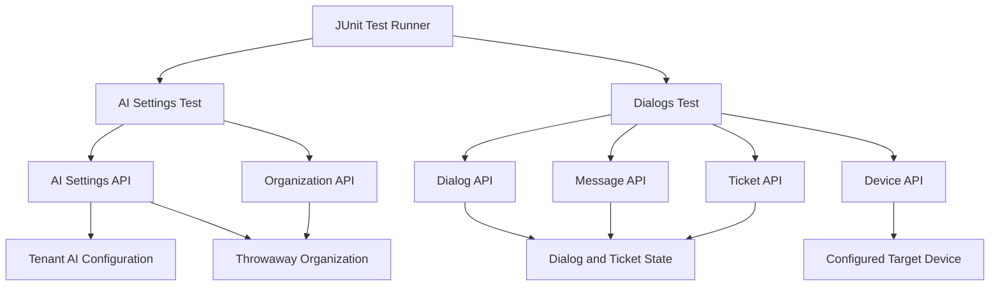
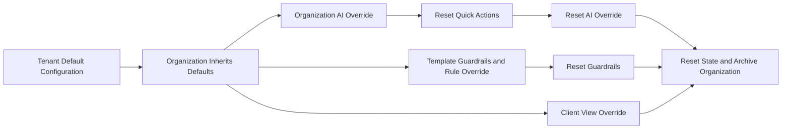
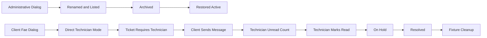

# Ai And Dialogs Tests

## Purpose

Ai And Dialogs Tests is an ordered, SaaS-tagged end-to-end test slice from the `openframe-test-service-core` library. It validates two related administrative experiences without duplicating the implementation of the OpenFrame services:

- tenant and organization-level AI assistant configuration, client presentation overrides, guardrails, supported models, and non-destructive connection checks;
- dialog lifecycle operations, including search and status filtering, archiving, Fae handoff to technicians, unread-message ownership, and resolution.

The code is supplied by [OpenFrame OSS Library](https://github.com/flamingo-stack/openframe-oss-lib) artifact `com.openframe.oss:openframe-test-service-core` and is run by this repository's `openframe-test` service. The suite uses JUnit 5 ordering because later scenarios intentionally consume fixtures and state produced by earlier scenarios.

## Scope and Safety Model

Both tests operate on live tenant APIs, but isolate their mutations:

- `AiSettingsTest` writes tenant-wide assistant configurations back unchanged, creates a unique throwaway organization for organization-specific override tests, and resets every override before archiving that organization.
- `DialogsTest` stamps created titles and messages with a unique run identifier, restores the administrator authentication context after each case, and cleans up its administrative and client dialog fixtures.
- The AI configuration save test is further limited to a pipeline-registered tenant and only runs when no unreadable tenant API key would need to be preserved.

## Architecture Overview

## Execution Characteristics

| Concern | Behaviour |
| --- | --- |
| Test class tags | Both classes are tagged `saas`; individual feature scenarios are tagged `feature`. |
| Ordering | `@TestMethodOrder(OrderAnnotation.class)` turns each class into a deliberate workflow rather than a set of independent cases. |
| Conditional infrastructure | Dialog handoff scenarios require a configured target machine. AI saving requires a pipeline-registered tenant. Assumptions skip dependent cases when prerequisites are unavailable. |
| Authentication context | Dialog scenarios temporarily use an agent session to send a client-side message, then release it so subsequent calls act as an administrator. |
| Cleanup | Cleanup uses raw reset or archive operations so temporary state is removed even if a prior assertion fails. |

## Test Areas

### AI Settings

The AI settings workflow validates default resolution and round-trip preservation for the admin and client assistants. It then proves that an organization can override and partially update its client view, assistant model and prompt, quick actions, and guardrails, before returning each setting to tenant inheritance. It also checks that provider/model discovery is internally consistent, validates a failed test connection with a fake key, and protects persisted credentials during the optional save scenario.

Key invariants include:

- assistant provider, model, answer style, prompts, quick actions, and stable quick-action identifiers survive an unchanged write-back;
- invalid models and unknown guardrail templates return user errors without creating an override;
- reset operations are idempotent and restore inheritance rather than merely deleting visible fields;
- a connection test has no persistence side effect.

### Dialogs

The dialog workflow begins with an administrative dialog and covers rename, scoped listing, full-text search, aggregate statistics, archival, and restoration. When a target device is available, it also creates a client-side Fae dialog, changes it to direct technician mode, coordinates the backing ticket into a technician-required state, verifies that a client message becomes unread only on the technician side, marks it read, and transitions the dialog through on-hold and resolved states.

The device-backed segment deliberately verifies authorization perspective: the message is sent inside an `AgentSession`, read there as the sender, then read as the administrator after the session is released.

## State Flows

### Organization AI Override Lifecycle

### Dialog Handoff Lifecycle

## Detailed Test Areas

- [Ai Settings](ai-and-dialogs-tests/ai_settings/ai_settings.md) documents the ordered tenant and organization AI configuration, guardrail, model-discovery, and connection-test workflow.
- [Dialogs](ai-and-dialogs-tests/dialogs/dialogs.md) documents the administrative dialog lifecycle and device-backed Fae handoff workflow.

## Maintainer Notes

- Preserve method order and prerequisite guards when adding a scenario. The classes use static fixture fields to carry state across ordered cases.
- Use the per-run identifier for any searchable or user-visible fixture text to avoid collisions in shared tenants.
- Keep tenant-wide AI mutations behaviour-neutral unless the test is explicitly restricted to a tenant created for the pipeline.
- For device-dependent cases, always close the agent session in both the normal path and recovery hooks so bearer state cannot leak into another test.
- The library source files are [AiSettingsTest.java](https://github.com/flamingo-stack/openframe-oss-lib/blob/7a766f00e4f58b5d89db007b878ac8d6e0c344f4/openframe-test-service-core/src/main/java/com/openframe/test/tests/AiSettingsTest.java) and [DialogsTest.java](https://github.com/flamingo-stack/openframe-oss-lib/blob/7a766f00e4f58b5d89db007b878ac8d6e0c344f4/openframe-test-service-core/src/main/java/com/openframe/test/tests/DialogsTest.java).
