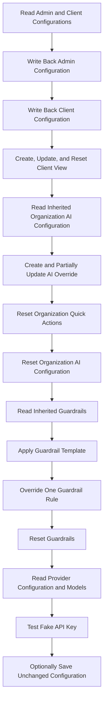

# Ai Settings

## Responsibility

Ai Settings documents the `AiSettingsTest` end-to-end workflow. The test is implemented in the OpenFrame OSS Library's [`AiSettingsTest.java`](https://github.com/flamingo-stack/openframe-oss-lib/blob/7a766f00e4f58b5d89db007b878ac8d6e0c344f4/openframe-test-service-core/src/main/java/com/openframe/test/tests/AiSettingsTest.java) and exercises tenant defaults plus organization-specific configuration through `AiSettingsApi` and `OrganizationApi`.

## Ordered Workflow

## Configuration Coverage

### Tenant Assistant Configurations

The test reads the admin and client `AgentAiConfig` records and checks that agent types differ, provider and model are set, provider names are one of Anthropic, OpenAI, or Google Gemini, and any answer style is recognized. A configuration without an identifier is treated as a synthetic default and must not claim persistence metadata.

It writes each assistant configuration back using an echo input. The round trip preserves assistant type, provider/model, answer style, prompt, quick-action default state, action contents, and quick-action identifiers. A successful write must return a persisted configuration.

### Organization Client View and AI Override

A unique organization is created for the test. The suite confirms its initial inherited state, then validates:

- creation and partial update of a client-view override, including assistant name, theme, and accent color;
- reset semantics and harmless repeated resets;
- inherited client assistant values before customization;
- rejection of a model not offered by the selected provider;
- creation of an organization-specific provider/model, answer style, custom prompt, and quick action;
- partial update semantics, including survival of untouched quick-action identifiers;
- a quick-actions-only reset that retains the rest of the organization override;
- a full reset that restores tenant inheritance and removes override timing metadata.

### Guardrails

The guardrail sequence reads the inherited policy, requires materialized rules to have natural keys and recognized approval levels, then rejects an unknown template without persisting state. It selects a tenant template, materializes it for the organization, changes one operation's approval level, and verifies all other rules retain their template values. A final reset restores the tenant guardrails.

### Provider Configuration

The test reads the active AI provider configuration and supported models. It confirms that the active provider/model pair is offered, including the fallback case where a synthetic client assistant config derives from the active provider configuration.

A fake key connection test must fail with an explanatory message, identify the attempted provider and model, and leave stored configuration and key-presence state unchanged. A malformed request without a model must receive HTTP 400. The final save case is guarded: it only runs on a registered pipeline tenant and only where no tenant-specific key must be echoed.

## Fixture and Cleanup Contract

Static fields retain the throwaway organization and each expected intermediate representation across the ordered methods. Dependency helpers use JUnit assumptions to skip later stages after a failed prerequisite instead of producing misleading null failures. `@AfterAll` resets the client view, AI override, and guardrails with raw calls before archiving the organization.
