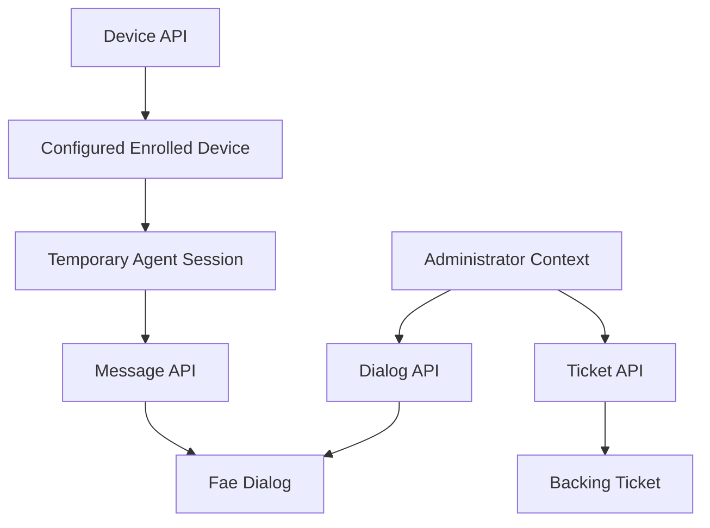
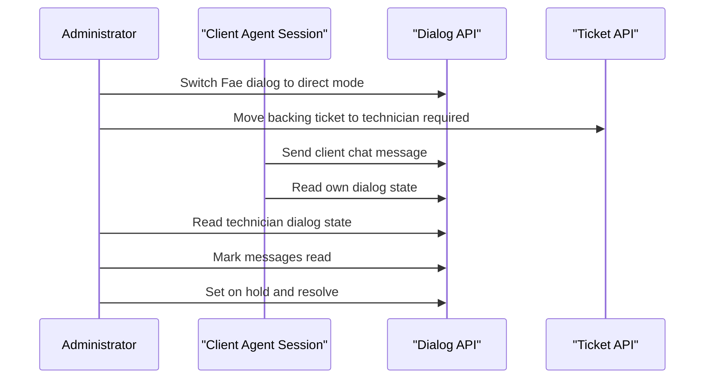

# Dialogs

## Responsibility

Dialogs documents the `DialogsTest` end-to-end workflow. The test is implemented in the OpenFrame OSS Library's [`DialogsTest.java`](https://github.com/flamingo-stack/openframe-oss-lib/blob/7a766f00e4f58b5d89db007b878ac8d6e0c344f4/openframe-test-service-core/src/main/java/com/openframe/test/tests/DialogsTest.java). It uses dialog, message, ticket, and device APIs to verify administrative dialog operations and the client-to-technician handoff path for a Fae dialog. No AI provider call is required.

## Test Topology

## Administrative Dialog Lifecycle

The first scenarios create an administrative dialog fixture and attach a run-unique title. They assert that the renamed dialog appears in the caller's active list and in a title search, while status filters only return matching statuses. The statistics scenario ensures a total count, valid per-status counts, a bounded sum, and formatted average resolution-time output.

The archive sequence proves that the dialog disappears from the active result set, appears under archived status, and returns to active after unarchiving without changing its identifier.

## Fae Handoff and Read-State Semantics

The remaining scenarios require a configured target machine. The test discovers the configured device, opens an agent session verified through SSH, and creates a client dialog tied to that machine. It then obtains the backing ticket and performs this lifecycle:

The test distinguishes the two principals explicitly. The client sender observes no unread messages on its own side. After the agent bearer is released, the administrator sees exactly one unread message. Marking messages read is verified as persisted and idempotent.

Status updates preserve direct mode. Setting `ON_HOLD` leaves the dialog unresolved, while setting `RESOLVED` creates a resolution timestamp and remains observable through a subsequent GraphQL read.

## Context Recovery and Cleanup

`releaseAgent` closes the temporary `AgentSession`. It is called both in the test body and in `@AfterEach`, ensuring a failure while impersonating the agent cannot leak its bearer token into an administrative case. `@AfterAll` cleans the administrative dialog and invokes the client fixture cleanup, which resolves and archives the related ticket and archives its dialog.

Dependent cases use assumptions: absent device configuration, missing enrolled machine, or a failed direct-mode setup skip later device-backed assertions with a diagnostic rather than treating absent state as product failure.
