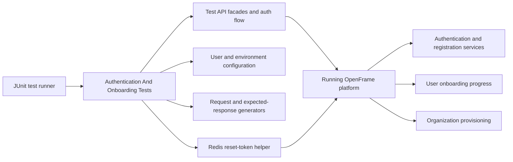
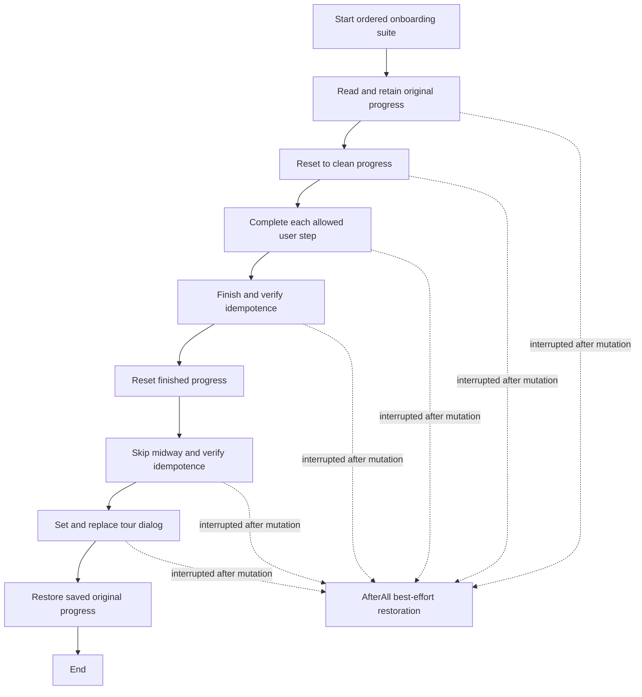
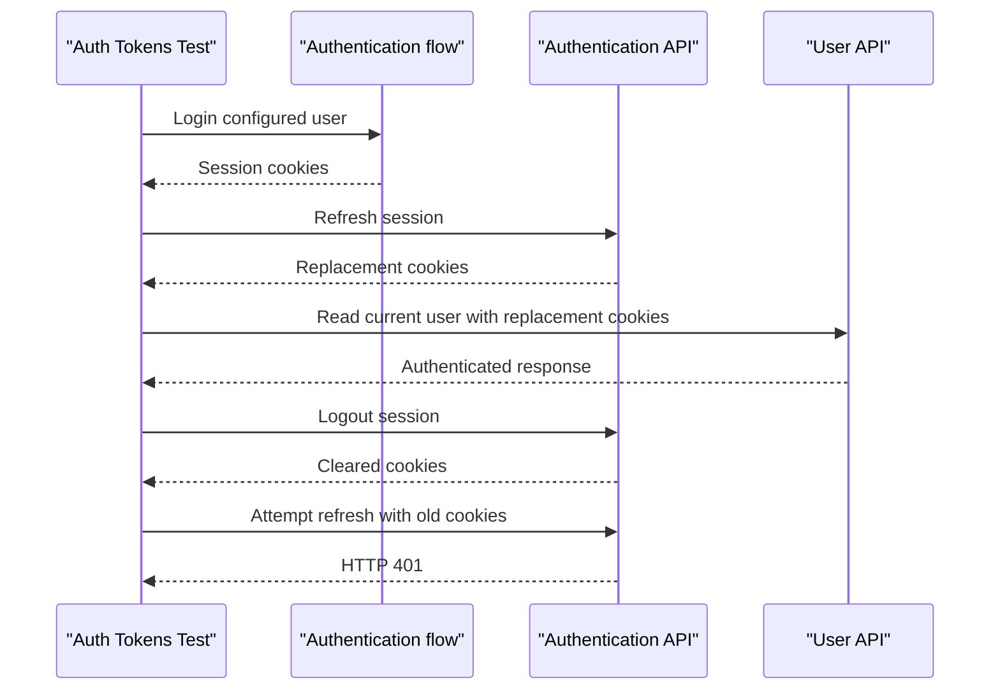
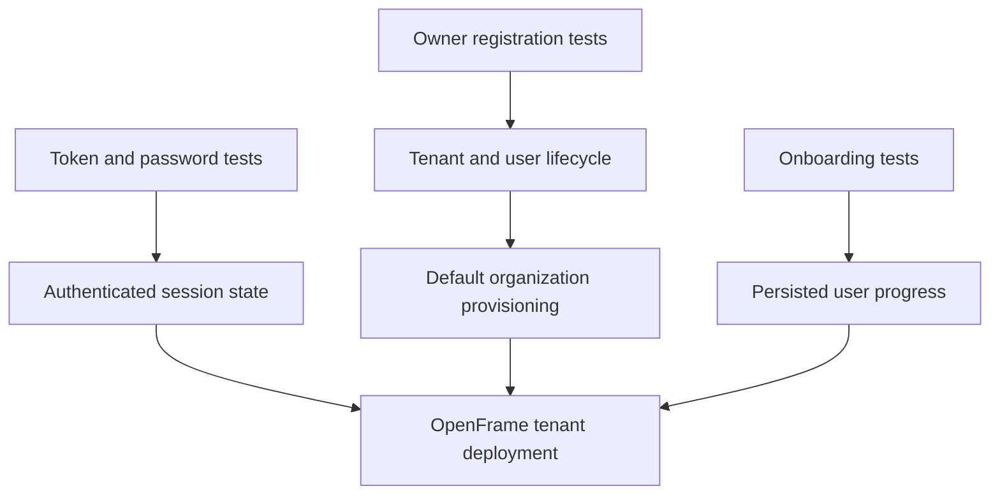

# Authentication And Onboarding Tests

Authentication And Onboarding Tests is the end-to-end test slice that verifies the account lifecycle around tenant-owner registration, browser-session authentication, token renewal and revocation, password recovery, and a signed-in user's Get Started progress. The five JUnit test classes are supplied by the `com.openframe.oss:openframe-test-service-core` library and are run by this repository's OpenFrame test service. They exercise APIs and the deployed data stores rather than duplicating authorization-server or onboarding implementation logic.

## Scope and execution model

The module deliberately mixes tests with different eligibility tags:

| Test class | Tags | Primary contract |
| --- | --- | --- |
| [Auth Tokens Test](https://github.com/flamingo-stack/openframe-oss-lib/blob/7a766f00e4f58b5d89db007b878ac8d6e0c344f4/openframe-test-service-core/src/main/java/com/openframe/test/tests/AuthTokensTest.java) | `oss`, `feature`, `token`, `logout` | Refreshing an authenticated session preserves access, while logout clears cookies and invalidates refresh use. |
| [Onboarding Test](https://github.com/flamingo-stack/openframe-oss-lib/blob/7a766f00e4f58b5d89db007b878ac8d6e0c344f4/openframe-test-service-core/src/main/java/com/openframe/test/tests/OnboardingTest.java) | `saas`, `onboarding`, `feature`, `read`, `negative` | User-scoped Get Started progress is valid, ordered, idempotent where expected, and restored after the suite. |
| [Owner Registration Test](https://github.com/flamingo-stack/openframe-oss-lib/blob/7a766f00e4f58b5d89db007b878ac8d6e0c344f4/openframe-test-service-core/src/main/java/com/openframe/test/tests/OwnerRegistrationTest.java) | `registration`, `login` | A new owner registration produces a tenant, can authenticate, and receives a default organization. |
| [Owner Registration Negative Test](https://github.com/flamingo-stack/openframe-oss-lib/blob/7a766f00e4f58b5d89db007b878ac8d6e0c344f4/openframe-test-service-core/src/main/java/com/openframe/test/tests/OwnerRegistrationNegativeTest.java) | `oss`, `registration-negative` | Closed registration and duplicate owner email attempts are rejected with an error status. |
| [Reset Password Test](https://github.com/flamingo-stack/openframe-oss-lib/blob/7a766f00e4f58b5d89db007b878ac8d6e0c344f4/openframe-test-service-core/src/main/java/com/openframe/test/tests/ResetPasswordTest.java) | `reset` | A reset token permits a password change and authenticates the user, while an invalid token returns the expected error. |

The `oss` and `saas` labels are not interchangeable: token and negative registration coverage is marked for OSS, while the personal Get Started journey is marked for SaaS. Test selection must therefore retain the tags expected by the target deployment.

## Architecture overview

The tests compose API facades, test configuration and generators from OpenFrame OSS Library. The system under test includes the authorization, user, tenant, organization, registration, and onboarding capabilities exposed by the running OpenFrame deployment. Password-reset verification additionally reads the generated token through the test Redis helper.

### Test isolation and lifecycle

The owner-registration suite is an ordered bootstrap sequence. Its `BeforeAll` setup randomizes the environment and user configuration. On successful registration, it writes the registered tenant identity into `PipelineContext`; later end-to-end tests can then target that tenant. A failed registration does not publish the tenant context.

Onboarding is also ordered because it intentionally mutates the currently signed-in user's persisted progress. It reads and saves the original state before changes, runs the progression scenarios, restores the original state as its final ordered test, and has an `AfterAll` best-effort restoration path if an earlier test interrupts the sequence. This makes the suite safe to run against a non-empty user record while still ensuring its assertions have a known clean state.

## Component responsibilities

### Session and token coverage

`AuthTokensTest` obtains a configured user, discovers that user's tenant where the tenant-aware variation is being tested, and logs in through `AuthFlow`. It verifies both refresh variants:

- A refresh with a discovered tenant identifier returns cookies different from the login cookies.
- A refresh without a tenant identifier also returns changed cookies.
- In both cases, those returned cookies are installed through `AuthHelper`, and the user identity check reports an authenticated session.

The logout scenarios use the same two contextual variants. They require the returned cookies to equal `AuthGenerator.clearedCookies()` and prove that attempting to refresh with the pre-logout cookies receives HTTP `401`. Together, these assertions distinguish replacement of active credentials from merely returning a successful logout response.

### Owner registration coverage

`OwnerRegistrationTest` verifies the positive initial-tenant path in three ordered operations:

1. Build a randomized user request and submit registration.
2. Compare the response with the generated expectation while excluding server-assigned identifiers, timestamps, plan, and HubSpot identifier fields. It still requires a non-null registration ID, owner ID, and update timestamp.
3. Authenticate as the new owner and confirm the current-user response is authenticated.
4. Query active organizations and require the default organization collection to be non-empty.

The paired `OwnerRegistrationNegativeTest` ensures that registration cannot bypass two gates: closed registration and an email already assigned to an owner. It identifies an existing owner through `UserApi`, generates an existing-user request, and requires each attempted registration to return a status code of at least 400. These are intentionally broad rejection assertions rather than assertions tied to a particular implementation status code.

### Password recovery coverage

`ResetPasswordTest` drives a valid recovery request for the configured user, obtains the token through the test-only `Redis` helper, builds a confirmation request, and confirms it. It updates the in-memory user password to the new password before asserting that the current-user response is authenticated. This reflects the expected post-reset login state of the test session.

The negative case submits a confirmation built from the literal invalid token. It expects the response to match the generator's canonical invalid-token error response, protecting both token validation and its public error contract.

### Personal onboarding coverage

`OnboardingTest` exercises the user-level Get Started progress model, whose permitted steps are:

- `MEET_MINGO`
- `DEVICES`
- `TICKETS`
- `SCRIPTING`
- `MONITORING`
- `LOGGING`
- `INCIDENTS`
- `KNOWLEDGE_MANAGEMENT`

It verifies the following invariants:

- Reads return a non-null completion list and flags, contain no duplicate steps, and include only the permitted user-step values.
- A reset clears completed steps, completion and skip flags, both timestamps, and the remembered tour dialog.
- Completing every valid step accumulates precisely those steps but does not automatically finish the flow.
- Completing a previously completed step is idempotent.
- The tenant-only `MSP_SETUP` value is rejected as a top-level GraphQL error and does not alter user progress.
- Explicit finish sets `completed` and a near-current `completedAt` timestamp, preserves steps, and keeps the first timestamp on repeated finish.
- Explicit skip preserves work already completed, sets `skipped` and `skippedAt`, does not set completion, and keeps the first timestamp on repeated skip.
- Setting a tour dialog stores its identifier, a later call replaces it, and reset removes it.
- Mutation responses agree with a fresh read, comparing stored timestamps at millisecond precision to avoid false failures from serialization precision.

The test permits two minutes of local-to-server clock skew when checking newly recorded timestamps. This is a bounded assertion of call-time behavior, not an exact equality check between machines.

## System fit

This module provides acceptance-level verification across several OpenFrame tenant services. The test library is an upstream dependency of this repository, pinned in the tenant build as `com.openframe.oss:openframe-test-service-core` version `7.0.11`. The application services and their runtime configuration are assembled by this repository; the reusable test classes, API wrappers, data transfer objects, and generators originate in OpenFrame OSS Library.

## Maintenance guidance

- Preserve method ordering in the registration and onboarding classes. Their assertions and cleanup depend on prior state transitions.
- Keep onboarding cleanup aligned with every new mutation introduced into the suite. Any field changed during a run must be captured and restored both in the final ordered test and in the `AfterAll` fallback.
- When adding onboarding steps, update the permitted step list and all assertions that expect the complete set. Do not accept tenant-only setup values as user steps.
- Retain both tenant-aware and tenantless authentication checks where the product supports both contexts.
- Do not narrow the negative registration checks to a specific HTTP status unless the public contract guarantees that exact status across deployments.
- Password-reset tests depend on test access to the reset token in Redis. Ensure this helper remains isolated to test infrastructure and is not treated as a production client flow.
