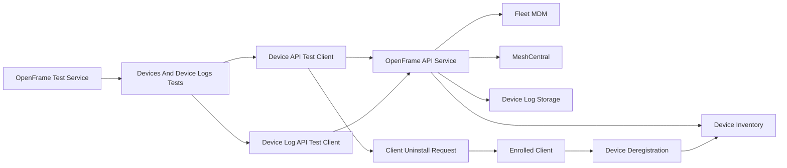
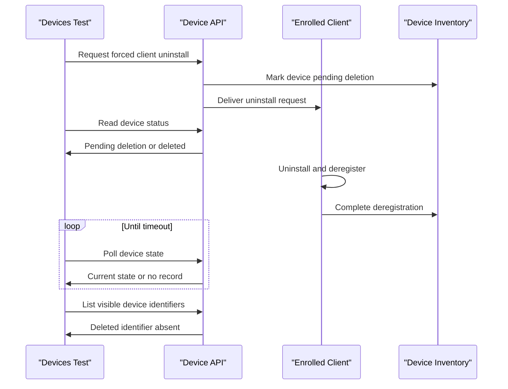
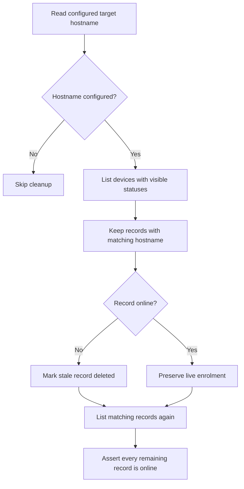

# Devices And Device Logs Tests

Devices And Device Logs Tests is the device-focused end-to-end verification suite supplied by the `com.openframe.oss:openframe-test-service-core` library. This repository runs that library through its OpenFrame test service. The module verifies the observable device-management and device-log contracts against a running tenant, including device inventory, Fleet and MeshCentral integration data, safe lifecycle actions, log querying, and cleanup of obsolete enrolments.

The suite is implemented in three test classes from OpenFrame OSS Library:

- [`DevicesTest`](https://github.com/flamingo-stack/openframe-oss-lib/blob/7a766f00e4f58b5d89db007b878ac8d6e0c344f4/openframe-test-service-core/src/main/java/com/openframe/test/tests/DevicesTest.java) verifies device discovery, detail records, inventory integrations, filtering, nicknames, and the dashboard-driven uninstall lifecycle.
- [`DeviceLogsTest`](https://github.com/flamingo-stack/openframe-oss-lib/blob/7a766f00e4f58b5d89db007b878ac8d6e0c344f4/openframe-test-service-core/src/main/java/com/openframe/test/tests/DeviceLogsTest.java) verifies the GraphQL device-log read contract and its validation boundaries.
- [`StaleDeviceCleanupTest`](https://github.com/flamingo-stack/openframe-oss-lib/blob/7a766f00e4f58b5d89db007b878ac8d6e0c344f4/openframe-test-service-core/src/main/java/com/openframe/test/tests/StaleDeviceCleanupTest.java) prevents accumulated historical enrolments of the pipeline machine from making hostname-based device targeting ambiguous.

## Scope And Test Boundaries

This module is an integration suite, not a unit-test suite. Its assertions depend on tenant data and connected services. Most device and log checks are tagged `saas` and `feature`; read-only inventory checks also carry the `read` tag. The cleanup case is tagged `oss` and `stale-devices`. The dashboard delete case is tagged `archive` because it requests a real agent uninstall and waits for deregistration.

The tests intentionally use seeded or enrolled tenant state:

- A Windows machine named `vm115982` is expected for the tag and device-log scenarios that require a specific enrolled device.
- Device details are expected to expose both `MESHCENTRAL` and `FLEET_MDM` tool connections.
- Log assertions require at least one tenant log line. The log suite widens its pinned query from 24 hours to 30 days if the default window is empty.
- Destructive and mutable device actions are constrained to the pipeline organization when one is present, and nickname changes are restored after verification.

## Architecture Overview

At runtime, `DeviceApi` provides the device-facing operations used by all three classes. It reads the device list and individual machine records, retrieves Fleet and MeshCentral detail, updates nicknames, changes a device to `DELETED`, and initiates forced client uninstalls. `DeviceLogApi`, used only by `DeviceLogsTest`, queries log connections and collects GraphQL error responses for invalid input assertions.

## Component Responsibilities

| Component | Primary responsibility | Key guarantees exercised |
|---|---|---|
| `DevicesTest` | Validates the device inventory and management experience. | Filter metadata and counts are populated; device records contain identity, status, operating-system, timestamps, organization, tools, and installed-agent data. |
| `DeviceLogsTest` | Validates tenant-wide and device-scoped device-log queries. | Newest-first ordering, inclusive time bounds, filter semantics, cursor paging, defaults, and GraphQL validation errors. |
| `StaleDeviceCleanupTest` | Retires stale rows for the configured pipeline hostname. | Only non-online records matching the target hostname are marked deleted; current online enrolments remain. |

## Device Inventory And Management Coverage

`DevicesTest` treats the device API as the contract behind the device list and details views.

### Inventory And Filter Contracts

The test obtains `DeviceFilters` and requires non-empty status, operating-system, and organization facets. For each first facet item, it checks a non-null value and label plus a non-zero count. It also requires a non-zero aggregate filtered count. This detects incomplete filter payloads rather than merely checking that the endpoint responds.

The device-detail scenario selects an online or offline device, then reads it by machine identifier and requires:

- Machine identity, hostname, agent version, status, type, operating system, registration time, update time, last-seen time, and organization identifier.
- At least one tool connection, including both MeshCentral and Fleet MDM connection types.
- Installed-agent records with both agent type and version.

Search and filtering checks add two focused guarantees:

- A hostname returned from the listed-device query can be used to find the corresponding device.
- An operating-system filter for `WINDOWS` returns only Windows records.
- The seeded `purpose:auto_test` tag returns the expected `vm115982` machine, and every returned row actually contains the requested key and value. The final assertion prevents a false positive in which a filter yields the expected count but incorrect rows.

### Fleet And MeshCentral Detail Coverage

A device must resolve to both integration identifiers. The Fleet MDM check requires host identity, hardware vendor/model/serial, processor attributes and core counts, memory, uptime, disk capacity, users, and software. When vulnerabilities are reported, every vulnerability must include a CVE, details link, creation timestamp, and software name.

The MeshCentral check requires the returned node identifier to equal the requested Mesh identifier and requires a positive last-connect time plus a non-blank last-connect address.

### Nickname Mutation And Restoration

The nickname test scopes its target to the pipeline organization when possible. It records the original nickname, writes a unique temporary nickname, verifies both the mutation response and a later read, clears the nickname using `null`, verifies the cleared state, and restores the original value in a `finally` block. Restoration occurs even when an intermediate assertion fails.

### Dashboard Delete Lifecycle

The `archive` test exercises the same lifecycle used by dashboard deletion. It chooses an online or offline pipeline-scoped device, checks the selected device belongs to the pipeline organization before the destructive request, and issues a force-client-uninstall request.

The test accepts an immediate `DELETED` state as well as the initial `PENDING_DELETION` state, then polls for up to 300 seconds. A successful end state is either a `DELETED` record or an unavailable record; if a record remains, it must be `DELETED`. Finally, the machine identifier must not appear in the normal listed-device query.

## Device Log Query Coverage

`DeviceLogsTest` uses ordered JUnit cases because later cases reuse the non-empty, fixed tenant window established by the first case. This stabilizes filter and paging assertions against a moving stream of log events.

### Tenant Window And Connection Shape

With no machine list or filter, the API defaults to at most 100 lines from the preceding 24 hours. Entries must be newest first and the first page cannot have a previous page. The test pins a second query ending at the current second; it uses a 24-hour range when defaults returned data, otherwise widens to the allowed 30-day range. The pinned response must:

- Contain at least one line within inclusive `from` and `to` bounds.
- Be sorted newest first by ingestion timestamp.
- Use only `DEBUG`, `INFO`, `WARN`, or `ERROR` levels.
- Provide a non-null message for every entry.
- Provide non-blank edge cursors, with page start and end cursors equal to the first and last edge cursors.

### Filters, Pagination, And Defaults

The suite derives a level and a word from the pinned data instead of assuming a particular log message. It then verifies that:

- A requested level returns only that level, while the complementary set never returns it.
- `contains` and `excludes` compare text case-insensitively.
- Search terms are literal, confirmed with `.*`, which must not behave as a regular expression.
- A five-line first page has no previous page and exposes a next page when enough data exists.
- A second page obtained from the first page's end cursor has a previous page, does not overlap the first page, and starts strictly older than the first page's oldest timestamp. The timestamp rule confirms that a timestamp group is not split across page boundaries.
- A query scoped to a device defaults to seven days rather than the tenant-wide 24-hour default, returns only that machine identifier, and preserves its hostname when present.
- The deprecated single-machine argument still narrows the result to that same device, preserving compatibility coverage.

### Input Validation Contract

The suite submits invalid queries through an error-collecting API helper and asserts explicit GraphQL codes rather than accepting silent fallback behavior.

| Invalid request | Expected result |
|---|---|
| Range longer than 30 days | `VALIDATION_ERROR` and a message naming the 30-day limit. |
| `from` later than `to` | `VALIDATION_ERROR`. |
| Empty machine identifier list | `VALIDATION_ERROR`; callers must omit the list for a tenant-wide read. |
| More than 50 machine identifiers | `VALIDATION_ERROR`. |
| Unknown machine identifier | `DEVICE_NOT_FOUND`. |
| More than five `contains` terms | `VALIDATION_ERROR`. |
| An `excludes` term longer than 256 characters | `VALIDATION_ERROR`. |
| Malformed cursor | `VALIDATION_ERROR`, not a restart at the first page. |

## Stale Enrolment Cleanup

Every pipeline execution can enrol the same physical machine again. Historical records sharing the target hostname make assistants and operators unable to identify a device safely. `StaleDeviceCleanupTest` addresses only that narrow condition.

The cleanup test skips when no target hostname is configured. Otherwise, it lists only records whose hostname matches case-insensitively, marks non-online records deleted through `DeviceApi.deleteDevice`, re-reads the matching rows, and asserts that every remaining row is online. It deliberately does not remove unrelated offline devices in the shared tenant and does not remove any online duplicate, because a second active machine with the same hostname requires human review.

## Maintenance Notes

- Keep device-log test cases ordered. The filters and paging tests depend on the first case establishing `windowFrom`, `windowTo`, and a non-empty tenant page.
- Preserve the five-minute clock-skew allowance in default-window assertions; the test runner and API service clocks can differ.
- Do not change the cleanup scope from target hostname plus non-online state without a separate safety review. Broad cleanup can retire user-managed devices in a shared tenant.
- Any new destructive device scenario should retain the pipeline-organization guard used by the dashboard deletion test and should restore mutable state where restoration is possible.
- If the seeded Windows hostname, tags, or integration expectations change, update the test fixture and the corresponding assertions together.
