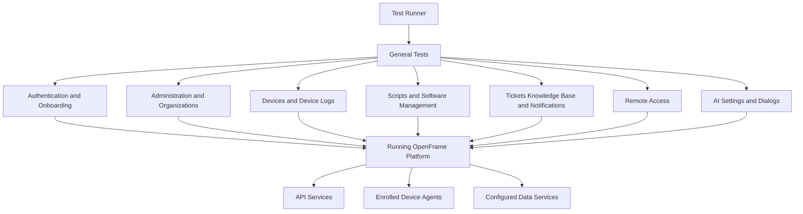
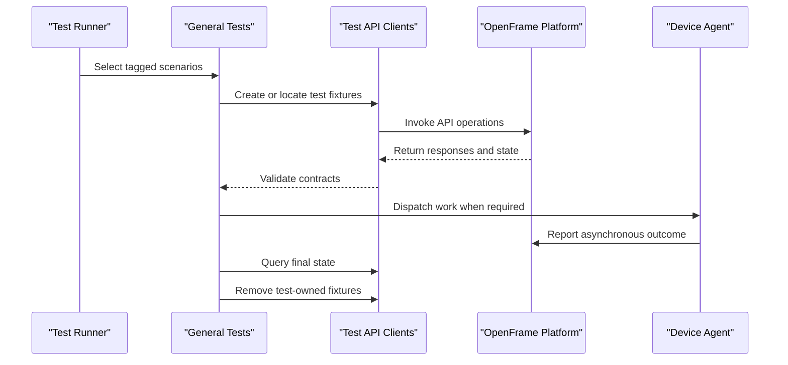

# General Tests

General Tests is the end-to-end contract-test collection supplied by the `com.openframe.oss:openframe-test-service-core` dependency. The tenant repository runs these scenarios through its OpenFrame test service against a deployed OpenFrame environment.

The module verifies observable platform behavior across administration, authentication, device management, scripts, software, remote access, tickets, knowledge base content, notifications, AI settings, and operational integrations. It is a verification layer: it drives public test API clients and validates returned state rather than implementing production service behavior.

## Architecture

The test runner selects scenarios by JUnit tags and executes API-driven test classes. Stateful scenarios use ordered execution, run-scoped fixture names, assumptions for optional infrastructure, and best-effort cleanup to limit residue in shared tenant environments.

## Core Components

| Component group | Representative test classes | Responsibility |
|---|---|---|
| Administration | `AdminFixtureTest`, `UserInvitationsTest`, `UserTest` | Establishes reusable administrator fixtures and verifies invitation, user, and tenant ownership behavior. |
| Authentication | `AuthTokensTest`, `OwnerRegistrationTest`, `ResetPasswordTest`, `OnboardingTest` | Verifies registration, sessions, refresh tokens, logout, password recovery, and onboarding state. |
| Organizations and assignments | `OrganizationsTest`, `AssignmentsTest` | Covers organization lifecycle, tenant-scoped fixtures, and assignment target behavior. |
| Devices | `DevicesTest`, `DeviceLogsTest`, `StaleDeviceCleanupTest` | Validates device inventory, integrations, logs, lifecycle actions, and safe stale-enrollment cleanup. |
| Automation | `ScriptsTest`, `ScriptScheduleTest`, `SoftwareBundleTest`, `SoftwareActionHistoryTest` | Exercises script execution, schedules, package discovery, software bundles, and execution history. |
| Remote access | `RemoteAccessPolicyTest`, `RemoteAccessSessionTest` | Verifies policy resolution, request approval, session lifecycle, and audit behavior. |
| Support workflows | `TicketsTest`, `TimeTrackingTest`, `KnowledgeBaseTest`, `NotificationsTest` | Covers ticketing, time entries, knowledge-base content, tags, logs, and notification settings. |
| AI and dialogs | `AiSettingsTest`, `DialogsTest` | Validates AI configuration inheritance, guardrails, dialog workflows, and technician handoff behavior. |
| Platform support | `IntegratedToolsTest`, `StatsTest`, `FrontendSupportTest` | Covers integrated-tool queries, frontend session support, and the disabled diagnostic statistics collector. |

## Test Execution Flow

## Component Documentation

The General Tests area is organized into focused documentation for these test slices:

- **Admin Fixture and User Management** — administrator setup, invitation lifecycle, user operations, and ownership transfer.
- **Authentication and Onboarding Tests** — owner registration, authentication tokens, password reset, and user progress.
- **Policy Management Tests** — Fleet policy workflows and API-key lifecycle coverage.
- **Organization and Assignments Tests** — organization lifecycle and knowledge-base assignment targets.
- **Devices and Device Logs Tests** — device inventory, integrations, log query behavior, and stale-record cleanup.
- **Scripts and Execution Tests** — script catalog, dispatch, schedules, targeting, and execution history.
- **Software Management Tests** — package search, bundle dispatch, software actions, inventory, and vulnerability views.
- **Remote Access and Policy Tests** — effective access mode resolution and remote-session workflows.
- **AI and Dialogs Tests** — AI settings, organization overrides, dialogs, and client-to-technician handoff.
- **Knowledgebase and Tags Tests** — knowledge-base articles, attachments, folders, and reusable tag definitions.
- **Logs and Notifications Tests** — audit-log exploration, notification inbox behavior, and frontend support calls.
- **Tickets and Time Tracking Tests** — ticket lifecycle, notes, attachments, statuses, timers, and manual entries.
- **Stats and Support Tests** — integrated-tool registry coverage and the disabled operating-system statistics utility.

## Runtime Context

General Tests originates in the OpenFrame OSS Library test artifact version `7.0.11`, which this repository consumes as `com.openframe.oss:openframe-test-service-core`. The tenant repository provides the runtime services, configuration, data sources, messaging infrastructure, and deployed endpoints that the scenarios exercise.