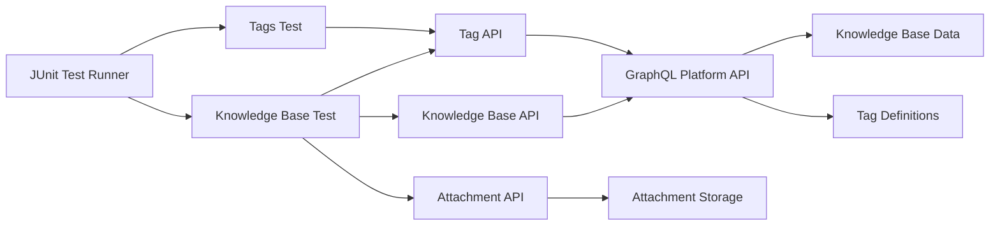
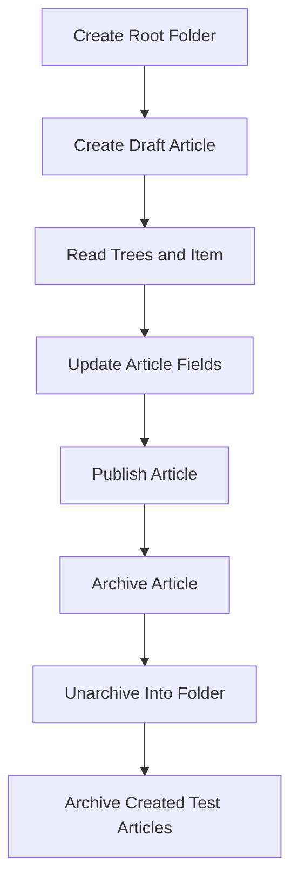
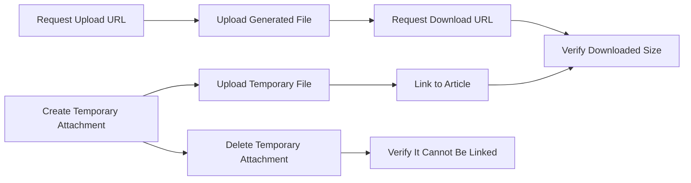

# Knowledgebase And Tags Tests

Knowledgebase And Tags Tests is an ordered end-to-end test area from the `openframe-test-service-core` library. It validates the Knowledge Base and reusable tag-definition behavior through the platform GraphQL test APIs. The library is consumed by this repository at version `7.0.11` and is run by the repository's OpenFrame test service.

The implementation is supplied by [OpenFrame OSS Library](https://github.com/flamingo-stack/openframe-oss-lib/blob/7a766f00e4f58b5d89db007b878ac8d6e0c344f4/openframe-test-service-core/src/main/java/com/openframe/test/tests/KnowledgeBaseTest.java) and [Tags Test](https://github.com/flamingo-stack/openframe-oss-lib/blob/7a766f00e4f58b5d89db007b878ac8d6e0c344f4/openframe-test-service-core/src/main/java/com/openframe/test/tests/TagsTest.java).

## Purpose

The module protects two related user-facing capabilities:

- **Knowledge Base lifecycle:** folders, draft articles, trees, reads, updates, publishing, archiving, restoration, and cleanup.
- **Attachment lifecycle:** direct and temporary uploads, download verification, linking, and deletion.
- **Tag behavior:** scoped creation, modification, entity-type filtering, key and value suggestions, article assignment, removal, invalid-reference rejection, and cleanup.

Both suites use JUnit ordered execution. This is intentional: later checks rely on records created in earlier checks. The tests verify persisted state by reading entities again after mutations rather than relying solely on mutation responses.

## Architecture Overview

## Test Design

### Ordered, stateful execution

`KnowledgeBaseTest` executes a numbered sequence. It first creates a root folder and a draft article, then validates query and mutation paths against available data. The suite creates additional records where an operation needs isolated parent and child folders or a fresh article. It archives specifically tracked articles in an `AfterAll` cleanup step, without hiding the original test failure if cleanup fails.

`TagsTest` creates a run-unique device tag, updates it, exercises filtered listings and suggestions, deletes it, and retains an `AfterAll` best-effort fallback. The run-specific key avoids collision with concurrent or previous runs.

### Assertions and boundaries

The suites check identifiers, entity types, relationships, metadata, status transitions, persisted state, and expected errors. They cover both a successful attachment download and the negative case in which a deleted temporary attachment cannot subsequently be linked. They also assert that a device tag does not leak into `SCRIPT` tag results.

## Primary Flows

### Knowledge Base article lifecycle

### Attachment lifecycle

## Components

Detailed component documentation is provided for the two independently maintained suites:

- [Knowledgebase Lifecycle](knowledgebase-and-tags-tests/knowledgebase-lifecycle/knowledgebase-lifecycle.md) documents folder, article, attachment, and article-tag scenarios.
- [Tag Definition Lifecycle](knowledgebase-and-tags-tests/tag-definition-lifecycle/tag-definition-lifecycle.md) documents device-tag editing, filtering, suggestion lookup, deletion, and cleanup.

## System Role

Knowledgebase And Tags Tests is test-only code from the OpenFrame OSS Library, not a production request handler. It validates API contracts implemented by the wider platform: Knowledge Base data is exposed through GraphQL-facing API services, while attachment upload and download URLs bridge the test API and object storage. Tag creation and lookup are shared capabilities exercised here for device tags and Knowledge Base article tags.

The suite's `feature`, `saas`, and selectively `read` JUnit tags allow a test runner to select capability or read-oriented coverage. Because the scenarios mutate platform data, environments running them must permit creation, update, archive, deletion, and file upload operations.