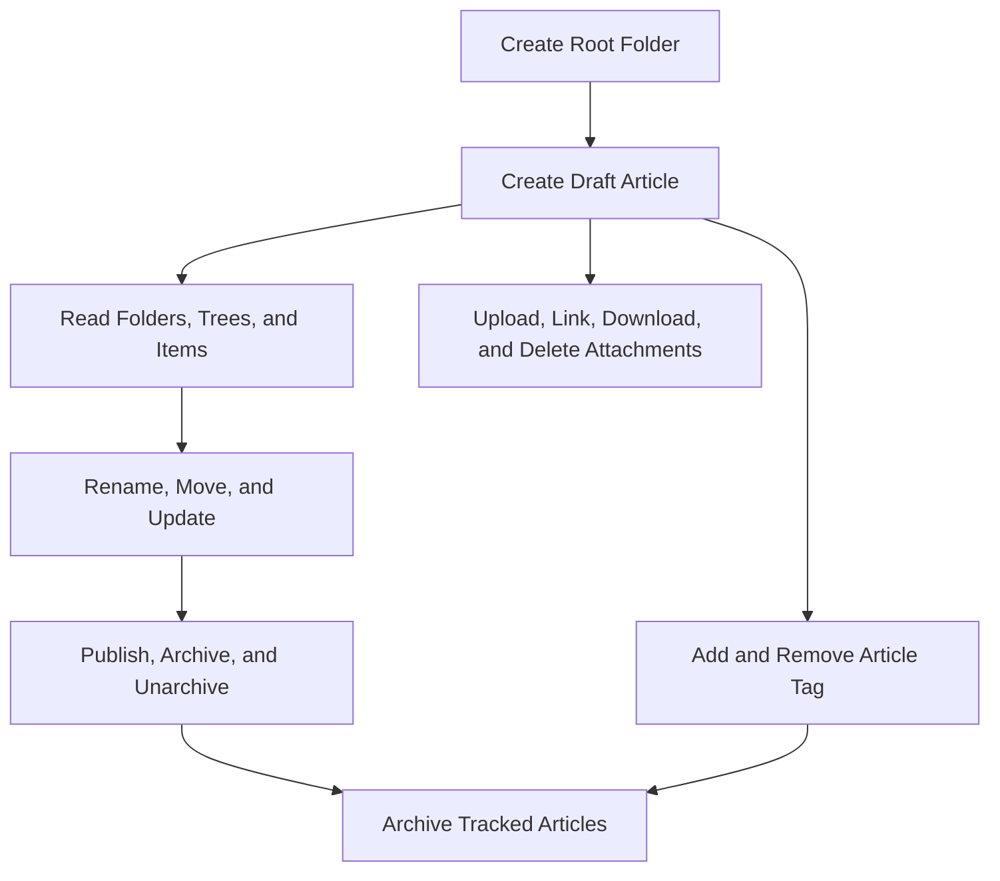

# Knowledgebase Lifecycle

Knowledgebase Lifecycle documents the `KnowledgeBaseTest` end-to-end suite from the OpenFrame OSS Library. Its source is [Knowledge Base Test](https://github.com/flamingo-stack/openframe-oss-lib/blob/7a766f00e4f58b5d89db007b878ac8d6e0c344f4/openframe-test-service-core/src/main/java/com/openframe/test/tests/KnowledgeBaseTest.java).

## Responsibility

The suite verifies the Knowledge Base GraphQL workflow as an ordered, stateful scenario. It starts by creating a root folder and draft article, then verifies read paths and mutates real records through their lifecycle. The `feature` and `saas` JUnit tags identify functional SaaS coverage, while selected checks also carry the `read` tag.

## Coverage Areas

| Area | Verified behavior |
|---|---|
| Folder structure | Creates root folders, lists root folders, reads the folder tree, renames a folder, and moves a child folder under a newly created parent. |
| Article structure | Creates a draft article, lists the article tree, fetches folder and article records by identifier, and updates article name, content, summary, and timestamp. |
| Publication state | Publishes a draft, archives an article, confirms archived-list membership, unarchives into a selected root folder, and returns a newly published article to draft state. |
| Attachments | Requests direct and temporary upload URLs, uploads generated files, downloads files, validates file size, links temporary attachments, and deletes both temporary and linked attachments. |
| Knowledge Base tags | Creates an article tag, adds and removes it, verifies global and subtree listings, and checks that an unknown tag reference is rejected. |
| Cleanup | Archives IDs of articles created for tagging and unpublishing in best-effort `AfterAll` cleanup. |

## Lifecycle Dependencies

The suite deliberately uses `@Order`. Read and mutation cases expect data established by earlier tests or retrieved through helpers such as an existing root folder, article, draft article, or article with an attachment. The move scenario avoids environment assumptions by making both its parent and child folders locally.

## Attachment Safety Checks

The direct attachment scenario asserts metadata returned when the upload URL is created, uploads the source file through `AttachmentApi`, requests a download URL, and confirms the returned byte count equals the declared file size. Temporary attachment coverage tests both sides of the state boundary:

1. A temporary object is uploaded and deleted, after which a linking request returns no linked attachment and the article does not list it.
2. A temporary object is uploaded and linked, after which the article includes its metadata and the content can be downloaded at the expected size.

## Lifecycle Invariants

- A root folder has no parent, while a moved folder reports the target parent identifier.
- Draft articles start without a publication time.
- Publishing yields `PUBLISHED`; archiving yields `ARCHIVED`; unarchiving restores an article to a supplied folder and removes the archived state.
- Updates retain the article identifier and parent while changing requested fields and the update timestamp.
- Mutations are followed by reads where persistence, not merely response shape, is significant.

The suite deletes one available root folder with the operation configured to archive its children. This makes the environment's Knowledge Base content mutable by design, so it belongs in an isolated test tenant.