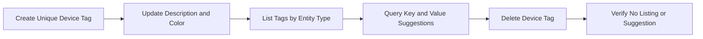

# Tag Definition Lifecycle

Tag Definition Lifecycle documents the `TagsTest` end-to-end suite from the OpenFrame OSS Library. Its source is [Tags Test](https://github.com/flamingo-stack/openframe-oss-lib/blob/7a766f00e4f58b5d89db007b878ac8d6e0c344f4/openframe-test-service-core/src/main/java/com/openframe/test/tests/TagsTest.java).

## Responsibility

The suite validates tenant-wide `DEVICE` tag-definition behavior through `TagApi`. It creates an identifier unique to the test run, edits mutable metadata, verifies entity-type isolation and picker suggestions, then deletes the tag. Its class-level `saas` tag and test-level `feature` tag support runner selection; the suggestion case is also marked `read`.

## Test Sequence

### Create and edit

A static run ID supplies a unique uppercase `E2E` key so normal reruns do not collide. The first test creates a `DEVICE` tag with a description and color, then updates only its description and color. It asserts that omission of the key preserves the original key and that the identifier remains stable.

### Scope and suggestion lookup

The suite lists tags for `DEVICE` and requires the created tag to be present. It separately queries `SCRIPT` and the scripts-specific list, requiring that the device tag is absent. This verifies entity-type partitioning.

For picker behavior, it queries all key suggestions and a prefix-filtered subset, then asserts that every prefix result contains the search prefix. A tag with no values must return an empty value suggestion list. If another available definition has values, the suite verifies that its suggestions include stored values.

### Deletion and cleanup

Deletion must return success, remove the tag from the `DEVICE` list, and remove its key from suggestions. The shared static tag reference is then cleared. An `AfterAll` fallback attempts deletion if a failure interrupted the normal delete test, but intentionally suppresses cleanup exceptions so they do not replace the test's original failure.

## Contract Invariants

| Contract | Assertion |
|---|---|
| Entity typing | A created device tag reports `DEVICE`; results from a device list are all device tags. |
| Partial update | A null key preserves the existing key while description and color change. |
| Isolation | A device tag never appears in `SCRIPT` or scripts-specific results. |
| Search | Full and prefix key lookup find the run-specific tag until deletion. |
| Deletion | The tag disappears from both the entity-type list and suggestion results. |

This test focuses on tag **definitions**. Article association is covered by Knowledgebase Lifecycle, which creates a `KNOWLEDGE_ARTICLE` definition and validates adding and removing it from a Knowledge Base article.