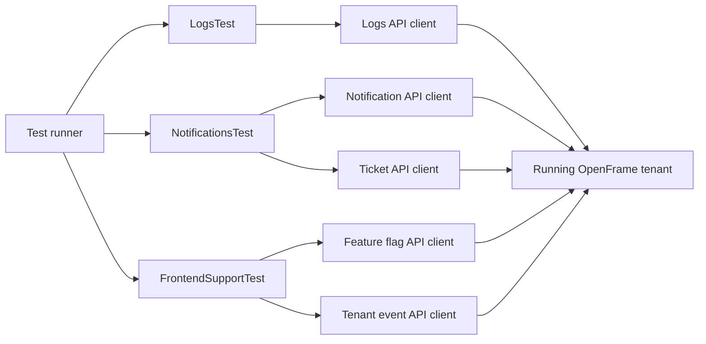
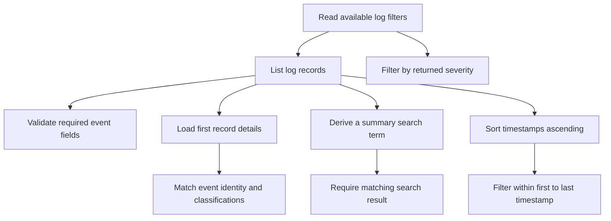
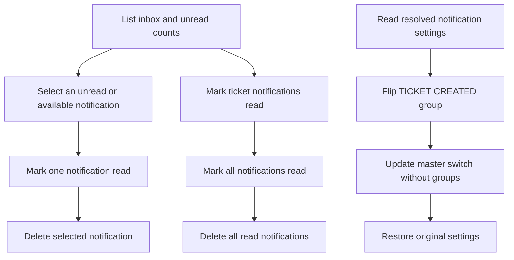
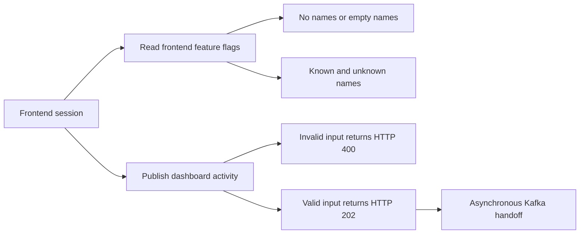

# Logs And Notifications Tests

Logs And Notifications Tests is the SaaS end-to-end coverage for three user-facing integration surfaces: log exploration, the notification inbox and preferences, and frontend session support. It is implemented by `LogsTest`, `NotificationsTest`, and `FrontendSupportTest` in the OpenFrame OSS Library's `openframe-test-service-core` artifact. This tenant repository runs that artifact through its OpenFrame test service.

The tests assert observable contracts rather than implementation details. They use the test API clients to query GraphQL-backed data, invoke notification mutations, and make REST requests for dashboard activity events. Their source is maintained in the OpenFrame OSS Library:

- [LogsTest](https://github.com/flamingo-stack/openframe-oss-lib/blob/7a766f00e4f58b5d89db007b878ac8d6e0c344f4/openframe-test-service-core/src/main/java/com/openframe/test/tests/LogsTest.java)
- [NotificationsTest](https://github.com/flamingo-stack/openframe-oss-lib/blob/7a766f00e4f58b5d89db007b878ac8d6e0c344f4/openframe-test-service-core/src/main/java/com/openframe/test/tests/NotificationsTest.java)
- [FrontendSupportTest](https://github.com/flamingo-stack/openframe-oss-lib/blob/7a766f00e4f58b5d89db007b878ac8d6e0c344f4/openframe-test-service-core/src/main/java/com/openframe/test/tests/FrontendSupportTest.java)

## Scope And Placement

All three classes extend the shared test base and carry the `saas` tag. The module therefore verifies a running tenant rather than isolated unit behavior. `NotificationsTest` also carries `post-mingo` and `notifications`, while `FrontendSupportTest` carries `frontend-support`. The individual tests add selection tags such as `feature`, `read`, `negative`, `destructive`, and `needs-notification`.

## Component Responsibilities

| Component | Responsibility | Principal coverage |
|---|---|---|
| `LogsTest` | Validates that log data can be discovered, listed, inspected, searched, filtered, sorted, and constrained by time. | Log filters; required list fields; details consistency; summary search; severity filtering; ascending timestamps; inclusive time ranges. |
| `NotificationsTest` | Exercises the signed-in user's notification inbox and per-type settings as an ordered stateful workflow. | Paging and unread counts; read/delete mutations; ticket-scoped reads; destructive bulk cleanup; settings update and restoration. |
| `FrontendSupportTest` | Covers backend calls made by the frontend shell during a session. | Feature-flag lookup semantics and dashboard activity request validation/acceptance. |

## Log Exploration Contract

`LogsTest` is a read-only feature suite. It first obtains the available tool types, event types, and severities, then uses the returned data to drive assertions instead of hard-coding a particular log source or severity.

The suite requires at least one log record and validates that every returned record exposes a tool event identifier, event type, tool type, timestamp, ingest day, and non-empty summary. It selects the first record to verify that a details query preserves its identifier, event type, and tool type. Search terms are derived from a returned summary, keeping the test aligned with available fixture data.

The timestamp checks distinguish ordering from filtering. The ascending query must be naturally sorted, while the range query must return only timestamps within the inclusive endpoints chosen from that ordered result.

## Notification Inbox And Settings Contract

`NotificationsTest` has ordered methods because later settings cases depend on state captured by the settings read case. It validates schema-like values for notification categories and severities, consistency between unread counts and the aggregate unread flag, and correctness of the read-only inbox views. The page limit used by the class is 50.

The targeted read-and-delete case requires an existing notification. It selects an unread item if possible, otherwise any inbox item, and skips through a JUnit assumption when the inbox is empty. This is intentional: users are not notified about their own actions, so the test cannot create a notification for itself. The `needs-notification` tag identifies this conditional test.

The ticket operation converts a ticket Relay identifier to its raw identifier before marking ticket notifications read. It also supports the absence of a ticket by using a generated non-existent identifier, then asserts that the operation is non-increasing for unread counts and idempotent on repeat.

The bulk inbox test is explicitly `destructive`: it marks every notification read and then deletes all read notifications, leaving the test user's inbox empty. It verifies both mutations are idempotent after their first successful application.

The settings sequence protects shared state. It reads and retains the original master switch and every group setting, toggles only `TICKET_CREATED`, verifies an update omitting type settings preserves stored overrides, then writes the original values back. An `AfterAll` cleanup performs a best-effort restoration whenever the final restoration case did not complete.

## Frontend Session Support Contract

`FrontendSupportTest` verifies two calls made by the frontend shell. Feature-flag coverage confirms that an unfiltered request returns a non-empty, duplicate-free set of named flags with non-null enabled values and includes the known `billings` flag. An empty names list must behave the same as no filter. A request for the known flag and a generated unknown flag must preserve request order, retain the known value, and resolve the unknown flag to `false`.

Dashboard activity coverage validates the REST request boundary before validating the successful path. Unsupported event types, blank subtypes, and missing repeat modes must each receive HTTP 400. A signed-in user's `DASHBOARD_ACTIVITY` request with the `skip_onboarding_main_dashboard` subtype and `SINGULAR` repeat mode must receive HTTP 202 with an empty body. The success assertion reflects asynchronous handoff to Kafka, not synchronous downstream completion.

## Execution Considerations

- The module expects seeded or otherwise available logs. Every log scenario asserts at least one record before deriving its input from that record.
- The notification suite is intentionally stateful and ordered. Do not execute its individual settings cases independently unless the prerequisite state is arranged.
- The notification mutation scenario that needs an inbox item can skip on a shared, empty tenant. Its placement after the Mingo phase is intended to make generated approval notifications available in pipelines that run that phase.
- The bulk notification scenario empties the test user's inbox. It should run only against the intended test identity.
- Feature flag tests retain the unfiltered response in memory for subsequent ordered cases; a failure in the first flag case causes the dependent cases to skip through an assumption.

## System Context

Logs And Notifications Tests belongs to the `test-service-core` library supplied by OpenFrame OSS Library version 7.0.11 to this repository. At runtime it provides regression coverage across the tenant's API, notification, frontend-support, and event-ingestion boundaries. The tenant deployment includes Kafka as a configured datasource, which is the asynchronous destination asserted by the dashboard activity acceptance test.
