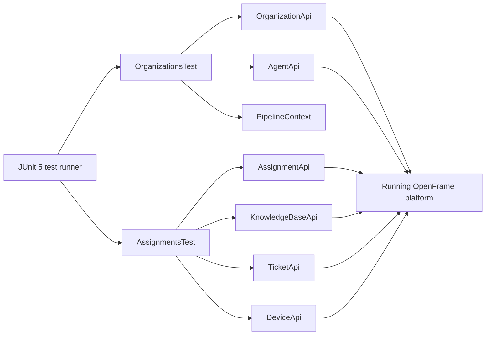
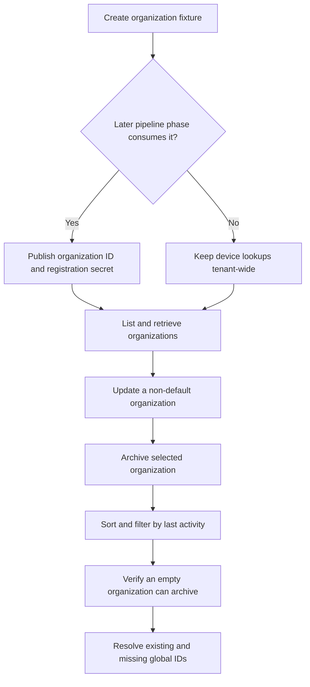
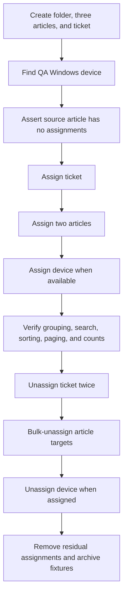

# Organization And Assignments Tests

Organization And Assignments Tests is a JUnit 5 end-to-end test module supplied by the `com.openframe.oss:openframe-test-service-core` library and run by this repository's OpenFrame test service. It verifies two tenant-facing capabilities:

- organization lifecycle and query behavior;
- assignment lifecycle for knowledge-base articles and ticket, article, and device targets.

The module executes against a running platform through test API facades rather than directly testing controller or repository implementations. Its ordered test methods intentionally share fixtures, so each class is a scenario with state transitions rather than a collection of independent unit tests.

## Scope and Source

| Test class | Tags | Primary responsibility | Source |
| --- | --- | --- | --- |
| `OrganizationsTest` | `oss`, `saas`, `organizations` | Creates, reads, updates, archives, sorts, filters, and resolves organizations. | [OrganizationsTest.java](https://github.com/flamingo-stack/openframe-oss-lib/blob/7a766f00e4f58b5d89db007b878ac8d6e0c344f4/openframe-test-service-core/src/main/java/com/openframe/test/tests/OrganizationsTest.java) |
| `AssignmentsTest` | `saas`, `feature`, `assignments` | Creates knowledge-base and ticket fixtures, assigns targets to an article, verifies retrieval semantics, then removes the assignments and fixtures. | [AssignmentsTest.java](https://github.com/flamingo-stack/openframe-oss-lib/blob/7a766f00e4f58b5d89db007b878ac8d6e0c344f4/openframe-test-service-core/src/main/java/com/openframe/test/tests/AssignmentsTest.java) |

## Architecture Overview

The test API facades encapsulate the platform calls. `PipelineContext` provides the handoff between pipeline phases: the organization scenario can publish an organization identifier and, on a best-effort basis, the active agent-registration secret for a later device-install phase.

## Organization Lifecycle Coverage

`OrganizationsTest` is ordered with `@Order` and applies both OSS and SaaS coverage where tagged. Its core workflow is:

### Scenario behavior

1. **Create Organization** creates a generated request and validates generated identifiers, timestamps, non-default status, contact information, and request-to-response mapping. Mailing address is expected to equal physical address on creation.
2. **Pipeline publication** occurs only when a later phase declares that it will consume the fixture. This prevents standalone runs from constraining later device lookups to an empty organization.
3. **Read operations** validate that listing returns populated organization records, that lookup by organization identifier matches the listed object, and that lookup by Relay global identifier returns the same record.
4. **Update Organization** updates the first non-default organization and compares the mutable payload while excluding service-owned fields such as identifiers, timestamps, status, and last activity.
5. **Archive Organization** archives the pipeline-created fixture when one was published; otherwise it archives the first eligible non-default organization. It confirms that the archived object leaves the active list.
6. **Activity queries** validate ascending `lastActivityAt` ordering and inclusive time-range filtering.
7. **Archive eligibility and missing-record behavior** confirm that an empty organization is archivable and reaches `ARCHIVED`, while a syntactically valid but nonexistent Organization Relay ID resolves to `null` rather than causing an error.

### Pipeline contract

The `org-create` and `org-archive` tags are deliberately namespaced. They avoid collisions with generic phase selectors used by other suites. Pipeline consumers should preserve their order: the created organization is retained for the potential device-install phase and archived afterward.

## Assignment Lifecycle Coverage

`AssignmentsTest` is an ordered SaaS feature scenario for item assignments. It creates one source knowledge-base article, two target articles, and one ticket. It also conditionally finds the QA Windows device named `vm115982`; device-specific checks are skipped if that host is absent.

### Fixtures and identifiers

All fixture names include a unique `RunId`, isolating concurrent or repeated suite executions. The test converts the ticket's raw identifier to a `Ticket` Relay global ID because the assignment mutation accepts the API service's global identifier. The source and article targets already use their returned identifiers.

The class tracks successfully created assignments in an insertion-ordered map keyed by target global ID. Later cases use assumptions to skip dependent assertions after an earlier setup failure, while `@AfterAll` removes every still-tracked assignment.

### Assignment assertions

| Area | Verified behavior |
| --- | --- |
| Empty state | A new source article has no counts, ticket rows, or ticket nodes. |
| Ticket target | The returned assignment has an `ItemAssignment` Relay ID, knowledge-article item type, ticket target type, timestamp, ticket global ID, ticket number, title, and non-null status kind. Its display name is the ticket number followed by the title. |
| Article targets | Each assignment resolves to a `KnowledgeBaseItem`, uses the article title as display name, and receives a distinct assignment ID. |
| Device target | When available, the Windows host resolves as a `Machine` with matching global ID, machine ID, and hostname. |
| Per-type listing | Article, ticket, and organization lists return the expected target IDs and filtered counts. |
| Search and pagination | Name search isolates one article; ascending and descending display-name sorts are checked with cursor-based one-item pages. |
| Count consistency | Aggregate assigned-item counts equal the count reported by each type-filtered connection. |
| Single removal | Unassigning a ticket removes it from the list and aggregate counts. A repeated unassignment remains successful and does not alter counts. |
| Bulk removal | Bulk-unassign by target type removes both article links while preserving the target article records and any independently assigned device. |
| Complete removal | Device removal leaves no counts once it is the final assignment. |

## Cleanup and Failure Handling

The assignment scenario is designed to minimize shared-environment residue:

- residual assignment links are removed with the raw unassignment helper;
- the fixture folder is deleted with the helper that archives its child articles;
- the fixture ticket is transitioned through `RESOLVED` and then `ARCHIVED`, after resolving the system-status identifiers during setup;
- assumptions make a dependent case visibly skipped when prerequisite state is unavailable rather than producing misleading follow-on failures.

The organization test archives fixtures as part of its scenario and explicitly cleans up the temporary empty organization used to test archive eligibility.

## Maintaining These Tests

When changing organization behavior, preserve the difference between standalone and pipeline execution. Publishing an organization to `PipelineContext` when no later phase installs a device can redirect later device tests into an organization with no enrolled devices.

When changing assignment behavior, keep the following contracts aligned with the platform API:

- assignment mutations use typed target values and Relay global IDs;
- filtered connection counts represent all matches, not only the current page;
- repeated unassignment is expected to answer `true` without changing state;
- cleanup must remain safe after partial setup or test failure.

Both classes use external test-library sources rather than code defined in this repository. The tenant repository supplies the service runtime that executes the library's `openframe-test-service-core` scenarios.