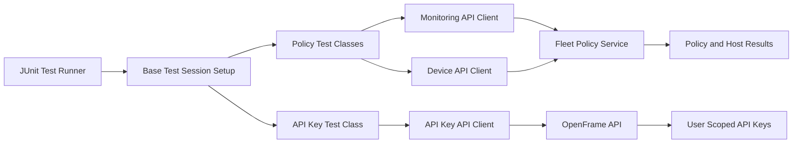
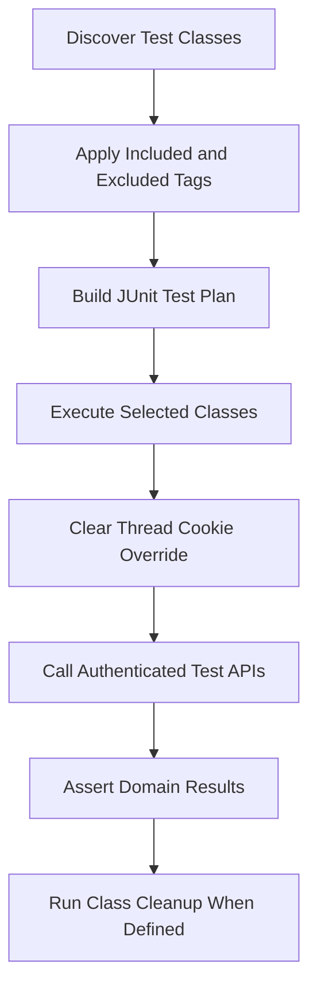
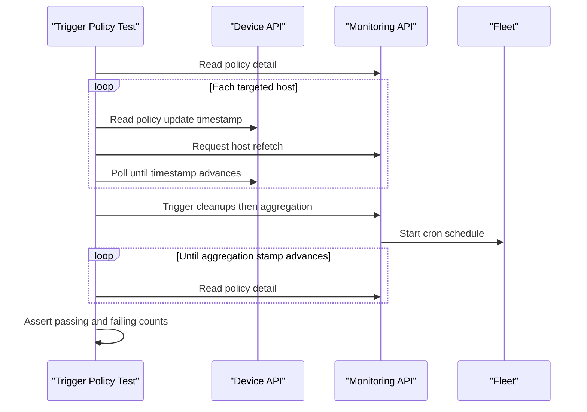
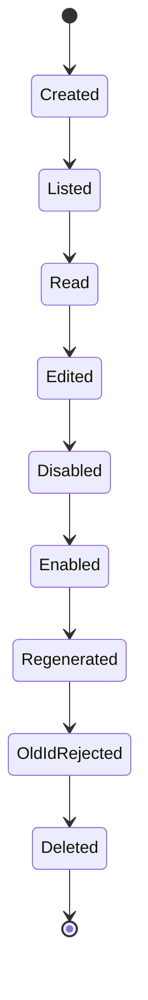

# Policy Management Tests

Policy Management Tests is an end-to-end JUnit 5 test group from the **OpenFrame OSS Library** `openframe-test-service-core` artifact. It validates two independently exposed management capabilities against a running OpenFrame tenant:

- Fleet policy creation, targeting, re-evaluation, aggregation, and deletion.
- User-scoped API-key lifecycle management, including secret rotation and cleanup.

The tests are executed by this repository's OpenFrame test service, while their implementation is supplied by the OpenFrame OSS Library at version `7.0.11`. They operate through authenticated test API clients rather than directly against persistence, so their assertions cover the tenant integration boundary.

## Scope and Source

| Test class | Primary responsibility | Source |
|---|---|---|
| `CreatePolicyTest` | Creates policies and assigns an online Windows Fleet host to the targeted policy. | [Create Policy Test](https://github.com/flamingo-stack/openframe-oss-lib/blob/7a766f00e4f58b5d89db007b878ac8d6e0c344f4/openframe-test-service-core/src/main/java/com/openframe/test/tests/CreatePolicyTest.java) |
| `DeletePolicyTest` | Deletes the seeded empty and targeted policies and verifies their identifiers are returned. | [Delete Policy Test](https://github.com/flamingo-stack/openframe-oss-lib/blob/7a766f00e4f58b5d89db007b878ac8d6e0c344f4/openframe-test-service-core/src/main/java/com/openframe/test/tests/DeletePolicyTest.java) |
| `TriggerPolicyTest` | Forces Fleet host evaluation and policy aggregation before asserting compliance counts. | [Trigger Policy Test](https://github.com/flamingo-stack/openframe-oss-lib/blob/7a766f00e4f58b5d89db007b878ac8d6e0c344f4/openframe-test-service-core/src/main/java/com/openframe/test/tests/TriggerPolicyTest.java) |
| `ApiKeysTest` | Walks one test-owned API key through creation, mutation, rotation, deletion, and failure cleanup. | [API Keys Test](https://github.com/flamingo-stack/openframe-oss-lib/blob/7a766f00e4f58b5d89db007b878ac8d6e0c344f4/openframe-test-service-core/src/main/java/com/openframe/test/tests/ApiKeysTest.java) |

## Architecture Overview

The module is a black-box integration suite. `BaseTest` resets thread-local cookie overrides before each class so the configured run-level authenticated session is used. API clients then invoke the OpenFrame API and Fleet-facing routes; assertions use the returned domain objects and status codes.

### Test Execution Model

The shared `TestRunner` discovers test classes, applies requested JUnit tags, and executes sequentially by default. It can run classes concurrently only when its caller explicitly configures parallelism. This module should be treated carefully when selecting tags because the policy cases have fixture relationships and Fleet aggregation is a shared server-wide operation.

## Policy Coverage

### Policy Creation and Targeting

`CreatePolicyTest` contains feature and device-tagged cases that create two definitions supplied by the monitoring test-data generator:

- **Empty policy**: verifies that a newly created policy preserves its generated name, description, and query.
- **Windows version policy**: locates an online Windows machine, verifies that it has tool connections and a Fleet identifier, assigns that Fleet host to the policy, then reads the policy detail to confirm the host is represented in `hostsIncludeAny`.

The test deliberately performs a detail read after assignment because the policy list response is not sufficient for the host-targeting assertion.

### Policy Compliance Re-evaluation

`TriggerPolicyTest` is tagged `mdm` and `scheduled`. It verifies both expected policy states only after actively producing fresh Fleet data:

1. Resolve each seeded policy by name and verify its query has not drifted from the generator's expected definition.
2. Read targeted hosts from the policy detail. The untargeted empty policy is normalized from a null host list to an empty list.
3. For every targeted host, request a Fleet refetch and poll until the host reports a later policy-update timestamp.
4. Trigger Fleet's `cleanups_then_aggregation` cron until Fleet returns `200`, meaning this invocation started an aggregation run. A `409` means another run was already active and is retried rather than treated as fresh work.
5. Poll the policy detail until `host_count_updated_at` is later than the pre-trigger value.
6. Assert the expected passing and failing host counts.

The targeted Windows policy must have zero failing hosts and a passing count equal to its assigned host count. The deliberately untargeted empty policy must have zero passing and failing hosts after aggregation. The test uses `host_count_updated_at`, not the policy record's general update timestamp, because host aggregation updates the former.

### Policy Deletion

`DeletePolicyTest` is tagged `archive`. It finds policies named `Empty` and `Windows version`, deletes each through the monitoring client, and asserts that Fleet returns the deleted identifier. These cases depend on policies already being present; they are not self-seeding. Do not run the archive-tagged deletion cases before the policy creation and compliance checks that require those fixtures.

## API Key Lifecycle Coverage

`ApiKeysTest` is tagged `oss` and `api-keys` and uses ordered JUnit methods. It creates one key using a run-unique name, carries the current key identifier through each later method, and limits assertions to that test-owned key in the authenticated user's list.

The ordered checks validate the following contract:

| Order | Operation | Assertions |
|---|---|---|
| 1 | Create | The identifier begins with `ak_`, the key is enabled with no traffic, and the one-time disclosed credential begins with the key identifier followed by `.sk_`. |
| 2–3 | List and read | The created key is visible to the calling user and retains its initial fields. |
| 4 | Edit | Name, description, and expiry change, while omitted fields retain their values. |
| 5–6 | Disable and re-enable | A disabled key remains listable and readable, then can be enabled again. |
| 7–8 | Regenerate | Rotation produces a different `ak_` identifier and secret, preserves settings, removes the old identifier, and returns `404` for old-key reads and regeneration. |
| 9 | Delete | The final identifier no longer resolves or appears in the list. |

An `AfterAll` fallback issues a raw delete for the current identifier if a prior ordered case failed before the normal delete method. The raw cleanup path prevents an earlier failure from masking the test result with a teardown exception.

## Operational Characteristics and Failure Diagnosis

### Asynchronous Fleet Behavior

Host refetch and policy aggregation are asynchronous. The shared `FleetWait` helper polls every three seconds and retries transient assertion or runtime failures until its deadline. Policy aggregation has a dedicated 180-second timeout, while accepting the cron trigger has a 60-second timeout. A stale count alone is not treated as a policy failure: the test first requires a new aggregation timestamp so a failure can distinguish non-compliance from incomplete Fleet processing.

The aggregation trigger applies to the entire Fleet instance rather than a single tenant. Runs against shared environments must account for concurrent trigger attempts, represented by Fleet's `409` response.

### Ordering and Isolation

- Policy creation, triggering, and deletion are separate classes; their fixture dependency is encoded by the selected run phase and tags, not by a cross-class JUnit ordering annotation.
- API-key methods are intentionally ordered because each uses the state created by the previous method. If creation fails, later methods use JUnit assumptions to report the prerequisite failure rather than emitting misleading null-state errors.
- API keys are user-scoped, and the class uses a run-specific name to avoid confusing its fixture with existing keys.
- The module asserts via service APIs and does not reach into database collections directly.

## Integration Boundaries

Policy coverage reaches the OpenFrame monitoring integration and Fleet policy APIs through `MonitoringApi`, including host selection through `DeviceApi`. API-key coverage calls the authenticated OpenFrame route rooted at `api/api-keys`. Both clients validate expected HTTP status codes as part of their helper methods; special negative paths use raw methods to assert expected `404` responses.

For broader test-suite configuration, authentication setup, and environment provisioning, see the platform documentation for the OpenFrame test service and its test runner configuration.
