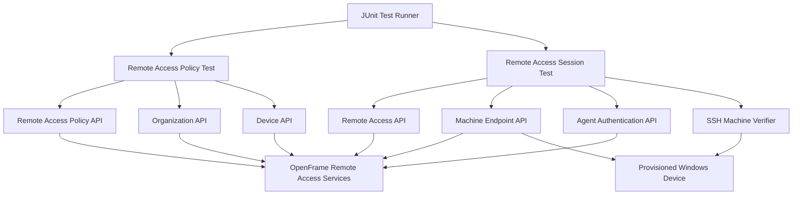
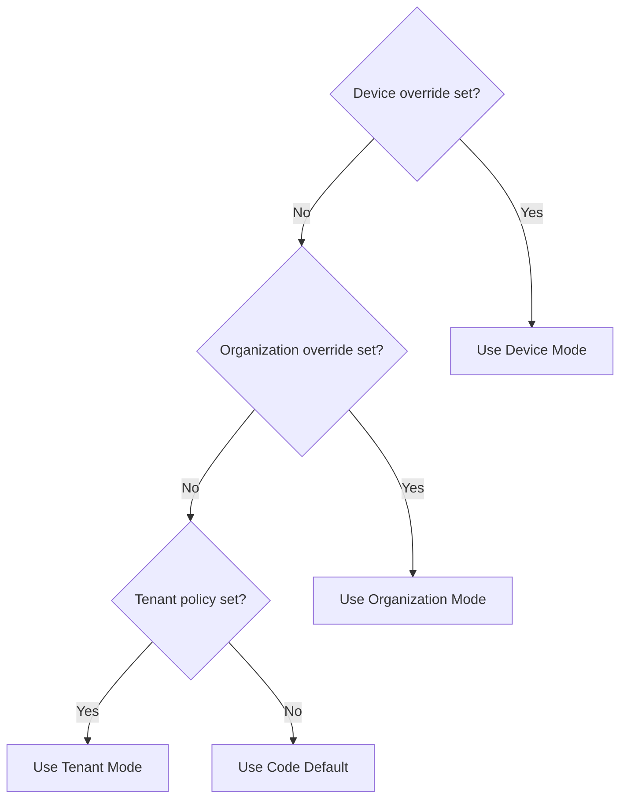
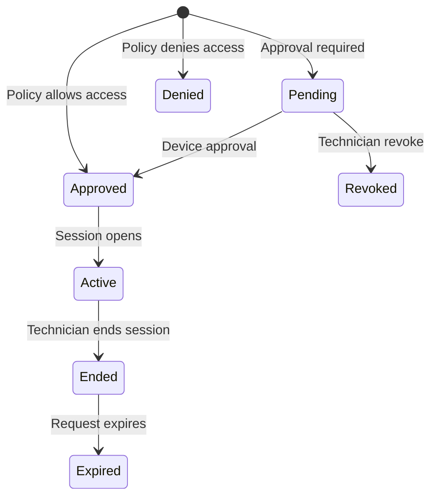

# Remote Access And Policy Tests

Remote Access And Policy Tests is an end-to-end JUnit 5 test module supplied by the `com.openframe.oss:openframe-test-service-core` library and run by this repository's OpenFrame test service. It verifies remote-access policy precedence and the complete request-to-session lifecycle against a provisioned Windows device.

The module has two complementary responsibilities:

- **Policy coverage** checks effective remote-access mode resolution through device, organization, tenant, and default scopes, including mutation failures and cleanup of temporary overrides.
- **Session coverage** creates and reads technician requests, exercises device approval where required, validates session and audit history, and proves terminal-state behavior.

## Architecture Overview

The tests use the OpenFrame APIs as black-box interfaces. The policy suite changes only test-owned state, while the session suite normally leaves policy unchanged. A pipeline setup test may temporarily set the tenant mode to `SILENT_ACCESS` so unattended session tests do not wait for an end-user approval; its matching teardown restores the recorded prior mode.

## Test Design

Both classes use ordered methods because later assertions consume identifiers and state established by earlier cases. Preconditions that depend on shared infrastructure use JUnit assumptions, so an unavailable device, an existing non-test override, or an incompatible policy mode produces a skipped dependent scenario rather than an unrelated failure.

| Concern | Mechanism |
| --- | --- |
| Isolation | A generated run identifier distinguishes the temporary organization and request reason from other executions. |
| Shared device | The suites target an enrolled Windows device named `vm115982`, prefer an online record, and avoid taking over a live session. |
| State safety | `AfterAll` cleanup uses best-effort raw API calls to clear test-created overrides, archive temporary organizations, revoke live requests, and end sessions created by the run. |
| Contract checks | Assertions cover stored fields, effective policy scope, GraphQL error codes, REST status codes, ordering, pagination clamps, and state transitions. |
| Device approval | The session test obtains the device agent identity over SSH, mints an agent token, then calls the machine endpoint to acknowledge and approve a pending request. |

## Policy Resolution Model

The policy tests establish the precedence model observed by the client-facing API. A device override has priority; otherwise the organization’s effective policy applies, which can inherit from the tenant. If no persisted policy exists, the platform’s code default is used. The suite expects `APPROVAL_REQUIRED` as that code default and treats both `APPROVAL_REQUIRED` and `NOTIFY_ONLY` as modes that can require end-user interaction.

## Session Lifecycle Model

A remote-access request stores the mode resolved at creation time. Under `APPROVAL_REQUIRED`, it begins in `PENDING` and the device must acknowledge and approve it. Policy-settled modes are decided immediately: `DENY_ACCESS` yields `DENIED`, while other non-approval modes yield `APPROVED`. An approved request opens an active session; ending that session records an administrative end, releases the device, and expires the associated request.

## Components

### [Remote Access Policy Tests](remote_access_policy_tests.md)

`RemoteAccessPolicyTest` validates inheritance and override behavior at organization and device scope. It creates a throwaway organization, verifies that it inherits the tenant mode, writes and clears an organization override, and confirms that unknown organizations are reported as `ORGANIZATION_NOT_FOUND`. For the enrolled device, it verifies inheritance, sets an equivalent device-level override to validate `DEVICE` precedence without changing behavior, clears it, and verifies the `DEVICE_NOT_FOUND` failure path.

The class also owns pipeline-scoped setup and teardown methods that set and restore the tenant remote-access mode. Its cleanup protects the environment if an ordered test fails before the normal archive or clear operation. See [Remote Access Policy Tests](remote_access_policy_tests.md) for the detailed scenarios, pipeline guard, and failure-containment design.

### [Remote Access Session Tests](remote_access_session_tests.md)

`RemoteAccessSessionTest` validates remote access from request creation through audit visibility. It checks request idempotency, policy-specific creation status, machine-endpoint approval semantics, rejection of actions that no longer apply, opening and ending a session, pagination limits, audit records, and invalid-device handling. Session cleanup attempts to revoke or end only resources created by the current run. See [Remote Access Session Tests](remote_access_session_tests.md) for the detailed lifecycle, approval paths, and audit-read contracts.

## External Integration Boundaries

This module is library code from OpenFrame OSS Library version `7.0.11`, consumed by this service repository. The relevant source files are:

- [Remote Access Policy Test](https://github.com/flamingo-stack/openframe-oss-lib/blob/7a766f00e4f58b5d89db007b878ac8d6e0c344f4/openframe-test-service-core/src/main/java/com/openframe/test/tests/RemoteAccessPolicyTest.java)
- [Remote Access Session Test](https://github.com/flamingo-stack/openframe-oss-lib/blob/7a766f00e4f58b5d89db007b878ac8d6e0c344f4/openframe-test-service-core/src/main/java/com/openframe/test/tests/RemoteAccessSessionTest.java)

The test service depends on a functioning OpenFrame deployment with its API, remote-access service, agent authentication path, and an enrolled Windows test device. It also relies on SSH access to that device only for the agent-side approval scenario.
