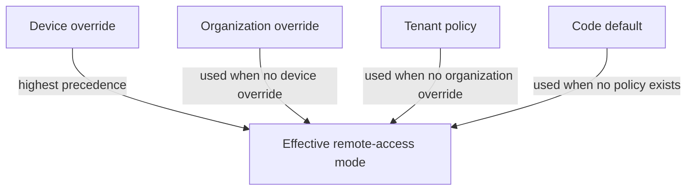
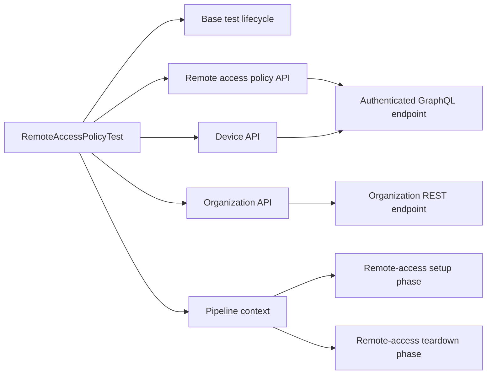
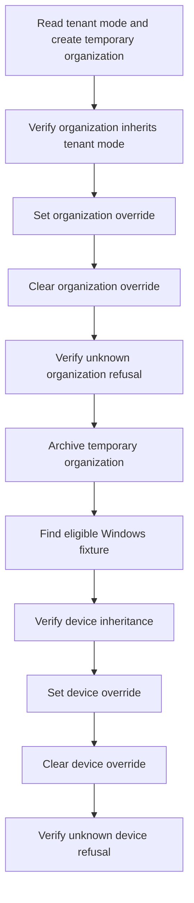
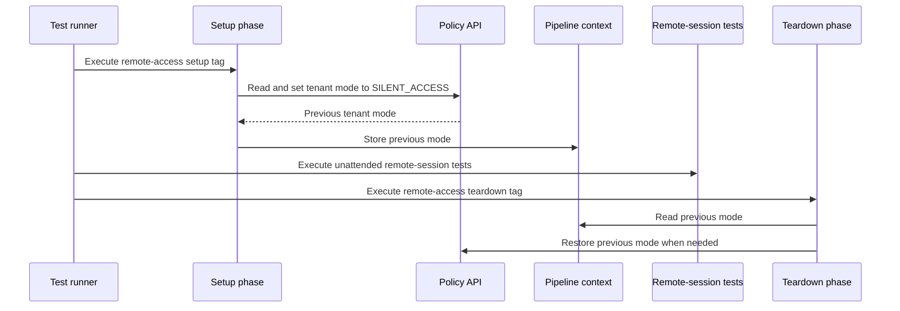

# Remote Access Policy Tests

Remote Access Policy Tests are ordered, pipeline-aware end-to-end checks for the remote-access policy hierarchy. They verify that policy values resolve from device to organization to tenant and finally to the platform default, that overrides can be applied and removed without affecting higher scopes, and that unknown resources are rejected with the expected GraphQL error contract.

The module is implemented by `RemoteAccessPolicyTest` in the OpenFrame OSS Library test artifact. The tenant repository runs that artifact through its OpenFrame test service. The implementation source is [RemoteAccessPolicyTest.java](https://github.com/flamingo-stack/openframe-oss-lib/blob/7a766f00e4f58b5d89db007b878ac8d6e0c344f4/openframe-test-service-core/src/main/java/com/openframe/test/tests/RemoteAccessPolicyTest.java).

## Purpose and Scope

The suite protects two related behaviours:

- **Policy resolution:** a device-level override has highest precedence, followed by an organization override, the tenant policy, and the code default.
- **Pipeline preparation:** a dedicated setup phase temporarily changes the tenant to `SILENT_ACCESS`, allowing unattended remote-session tests to proceed without a user accepting an approval prompt on the device.

The policy cases are tagged `oss`, `remote-access-policy`, `saas`, and `feature`. Device-specific cases also require the `needs-device` tag. The setup and restoration cases have separate `remote-access-setup` and `remote-access-teardown` tags so a runner can place them before and after remote-session-dependent phases.

## Policy Model

A remote access policy can be stored as an override at organization or device scope. The API returns both the locally stored `mode` and a resolved `effectiveMode`; device responses additionally state the `effectiveScope`.

The suite exercises the observable outcomes of this precedence chain:

| Scope or condition | Stored `mode` | Expected resolved result |
|---|---|---|
| Newly created organization | `null` | The current tenant mode |
| Organization override | Selected mode | The organization override |
| Organization override cleared | `null` | The tenant mode |
| Device without override | `null` | Organization, tenant, or default result |
| Device override | Selected inherited mode | Same mode at `DEVICE` scope |
| Device override cleared | `null` | The previously inherited mode and scope |

The test deliberately selects a device override equal to the device's inherited effective mode. This validates precedence and persisted audit metadata while preserving the device's active remote-session behaviour.

## Architecture and Dependencies

`RemoteAccessPolicyTest` extends the shared `BaseTest`, which clears thread-local authentication state before each class and allows the run-level authenticated session to be reused. It uses library-provided API adapters rather than calling endpoints directly in test methods.

### Primary collaborators

| Component | Responsibility in the tests |
|---|---|
| `RemoteAccessPolicyApi` | Reads and changes tenant, organization, and device policies. It defines `SILENT_ACCESS`, `APPROVAL_REQUIRED`, and `NOTIFY_ONLY`. |
| `OrganizationApi` | Creates a unique temporary organization and archives it after the organization-policy scenarios complete. |
| `DeviceApi` | Locates the configured Windows fixture by hostname and supplies the machine identifier used by device-policy operations. |
| `PipelineContext` | Carries the tenant mode that the setup phase replaced so the teardown phase can restore it. |
| `OrganizationGenerator` and `RunId` | Create an isolated organization request and append a run-unique identifier to its name. |
| JUnit assumptions | Skip dependent device cases when the fixture is absent or already has an override that the suite does not own. |

The policy adapter treats transport and domain failures according to the API contract. Organization mutation refusals are returned in `userErrors`; unknown organization queries and unknown device mutations are inspected as GraphQL errors with an error code in `extensions.code`. In both raw GraphQL error cases, the HTTP status remains `200` and `data` is absent.

## Ordered Test Workflow

The class uses `MethodOrderer.OrderAnnotation`; its first nine methods form a stateful feature sequence. Later methods are independent tagged phases intended for the surrounding pipeline.

### Organization scenarios

1. The first case reads the tenant mode, creates a named temporary organization, and confirms there is no organization override. The effective mode must equal the captured tenant mode, while `updatedBy` and `updatedAt` remain empty.
2. The next case picks a value different from the tenant mode, writes an organization override, and checks the stored value, resolved value, and audit fields. It also verifies that the tenant value did not change.
3. Clearing the organization mode with `null` must remove the override and restore the tenant-derived effective mode.
4. A randomly generated organization identifier must be rejected as `ORGANIZATION_NOT_FOUND`. The query path is expected to return a GraphQL error; the mutation path returns the code in `userErrors` and no policy.
5. The temporary organization is archived once its assertions finish.

### Device scenarios

Device scenarios locate the designated Windows fixture hostname. They use an assumption rather than changing a device that is not eligible: the device must be enrolled and must not already have a device-scope override.

The inheritance case accepts `ORGANIZATION`, `TENANT`, or `DEFAULTS` as the effective scope. It then verifies that the effective mode equals the device organization's effective policy and that `ORGANIZATION` occurs exactly when that organization stores an override. The remaining cases set an explicit device override, verify `DEVICE` precedence and audit fields, clear the override, and confirm the original effective mode and scope are restored. A random machine identifier must yield `DEVICE_NOT_FOUND` in GraphQL error extensions.

## Remote Session Pipeline Guard

`APPROVAL_REQUIRED` and `NOTIFY_ONLY` both hold a remote session until the end user accepts on the device. An unattended pipeline therefore cannot rely on either mode while running remote-session checks. The setup phase sets the tenant policy to `SILENT_ACCESS` and saves the previous value in `PipelineContext`.

The teardown is intentionally conservative: it does nothing when the prior value is absent or was already `SILENT_ACCESS`. Otherwise, it writes the saved value back and verifies the restored tenant mode. This avoids leaving a long-lived tenant in a mode selected only for automation.

## Cleanup and Failure Containment

The `@AfterAll` cleanup protects shared environments when an ordered assertion fails before its normal cleanup step:

- If a device override may have been set, it clears that override through the raw API and logs the returned HTTP status.
- If an organization override may have been set, it clears it through the raw API.
- If the temporary organization was created but not archived, it archives the organization through the raw REST call.

The boolean flags are set before mutating calls where appropriate. This design favors cleanup after partial failures and avoids masking the original failure when a teardown request itself cannot satisfy a success assertion.

## Maintenance Guidance

- Keep the first nine tests ordered. Their precondition helpers use assumptions to explain which earlier case failed or was skipped.
- Preserve the fixture-safety rule: do not overwrite a pre-existing device override. An externally managed policy is outside this suite's ownership.
- When adding a policy mode, update the `RemoteAccessPolicyApi` constants and extend assertions only after confirming the remote-session gate semantics for that mode.
- If the fixture hostname changes, update the test constant and ensure the replacement is a Windows device enrolled in the target environment.
- Keep setup and teardown tags paired in pipeline configuration. Running remote-session tests without the setup phase may cause them to block at end-user approval.
- Maintain the GraphQL error assertions separately from successful-response assertions. The API deliberately distinguishes mutation user errors from GraphQL execution errors.

## Relationship to the Test System

This module belongs to the Remote Access and Policy Tests grouping in the `openframe-test-service-core` library artifact. Its sibling remote-session tests consume the silent-access state established by this module's setup phase. The library artifact is consumed by the tenant repository at version `7.0.11`; the source file linked above is the implementation-specific revision supplied to the documentation pipeline.
