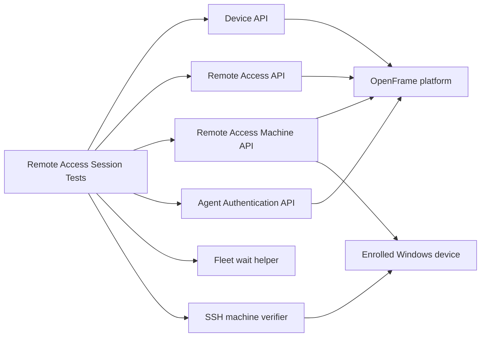
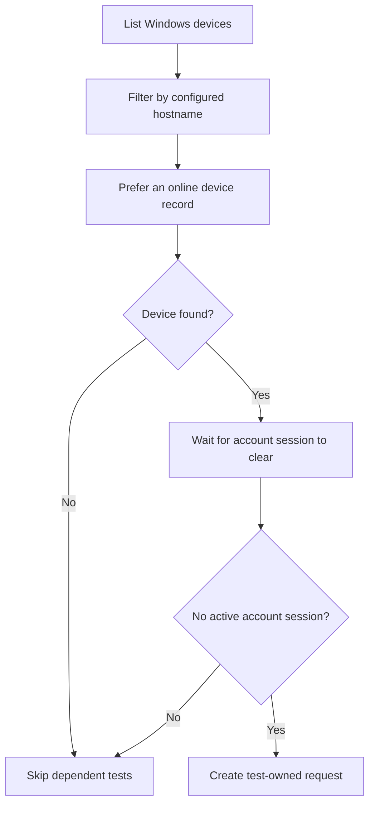
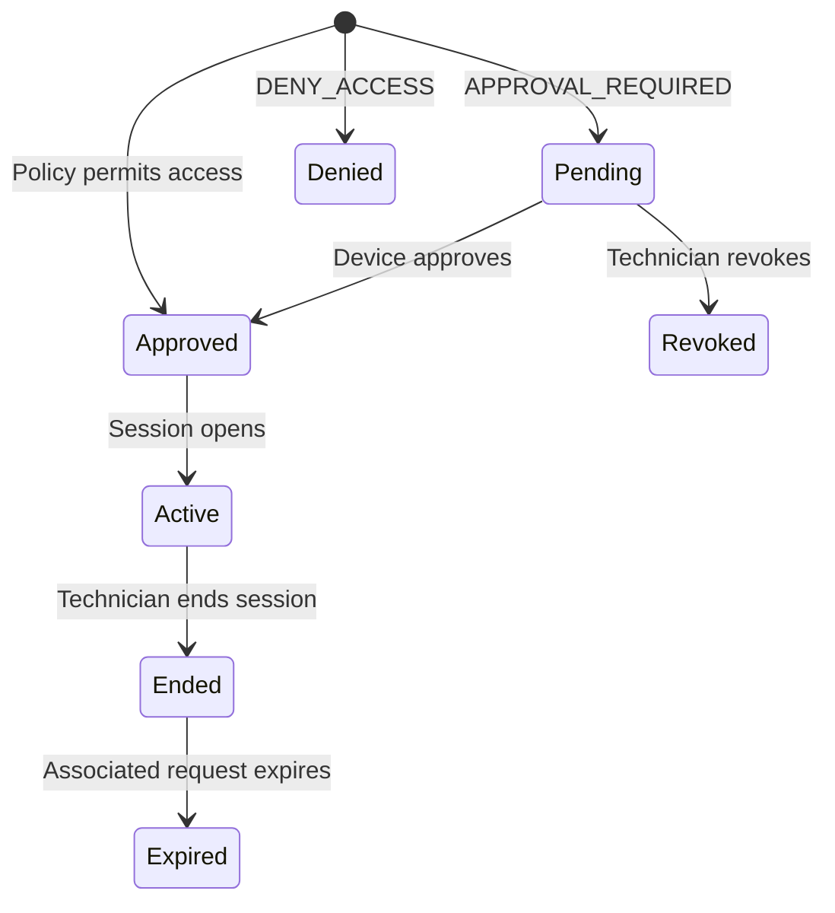
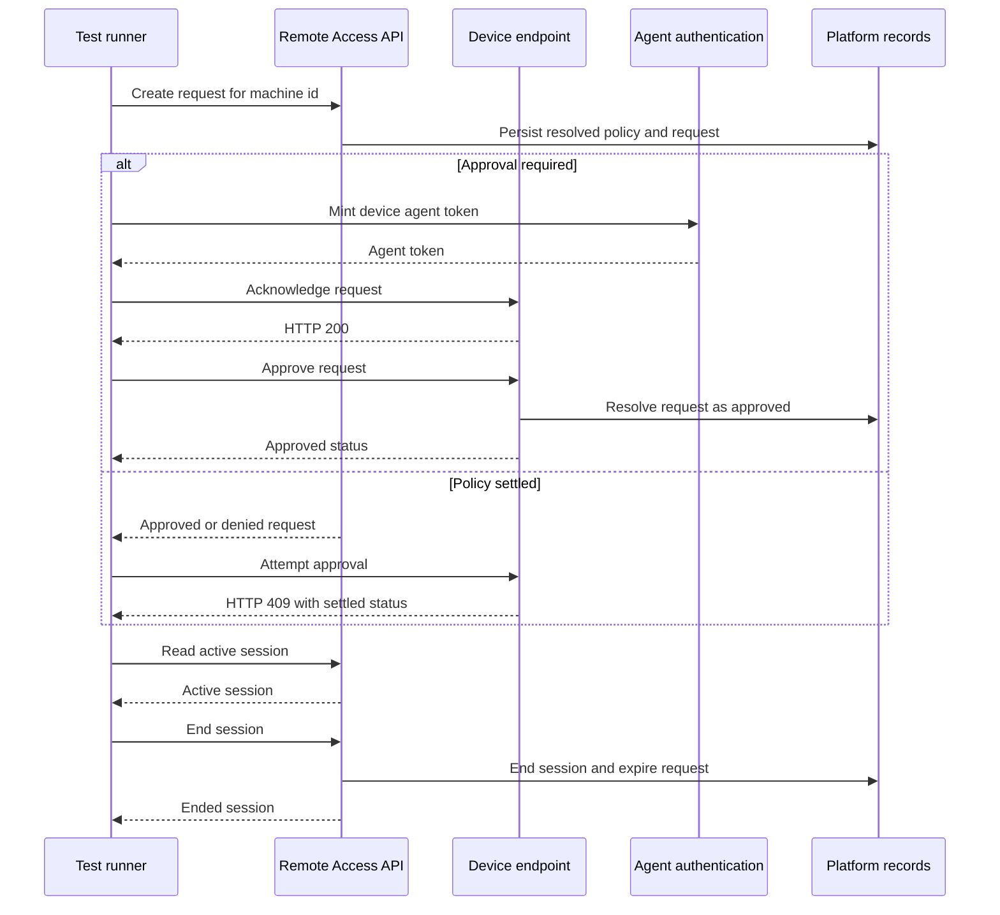
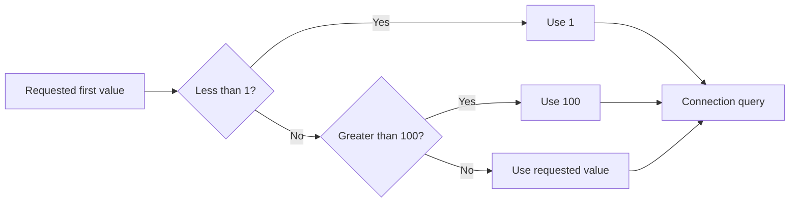

# Remote Access Session Tests

Remote Access Session Tests is an ordered JUnit 5 end-to-end suite that verifies the remote-access request and session lifecycle against an enrolled Windows device. It creates a technician-owned request, follows the policy-dependent decision path, validates the resulting session and history records, then releases any state it created.

The implementation is `RemoteAccessSessionTest` from the OpenFrame OSS Library artifact `com.openframe.oss:openframe-test-service-core`, consumed by this repository at version `7.0.11` and run by the OpenFrame test service. The implementation source is [RemoteAccessSessionTest.java](https://github.com/flamingo-stack/openframe-oss-lib/blob/7a766f00e4f58b5d89db007b878ac8d6e0c344f4/openframe-test-service-core/src/main/java/com/openframe/test/tests/RemoteAccessSessionTest.java).

## Purpose and Scope

The suite is tagged `saas`, `needs-device`, and `remote-access`. Its feature tests are deliberately stateful: later tests consume the request and session identifiers created earlier. JUnit order annotations establish the workflow, while assumptions skip dependent cases when shared test infrastructure or the active policy cannot satisfy a scenario.

It covers the following external contract:

- Selection of the designated online Windows fixture, `vm115982`.
- Request creation, stored request metadata, ULID-shaped identifiers, and policy-resolved creation status.
- Idempotent creation for the same technician while a request occupies the device.
- Device acknowledgement and approval for `APPROVAL_REQUIRED`, including agent authentication obtained from the device over SSH.
- Refusal behaviour for policy-settled requests, settled-request revocation, repeated session ending, and unknown device identifiers.
- Active-session reads, administrative session termination, and the associated request expiration.
- Device-scoped session history and remote-access request audit ordering, cursors, counts, and pagination clamping.

The suite does not alter the device's remote-access mode. The surrounding [Remote Access Policy Tests](remote_access_policy_tests.md) cover policy hierarchy and can prepare unattended execution by setting `SILENT_ACCESS` temporarily.

## System Context and Dependencies

Remote Access Session Tests uses test-library API adapters as black-box interfaces to deployed OpenFrame services. It does not implement remote access itself; it validates the observable behaviour of the service, its machine-facing endpoint, and their persisted records.

### Primary collaborators

| Component | Responsibility in the suite |
|---|---|
| `DeviceApi` | Lists Windows devices and supplies the OpenFrame machine identifier for the selected online fixture. |
| `RemoteAccessApi` | Creates, reads, revokes, and audits remote-access requests; reads and ends sessions; and provides best-effort cleanup helpers. |
| `RemoteAccessMachineApi` | Calls the device-facing acknowledgement and approval operations. |
| `AgentAuthApi` | Mints an agent token from client credentials read from the fixture. |
| `AgentIdentity` and `SshMachineVerifier` | Read the local agent identity over SSH and verify it belongs to the machine selected by the test. |
| `FleetWait` | Waits up to 180 seconds for a session held by the current account to clear before creation is attempted. |
| `RunId` | Makes the request reason unique, helping distinguish resources created by concurrent runs. |

The suite uses the machine identifier, not the Relay global identifier. Passing an unknown string or the selected device's global identifier to request creation must produce `DEVICE_NOT_FOUND` and no created request.

## Fixture Ownership and Isolation

The target tenant can contain duplicate device records in `PENDING_DELETION`; device selection filters for the configured hostname and prefers an `ONLINE` record. Before creating a request, the suite waits for an active session held by its account to disappear. It then treats device-busy results as an assumption failure rather than taking over another technician's work.

The same pattern protects assertions that only apply to one policy mode. For example, device approval runs only when the resolved mode is `APPROVAL_REQUIRED`; policy-settled approval tests run only under another mode. This makes the class portable across configured modes without disguising an incompatible environment as a functional defect.

## Request and Session Lifecycle

A request captures the mode resolved at creation, device and technician identifiers, desktop session kind, run-specific reason, recording setting, timestamps, and a server-side expiry. The initial state depends on the resolved policy:

| Resolved mode | Initial request status | Decision source | Device action |
|---|---|---|---|
| `APPROVAL_REQUIRED` | `PENDING` | Unset until resolution | The device acknowledges and approves the request. |
| `DENY_ACCESS` | `DENIED` | `POLICY` | Approval is rejected because the request is settled. |
| `SILENT_ACCESS` | `APPROVED` | `POLICY` | No device approval is expected. |
| Other policy-approved mode | `APPROVED` | `POLICY` | No device approval is expected. |

The active session must reference the creating request and technician, retain the session kind, mode, reason, and recording setting, and expose a `26`-character Crockford-base32 ULID. While active, it has `ACTIVE` status and a start time but no ending fields or duration. Its recording state is `PROCESSING` when recording is enabled and `NONE` otherwise. A `SILENT_ACCESS` session must not have a device session-chat identifier.

## Ordered Test Flow

The first request is the primary test resource. A second create attempt must return that same live request with `created` set to `false`, rather than opening another request. Once approved, it opens the caller's active session. Ending that session produces an `ENDED` session with `ADMIN` as its end reason, frees the device, and changes the original request to `EXPIRED`.

### Test phases

1. **Create and read the request.** The suite asserts a plain ULID request identifier, copied device and technician identities, the desktop session kind, reason, nullable ticket identifier, recording flag, timestamps, resolved mode, initial status, and policy decision metadata. A subsequent read must preserve stored values, with persisted timestamps normalized to milliseconds.
2. **Prove create idempotency.** While the first request remains `PENDING`, `DELIVERED`, or `APPROVED`, a repeated creation call from the same technician returns the same request, unchanged and without user error codes.
3. **Exercise the decision boundary.** For approval-required policy, the device endpoint first acknowledges then approves with a token minted from credentials retrieved over SSH. The technician view must show `APPROVED`, decision source `USER`, and a resolution timestamp. For a policy-settled request, device approval must return HTTP `409`, include the settled status, and leave the policy as decision source.
4. **Verify terminal request protection.** Revoking an already settled request returns `REMOTE_ACCESS_REQUEST_SETTLED`, includes the existing request, and changes no state.
5. **Read and end the session.** An approved request exposes one active session. Ending it returns the same session as `ENDED`, with an `ADMIN` end reason, non-negative duration, and an end time no earlier than the start. A second end returns `REMOTE_SESSION_ENDED` with the unchanged session.
6. **Inspect history and audit.** Device session history must contain the ended session, cursor-bearing edges, descending start-time order, and a total count at least as large as returned edges. Request audit must retain mode, policy scope, decision source, reason, technician, current status, linked session, descending creation order, and a valid count.
7. **Revoke a live secondary request.** When the mode is approval-required and the device is free, the suite creates a second request, revokes it, and verifies `REVOKED`, `TECHNICIAN` decision source, and resolution time.
8. **Check invalid input.** Both an invented machine identifier and a device global identifier must be refused as `DEVICE_NOT_FOUND`.

## Pagination and Read Contracts

The session and request audit connection queries are tested with a creation-time lower boundary and a requested size of `100`. Both are expected to return newest-first records and nonblank cursors. The suite also verifies lower and upper pagination clamps:

For session history, `0` returns one edge, `500` returns no more than one hundred edges, and an omitted size returns no more than the default twenty edges. Request audit additionally verifies the `0` and `500` clamp cases.

## Cleanup and Maintenance

The `AfterAll` cleanup makes the shared test environment resilient to partial failure:

- If the secondary request was created, the suite attempts to revoke it.
- If the primary request exists, it attempts to revoke it and to end a session associated with that request on the selected device.
- Cleanup calls are intentionally best effort, so a cleanup failure does not mask the primary assertion result. Settled requests are harmless no-ops for revocation.

When maintaining Remote Access Session Tests:

- Preserve method order and the precondition helpers. They make a missing earlier resource or policy-incompatible branch an explicit skip with a diagnostic explanation.
- Keep the request reason run-unique and use only the request and session resources created by the current class.
- Do not replace the machine identifier with a global device identifier in remote-access mutations.
- Update the creation-state expectation whenever a new remote-access mode changes whether policy or a device resolves the request.
- Keep the policy preparation and restoration pipeline paired with [Remote Access Policy Tests](remote_access_policy_tests.md) when unattended execution requires `SILENT_ACCESS`.
- Keep SSH credential retrieval restricted to the approval scenario; it validates the real device-agent path and should not be required for policy-settled paths.

## Relationship to the Test System

Remote Access Session Tests is a child of the [Remote Access And Policy Tests](remote-access-and-policy-tests.md) grouping in the OpenFrame test service library. Its sibling [Remote Access Policy Tests](remote_access_policy_tests.md) validates the policy precedence that determines which branch of this suite can execute. Together, the modules protect the configured policy boundary and the technician-to-device session lifecycle without leaving a shared fixture occupied after a run.
