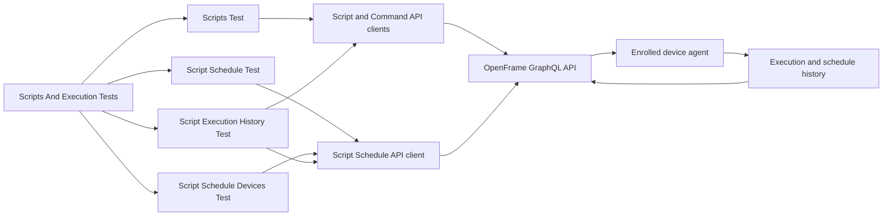
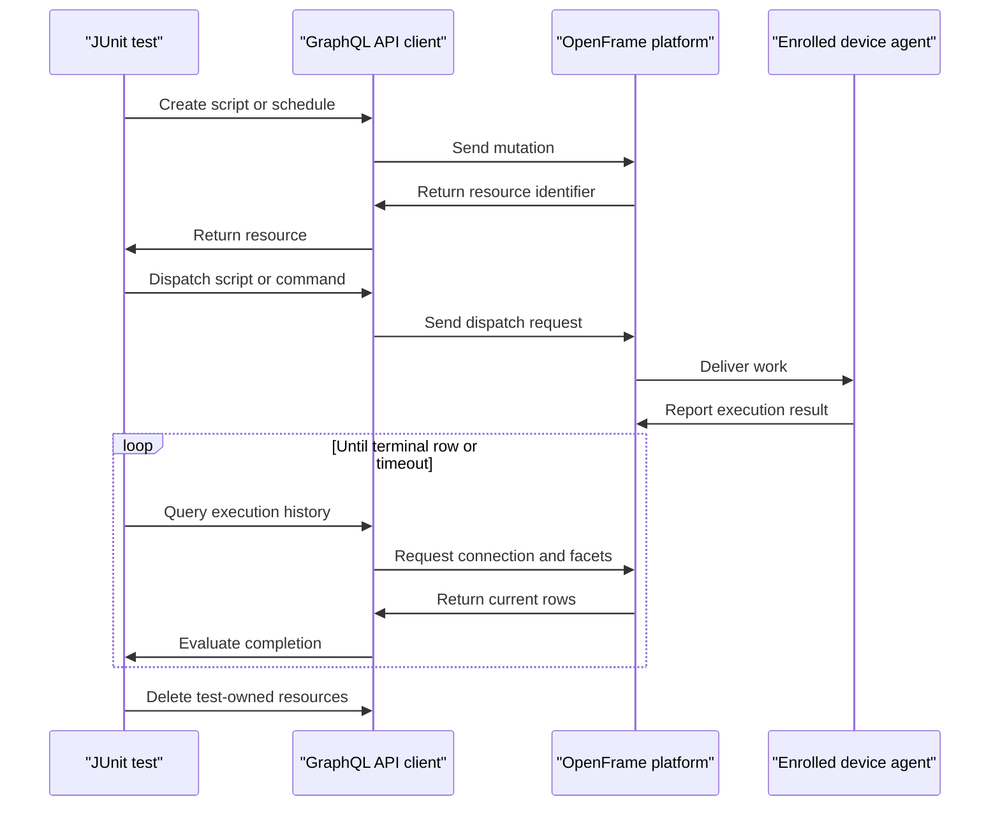

# Scripts And Execution Tests

Scripts And Execution Tests is the end-to-end verification slice for Remote Monitoring and Management script catalog, dispatch, schedule, targeting, and execution-history behavior. It is implemented by four JUnit 5 classes in the OpenFrame OSS Library's `openframe-test-service-core` artifact and is run by this repository's OpenFrame test service.

The tests exercise the system through its test GraphQL API clients rather than directly inspecting persistence. They create run-scoped resources, assert the externally visible contract, and remove resources in class-level cleanup. Device-dependent cases declare `needs-device`; they use assumptions to abort when their required enrolled device is unavailable rather than report a misleading product failure.

## Scope

The module covers four complementary contracts:

- Script catalog lifecycle: creation, listing, retrieval, update, archive and restore.
- Ad-hoc script and command dispatch, including environment-variable overrides, batch de-duplication, unknown-device rejection, and cancellation dispatch.
- Script schedule lifecycle and schedule validation.
- Schedule device selection through explicit assignment, bulk operations, replacement, criteria, and platform compatibility.
- Script and schedule execution-history connections, filters, empty-state behavior, and result visibility after asynchronous agent reporting.

## Architecture

The suite is a consumer-facing contract test. It uses `ScriptApi`, `ScriptScheduleApi`, `DeviceApi`, and, where needed, `CommandApi` to create and query resources. It does not depend on a database implementation. The device agent is required only for flows that actually dispatch work or need a device target.

## Test Components

### Script Catalog And Dispatch

[`ScriptsTest`](https://github.com/flamingo-stack/openframe-oss-lib/blob/7a766f00e4f58b5d89db007b878ac8d6e0c344f4/openframe-test-service-core/src/main/java/com/openframe/test/tests/ScriptsTest.java) validates the script-facing API as well as ad-hoc execution dispatch.

| Area | Contract verified |
|---|---|
| Catalog lifecycle | A script can be created, listed, fetched, updated, archived, restored, and deleted. Listing checks schema-required identifiers, names, and shell values. |
| Script execution | An echo script stores its environment variable, accepts a run-time override, records a manual execution with the requested administrative privilege, and returns terminal output, status, exit code, and timestamps. |
| Batch behavior | A batch with a duplicate machine identifier produces a single execution for that device. Each dispatch receives a distinct UUID execution identifier. |
| Rejection semantics | A batch containing an unknown machine is rejected as a whole with `DEVICE_NOT_FOUND`; it must not dispatch to the valid machine in the same request. The same constraint is checked for commands. |
| Commands | Single and batch ad-hoc command requests return execution identifiers. Cancellation is verified at dispatch-response level because command result inspection and agent-side cancellation completion are not asserted by this class. |

The dispatch cases target one configured online Windows host and use `FleetWait` with a five-minute upper bound to wait for the execution row to reach `SUCCESS` or `FAILED`. This accounts for the asynchronous boundary between accepting a dispatch and receiving an agent result.

### Script Schedule Lifecycle

[`ScriptScheduleTest`](https://github.com/flamingo-stack/openframe-oss-lib/blob/7a766f00e4f58b5d89db007b878ac8d6e0c344f4/openframe-test-service-core/src/main/java/com/openframe/test/tests/ScriptScheduleTest.java) covers schedule behavior without assigning devices, ensuring that no script is dispatched while lifecycle operations are tested.

It creates a date-time schedule on the nearest 30-minute slot, with an hourly recurrence, then verifies the returned defaults and persisted state. The class also validates:

- Search by a run-specific name fragment and connection page information.
- Platform facets that include the created Windows schedule.
- Full-replacement update behavior, including clearing the recurrence with a null repeat value.
- Archive and unarchive visibility under active and archived status filters, including idempotent archive behavior.
- Rejection of off-grid start times, recurrence intervals that are not full 30-minute slots, and device-online schedules incorrectly given a start time.

### Schedule Device Targeting

[`ScriptScheduleDevicesTest`](https://github.com/flamingo-stack/openframe-oss-lib/blob/7a766f00e4f58b5d89db007b878ac8d6e0c344f4/openframe-test-service-core/src/main/java/com/openframe/test/tests/ScriptScheduleDevicesTest.java) verifies how schedules resolve their device population. It prefers an enrolled Windows device but can use another listed device, then creates a script and schedule compatible with that device's operating system.

The ordered test flow establishes and reuses a schedule so later tests can validate:

1. The schedule device picker initially offers the matching device as unassigned.
2. Adding a device updates the persistent count and picker state, while a repeated add is idempotent.
3. Removing the device clears the assignment, and a repeated remove is a no-op.
4. Bulk add by hostname search selects the target; bulk removal without a filter clears all explicit assignments.
5. Replacing the device set implements PUT semantics, including replacement with an empty set.
6. Criteria selection persists `CRITERIA` mode and resolves a rule based on operating system and, when available, organization.
7. A device that does not match a schedule's supported platform is rejected and is not offered by the picker.

Schedules are placed one day in the future and cleanup clears assignments before deleting schedules. This keeps the targeting assertions from unintentionally triggering a real execution.

### Execution History And Facets

[`ScriptExecutionHistoryTest`](https://github.com/flamingo-stack/openframe-oss-lib/blob/7a766f00e4f58b5d89db007b878ac8d6e0c344f4/openframe-test-service-core/src/main/java/com/openframe/test/tests/ScriptExecutionHistoryTest.java) validates read paths after producing its own data. It does not search for a pre-existing tenant script, preventing false skips caused by prior tests cleaning up their fixtures.

For script history, the test creates and dispatches a new script to an online Windows device, polls until an execution appears, and checks:

- Connection page information, positive filtered count, and the first page size.
- Execution identity, association with the created script, allowed statuses, and dispatch timestamps.
- Presence of initiator, status, and machine facet lists.
- Equality between the sum of status-facet counts and the connection total.

For a newly created schedule that has never fired, it asserts a distinct empty-state contract: execution and run connections have zero rows but retain page information; execution and run facets have matching zero totals and empty status or initiator lists. This confirms that absence of history is represented as an empty result, not a null value or error.

## Execution Flow

## Test Isolation And Operational Constraints

- **Run-scoped data:** Schedules and scripts use a generated run identifier in their names. This makes list and history assertions target fixtures created by the same run.
- **Ordered classes:** Schedule lifecycle and device-targeting classes use ordered test methods because later checks require fixtures created by earlier methods. Guard assumptions point to the earlier failure when that prerequisite is missing.
- **Agent availability:** `ScriptExecutionHistoryTest` and device-targeting or dispatch cases require an enrolled device. The history test additionally requires an online Windows device; `ScriptsTest` requires its configured online Windows host.
- **Asynchronous reporting:** Dispatch acceptance is not treated as execution completion. The suite polls the history API and asserts terminal state or an explicit timeout failure.
- **Cleanup:** All four test classes use `AfterAll` cleanup. Cleanup failures are logged as warnings so the original assertion failure remains visible, though an undeleted fixture can remain in the tenant.
- **Non-destructive scheduling:** Schedule fixtures are placed in the future, and lifecycle-only schedules have no devices. This prevents schedule test setup from running arbitrary work on an enrolled endpoint.

## Relationship To The Platform

This repository consumes the OpenFrame OSS Library artifact `com.openframe.oss:openframe-test-service-core` at version `7.0.11`. The four test classes documented here originate in that library and are executed by the repository's OpenFrame test service. The platform services supply the GraphQL script and schedule contracts, while the endpoint agent supplies the execution result that makes history assertions observable.

The service and stream layers are responsible for the broader dispatch and result-processing path; this module intentionally verifies their observable script-management behavior rather than duplicating their implementation logic.
