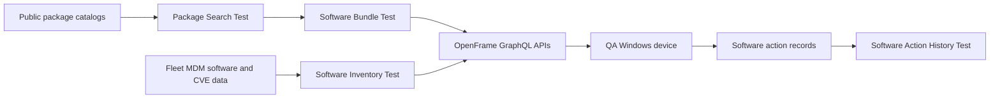
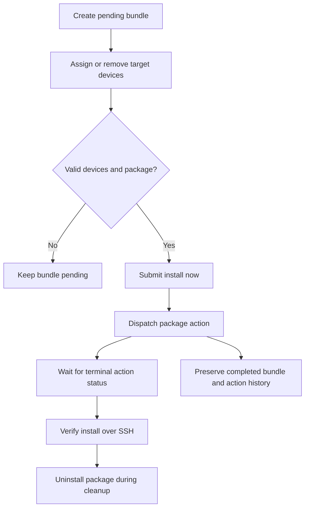
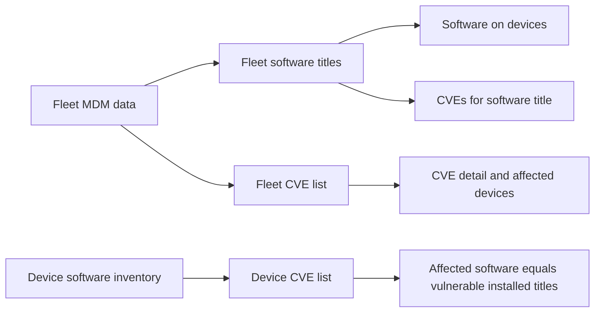

# Software Management Tests

Software Management Tests are end-to-end JUnit tests for the OpenFrame software-management experience. They exercise the deployed GraphQL surface and connected infrastructure rather than mocking it: package-catalog lookup, software bundle authoring and dispatch, execution history, fleet inventory, and vulnerability views.

The tests are supplied by the `com.openframe.oss:openframe-test-service-core` library at version `7.0.11` and run here through the OpenFrame test service. The implementation sources live in the OpenFrame OSS Library:

- [Software Action History Test](https://github.com/flamingo-stack/openframe-oss-lib/blob/7a766f00e4f58b5d89db007b878ac8d6e0c344f4/openframe-test-service-core/src/main/java/com/openframe/test/tests/SoftwareActionHistoryTest.java)
- [Software Bundle Test](https://github.com/flamingo-stack/openframe-oss-lib/blob/7a766f00e4f58b5d89db007b878ac8d6e0c344f4/openframe-test-service-core/src/main/java/com/openframe/test/tests/SoftwareBundleTest.java)
- [Software Inventory Test](https://github.com/flamingo-stack/openframe-oss-lib/blob/7a766f00e4f58b5d89db007b878ac8d6e0c344f4/openframe-test-service-core/src/main/java/com/openframe/test/tests/SoftwareInventoryTest.java)
- [Package Search Test](https://github.com/flamingo-stack/openframe-oss-lib/blob/7a766f00e4f58b5d89db007b878ac8d6e0c344f4/openframe-test-service-core/src/main/java/com/openframe/test/tests/PackageSearchTest.java)

## Purpose and Scope

The module guards contracts across the software-management workflow:

1. Discover packages from Homebrew and Winget catalogs.
2. Assemble a pending software bundle, select devices, and validate submission rules.
3. Dispatch an immediate package installation to a real Windows device and confirm the resulting action history.
4. Remove the temporary installation over SSH so the test leaves the selected device in its prior state.
5. Validate read-only fleet software inventory and CVE views, including filtering, facets, sorting, pagination, details, and not-found behavior.

The suite uses the `saas` tag. Bundle and selected inventory cases additionally use `needs-device`, because they depend on the QA Windows host named `vm115982`. Software action history carries the `post-mingo` tag because it relies on an installation created by the bundle workflow.

## Architecture Overview

The suite has two complementary paths:

- **Mutation and execution path:** Package Search Test validates the package-selection input; Software Bundle Test creates and submits a bundle; Software Action History Test validates the persisted, device-level outcome.
- **Read-model path:** Software Inventory Test validates fleet-wide and device-scoped projections of installed software and vulnerabilities. It is read-only and does not require cleanup.

## Component Responsibilities

| Component | Primary responsibility | Key contract coverage |
|---|---|---|
| `PackageSearchTest` | Verifies the catalog used by the software installation form. | Manager-specific fields, Homebrew formula and cask distinction, Winget versions, cursor pagination, page-size cap, disabled Chocolatey behavior, validation, and missing packages. |
| `SoftwareBundleTest` | Exercises draft-to-dispatch lifecycle on a real device. | Draft defaults, single and bulk device assignment, idempotent assignment changes, input validation, finality of submitted bundles, immediate Winget installation, action creation, and SSH cleanup. |
| `SoftwareActionHistoryTest` | Verifies the queryable history created by software execution. | Newest-first ordering, cursor page behavior, action details, device execution results, status and customer filtering, facet totals, and empty or unknown results. |
| `SoftwareInventoryTest` | Verifies fleet and device software inventory plus CVE read models. | Search, sorting, facets, pagination, per-device versions, vulnerability detail and affected-device joins, scope consistency, and `NOT_FOUND` responses. |

## Bundle and Action Lifecycle

`SoftwareBundleTest` is the stateful backbone of the execution path. It first creates a `PENDING` draft, then validates explicit device assignment and assignment through a device filter plus hostname search. Repeating additions is expected to be idempotent, and removing unmatched devices is a no-op.

The test then proves that invalid submission does not mutate the draft. A bundle without devices is rejected as `BAD_REQUEST`; an empty package list is rejected as `VALIDATION_ERROR`; a Homebrew package without its package type is rejected as `BAD_REQUEST`; and an unknown bundle is rejected as `NOT_FOUND`.

For the real execution case, the test targets the preferred online instance of the designated Windows host. It requires an available SSH verifier, a usable Winget package manager, and absence of the harmless test package before submission. The accepted bundle has mode `NOW`, action `INSTALL`, no schedule identifier, and one execution identifier per dispatched package. Once submitted, it is immutable history: re-submission does not dispatch another action, reassignment is rejected, and deletion returns false.

The real installation has a ten-minute wait budget, accommodating the online dispatch sweep and package-manager execution. The test accepts a terminal action status while waiting, then explicitly asserts `COMPLETED` and a successful device response before checking the installed Windows program. Cleanup removes unsubmitted drafts when possible and removes the package if a partial failure left it installed.

## Action History Contracts

`SoftwareActionHistoryTest` reads the outcome of a completed Winget bundle install. It prefers the action written by the bundle test but can fall back to another finished bundle installation in the tenant, allowing the tests to share no Java static state.

The test asserts that completed install rows:

- match the requested status, action, engine, and optional package search;
- contain identifiers and dispatch timestamps;
- are ordered by dispatch time descending;
- report a response count between one and the targeted-device total; and
- return the same object from the action-detail lookup.

For a selected action, device execution rows must carry a machine identifier, hostname, valid lifecycle status, and organization identifier. Completed rows have exit code zero plus dispatch and completion timestamps. Device lists can be narrowed by status and customer, and their hostname and machine identifier searches are case-aware according to the asserted behavior.

Facet assertions connect the list and filtering APIs: applying completed-install, install-action, and Winget-engine filters yields only those facet values; unfiltered facet counts sum to the list's `filteredCount`. A unique run-specific search validates empty connections, empty facets, null action detail, and an empty device list for unknown action identifiers.

## Inventory and Vulnerability Contracts

`SoftwareInventoryTest` is a read-only integration suite over Fleet MDM-derived data exposed by OpenFrame. It requires fleet software and at least one software title with a CVE for the fleet-wide path. Device-specific cases use the same QA Windows device when available.

### Fleet Software

The suite checks that titles have unique identifiers, nonblank names, an allowed source, and positive device counts. It verifies source, version-status, and severity facets; name search; ordering by name, device count, and CVE count; minimum-severity filtering; cursor pagination; and `BAD_REQUEST` for unsupported sort fields.

For a vulnerable title, it validates the title detail, the installed-device view, per-device version and status facets, software-to-device search, and the CVEs associated with that title. Device-count invariants are checked against the number of distinct machines shown by the detailed view.

### CVE Views

Fleet CVE list rows intentionally omit detail-only fields. CVE detail then supplies affected software and its affected devices. The module verifies CVE identifier formatting, severity filtering and ordering, facet counts, pagination, and unknown-CVE empty or null responses.

Device-scoped CVE queries add affected software to each row. The test compares this derived set to the vulnerable titles reported by the device's software inventory, ensuring the two projections agree. All four device-scoped reads return `NOT_FOUND` for an unknown machine identifier.

## Package Catalog Contracts

`PackageSearchTest` is a read-only test of the public package catalog behind the installation form.

- **Homebrew:** The suite searches for a formula, verifies search and detail fields, confirms the formula install command, and verifies the current version. A mixed result query confirms that formula and cask identifiers are opened only with the exact package type returned by search. Requesting the opposite type returns `NOT_FOUND`.
- **Winget:** The suite finds a stable package, verifies manager-specific publisher and installation command fields, and verifies that package versions are distinct and newest first. This path requires access to the public Winget CDN.
- **Pagination:** It returns one cursor page at a time, feeds the first page's end cursor into the second request, and checks that both pages equal the corresponding prefix of a larger query without skips or duplicates. Requests larger than the service cap are clamped to 39 result rows.
- **Negative behavior:** Unknown package identifiers return `NOT_FOUND`; blank identifiers return `VALIDATION_ERROR`; Chocolatey lookup and detail requests return `VALIDATION_ERROR` while that package manager remains disabled by deployment configuration.

## Execution Prerequisites and Diagnostics

| Requirement | Affected coverage | Expected result when unavailable |
|---|---|---|
| Fleet MDM connectivity with software and CVE data | Fleet inventory and vulnerability tests | Assertions identify an empty inventory or no vulnerable title as the failed prerequisite. |
| QA Windows device `vm115982` | Bundle execution and device-scoped inventory | Device-dependent tests use JUnit assumptions and are skipped when the device is absent or unsuitable. |
| Online device and usable Winget state | Immediate bundle installation | The installation case is skipped instead of waiting for an offline device or unusable manager. |
| SSH configuration for the QA Windows device | Installation verification and cleanup | The installation case is skipped when the verifier cannot target the configured host. |
| Public Homebrew and Winget endpoints | Package catalog searches | Catalog assertions fail if the required external source is unavailable. |

## Maintainer Notes

- Preserve test ordering inside the stateful classes. In particular, Software Action History Test expects the bundle-install workflow to run first in the pipeline.
- Keep the bundle package harmless and preserve the cleanup guarantees. The test deliberately verifies both installation and removal on a shared QA host.
- Use run-specific nonexistent identifiers for empty-result and not-found checks so the suite does not depend on a permanently reserved name.
- Treat manager-specific field differences as contracts. For example, Homebrew requires a formula or cask type, Winget exposes a publisher and version history, and Chocolatey is intentionally disabled in the current deployment.
- When changing GraphQL filtering or projections, update list, facet, detail, and device-scoped assertions together. These tests deliberately compare totals and cross-view joins to detect divergence.
