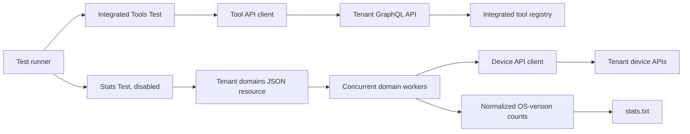
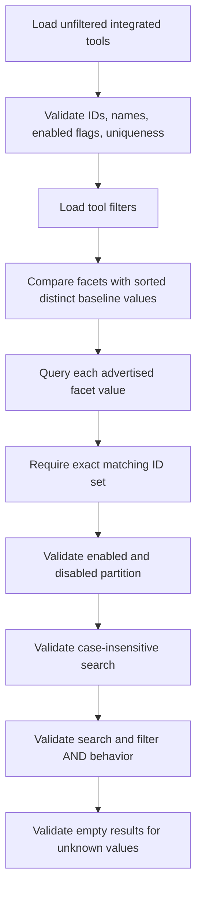
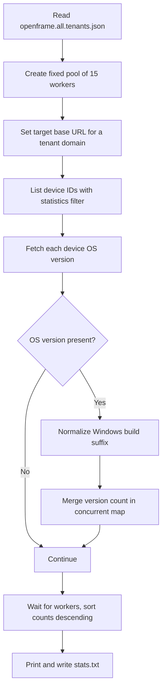

# Stats And Support Tests

Stats And Support Tests is a small, service-level test module supplied by the `openframe-test-service-core` library and run by this repository's OpenFrame test service. It has two distinct roles:

- **Integrated tool contract coverage:** verifies that the tenant's read-only integrated-tool registry behaves consistently through the GraphQL tool API.
- **Operational statistics collection:** provides a deliberately disabled, ad hoc collector that aggregates operating-system versions across domains listed in a bundled tenant inventory.

The implementation resides in the OpenFrame OSS Library rather than this repository. The tenant service assembles and runs library version `7.0.11`, including the `com.openframe.oss:openframe-test-service-core` artifact.

## Architecture Overview

The two tests do not form a production request path. They exercise existing tenant-facing APIs: the integrated-tool test asserts API semantics, while the statistics test reads device information from each configured tenant domain and writes a local report.

## Components

| Component | Responsibility | Execution status |
|---|---|---|
| [`IntegratedToolsTest`](https://github.com/flamingo-stack/openframe-oss-lib/blob/7a766f00e4f58b5d89db007b878ac8d6e0c344f4/openframe-test-service-core/src/main/java/com/openframe/test/tests/IntegratedToolsTest.java) | Validates listing, filtering, searching, identifiers, and filter facets for integrated tools. | Active JUnit feature/read tests, tagged `saas` and `integrated-tools`. |
| [`StatsTest`](https://github.com/flamingo-stack/openframe-oss-lib/blob/7a766f00e4f58b5d89db007b878ac8d6e0c344f4/openframe-test-service-core/src/main/java/com/openframe/test/tests/StatsTest.java) | Collects and persists an operating-system-version frequency report across configured tenant domains. | Disabled at the class level. |

## Integrated Tool Contract Coverage

`IntegratedToolsTest` treats the unfiltered integrated-tool list as the reference set and checks that all query variants remain internally consistent.

### Assertions

- **Baseline registry quality:** the list is non-empty, every Relay ID decodes with the `IntegratedTool:` prefix, names are present, enabled flags are non-null, and IDs are unique.
- **Facets:** type, category, and platform-category filters must equal the sorted, distinct, non-null values derived from the unfiltered tool list.
- **Facet filtering:** for every advertised facet value, the filtered response must contain exactly the matching tools from the baseline list.
- **Enabled-state partitioning:** `enabled=true` returns only enabled tools; `enabled=false` returns only disabled tools; together they partition the complete list.
- **Case-insensitive search:** an uppercased tool name must still locate the selected tool, and every result must match the query in either its name or description.
- **Combined predicates:** a search and a filter compose with logical AND. A tool is returned with its own enabled state but excluded with the opposite state.
- **No-match handling:** unknown type/category values and an unmatched search return an empty list. The search assertion includes regex metacharacters to verify literal treatment rather than regex interpretation.

### Query Validation Flow

A tenant with no advertised type, category, or platform-category values causes only the per-facet test to be skipped via a JUnit assumption. The baseline list, enabled-state, search, and no-match checks remain applicable.

## Operating-System Statistics Collection

`StatsTest` is annotated with JUnit `Disabled`, so normal test execution does not invoke it. It is an operator-driven utility for sampling tenant device data, not a pass/fail regression test.

### Collection Process

The collector reads domain values from the `openframe.all.tenants.json` classpath resource, uses a fixed pool of 15 workers, and requests devices with a page size of 100. Each worker pauses briefly before fetching a device OS version, ignores individual device lookup failures, and merges nonblank versions into a `ConcurrentHashMap`.

Windows values have a trailing dotted numeric build suffix removed, grouping values such as a Windows product/version with different build numbers under one normalized label. Other operating-system strings are counted without normalization. Final output is sorted by count in descending order, printed as tab-separated rows, and persisted to `stats.txt` in the process working directory.

## Operational Considerations

- The statistics collector changes a shared base URL through `RequestSpecHelper.setBaseUrl`; its per-domain parallelism should be reviewed carefully if the underlying request specification is globally shared.
- A failed OS-version lookup is intentionally swallowed, so the resulting report is best treated as a successful-sample aggregate rather than an exhaustive inventory.
- `stats.txt` is a generated local artifact. It is not an API response or durable platform record.
- The integrated-tool tests depend on tenant setup providing at least one registered integrated tool; that condition is asserted explicitly.

## System Context

Stats And Support Tests validates behavior supplied by the API and client service layers without reimplementing those layers. In particular, the integrated-tool checks cover the registry exposed to tenants, while the statistics utility queries device inventory through the test `DeviceApi` helper. The module therefore serves as a compatibility and diagnostic boundary between the test runner and deployed tenant services.
