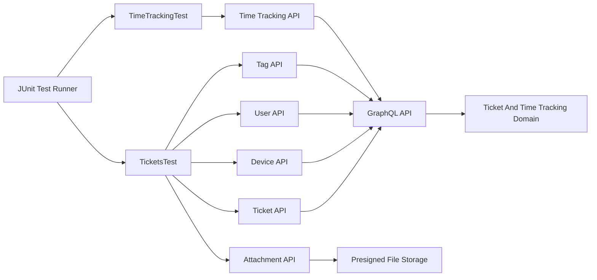
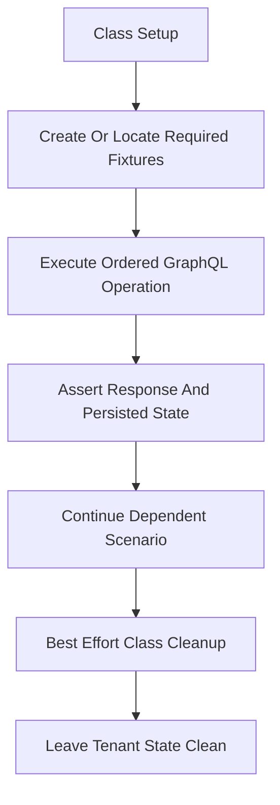
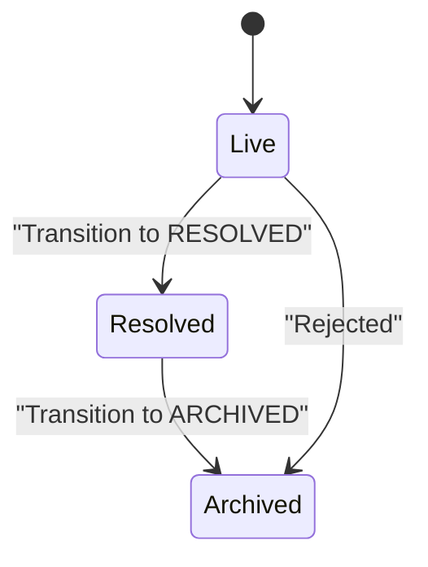
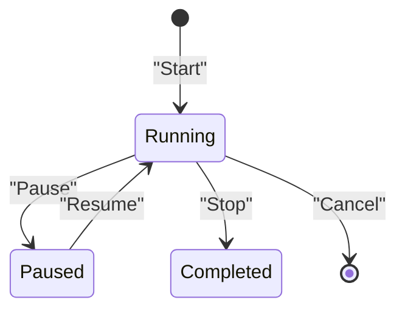

# Tickets And Time Tracking Tests

Tickets And Time Tracking Tests is an ordered JUnit 5 end-to-end test module from the OpenFrame Test Service Core library. It validates the GraphQL contracts for ticket lifecycle management, notes and attachments, and employee time tracking. The tenant repository runs this library as part of its `openframe/services/openframe-test` service; the two test classes are supplied by the `com.openframe.oss:openframe-test-service-core` dependency.

The implementation is in the OpenFrame OSS Library at [TicketsTest.java](https://github.com/flamingo-stack/openframe-oss-lib/blob/7a766f00e4f58b5d89db007b878ac8d6e0c344f4/openframe-test-service-core/src/main/java/com/openframe/test/tests/TicketsTest.java) and [TimeTrackingTest.java](https://github.com/flamingo-stack/openframe-oss-lib/blob/7a766f00e4f58b5d89db007b878ac8d6e0c344f4/openframe-test-service-core/src/main/java/com/openframe/test/tests/TimeTrackingTest.java).

## Core Components

| Component | Responsibility |
| --- | --- |
| `TicketsTest` | Ordered ticket-management end-to-end coverage, including lifecycle, status administration, collaboration content, attachments, filtering, and cleanup. |
| `TimeTrackingTest` | Ordered timer and manual-time-entry end-to-end coverage, including duration accounting, validation guards, employee reporting, and cleanup. |

## Purpose And Coverage

The module protects two user-facing workflows:

- **Tickets:** ticket discovery, creation, search, ordering, assignment, device and organization association, lifecycle transitions, custom status administration, notes, attachments, filtering, statistics, and scoped bulk archiving.
- **Time tracking:** one active timer per user, pause and resume accounting, manual time entries, employee-oriented listing and statistics, validation errors, and cleanup.

Most executable cases use the `feature` tag. Read-only ticket checks also carry `saas` and `read`; negative-path checks carry `negative`. Both classes use `MethodOrderer.OrderAnnotation`, so stateful scenarios intentionally run in a defined sequence.

## Architecture

The tests use API helpers and DTOs from the same test library rather than directly accessing persistence. This makes the assertions verify the externally observable GraphQL behavior, including Relay identifier conversion where an API returns raw identifiers alongside global IDs.

## Execution Model

### Shared-Test-Tenant Safety

`TicketsTest` limits newly created records to a pipeline-scoped device and that device's organization. It prefers an online device but may fall back to an offline one. The class maintains in-memory lists of tickets, custom status identifiers, and staged attachment identifiers. Its after-class cleanup discards staged files, moves remaining owned tickets through the resolved and archived lifecycle states, and removes custom statuses.

`TimeTrackingTest` cancels a pre-existing timer before execution, records every created entry identifier, and cancels any active timer plus deletes remaining entries after execution. Cleanup is deliberately best effort so an unsuccessful cleanup does not hide the assertion that originally failed.

## Ticket Workflow Tests

`TicketsTest` verifies the ticket workflow through `TicketApi`, supplemented by device, user, tag, and attachment APIs.

### Read And Fixture Coverage

- Lists tickets and reports all missing mandatory fields in one assertion result, rather than stopping at the first malformed ticket.
- Lists ticket tags and validates their identifiers and keys.
- Seeds the idempotent `QA_TICKET_TAG` ticket tag before ordered creation scenarios.
- Retrieves an individual ticket and searches by the title of an existing ticket.

### Creation, Ordering, And Association

Ticket creation validates the title, description, ticket number, organization, device, assignee, owner, and tag relationship. A new ticket must start in a live status definition; the test intentionally does not depend on one literal starting status because tenants may configure different initial lifecycle kinds.

The reorder test creates a second active ticket so it can find a status column with at least two entries. It then moves the last ticket before the first within one status column, proving that the ticket stays in its status definition while receiving a new ordering key.

Further mutation coverage verifies partial edits, unassignment and reassignment, unlinking a device while retaining the organization, unlinking the organization, and filtering by the ticket's device. Each operation is reread where persistence is important.

### Lifecycle And Status Administration

The lifecycle cases resolve system status IDs dynamically by kind and treat `statusDefinition` as the lifecycle authority. They cover:

- resolving a ticket and checking the resolved timestamp;
- rejecting a direct transition from a live status to `ARCHIVED` with `TICKET_INVALID_TRANSITION`;
- archiving a resolved ticket;
- atomically taking over a ticket by assigning the caller and moving to `TECH_REQUIRED`;
- rejecting a take-over transition to `ARCHIVED` when that transition is not allowed;
- creating, editing, reordering, listing, and deleting custom statuses;
- rejecting deletion of system statuses with `TICKET_STATUS_SYSTEM_PROTECTED`;
- reading the transition matrix and validating the resolved-to-archived rule; and
- validating non-negative per-status statistics whose sum does not exceed the total count.

The bulk-archive sequence prepares two tickets in the same organization: one assigned to the caller and one unassigned. The bulk archive filter targets the caller and organization, then verifies that the assigned ticket is archived while the unassigned ticket remains resolved. If the setup step did not complete, the dependent case is skipped with a clear assumption message.

### Notes And Attachments

The notes-and-attachments scenario creates a dedicated ticket and validates a complete content workflow:

1. Add a note and verify its raw ticket identifier, author, content, and presence in ticket details.
2. Edit the note, verify the same identifier and an update timestamp, then delete it.
3. Request a temporary attachment upload URL, upload fixture bytes through `AttachmentApi`, and link the staged item by updating the ticket.
4. Verify attachment filename and size, request a download URL, and compare downloaded bytes with the source fixture.
5. Delete the ticket attachment and separately discard an unlinked staged attachment.

Recording a staged attachment immediately after it exists is intentional: a failure after staging but before linking must still be recoverable by class cleanup.

## Time Tracking Workflow Tests

`TimeTrackingTest` exercises `TimeTrackingApi` as the authenticated caller. It derives the caller's raw and Relay global user IDs from the first started timer, allowing later employee-scoped manual-entry assertions to use the expected identifier form.

### Timer Lifecycle

The ordered timer scenario starts a timer with unique run-scoped notes, reads it as the current timer, pauses it, resumes it, and stops it. It verifies that repeated pause and resume calls are idempotent. Deliberate two-second waits are required because the server calculates whole-second work and break durations from server-side timestamps. The final checks ensure that work duration excludes break duration, their sum approximates elapsed time, no active timer remains, and the completed entry is visible both in the caller's daily list and by identifier.

### Guard And Manual-Entry Coverage

Negative cases confirm that cancelling without an active timer returns false, pausing without a timer is refused, a second timer cannot start, and a running timer cannot be edited. A `finally` block cancels the guard-test timer regardless of assertion outcome.

The manual-entry scenario creates a one-hour historical entry, confirms its `MANUAL` source and computed end time, partially updates notes and duration, filters it from the employee list, validates aggregate count and duration statistics, and confirms first deletion succeeds while repeated deletion returns false.

A separate negative case requires either ticket content or notes for a manual entry. The non-positive-duration case is intentionally disabled: the expected contract is a positive-duration validation error, but current server-side exception mapping does not expose that validation message reliably. The assertion remains in the suite as the intended behavior for re-enablement after the product defect is corrected.

## Maintenance Notes

- Preserve method ordering when adding stateful cases; several tests intentionally consume fixture state prepared by earlier ordered methods.
- Prefer a test-owned ticket over a shared-tenant listing for destructive transitions.
- Resolve lifecycle statuses by kind rather than assuming a tenant-specific status identifier or initial status.
- Add all created tickets, temporary attachments, statuses, and time entries to the relevant cleanup collection as soon as they are created.
- Keep timer duration assertions tolerant of whole-second truncation and network round-trip variation.
