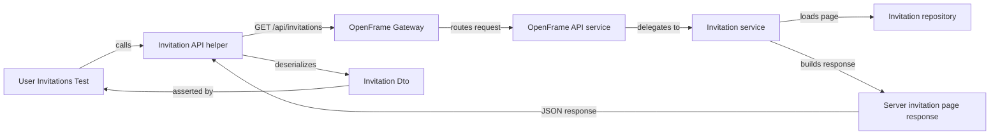
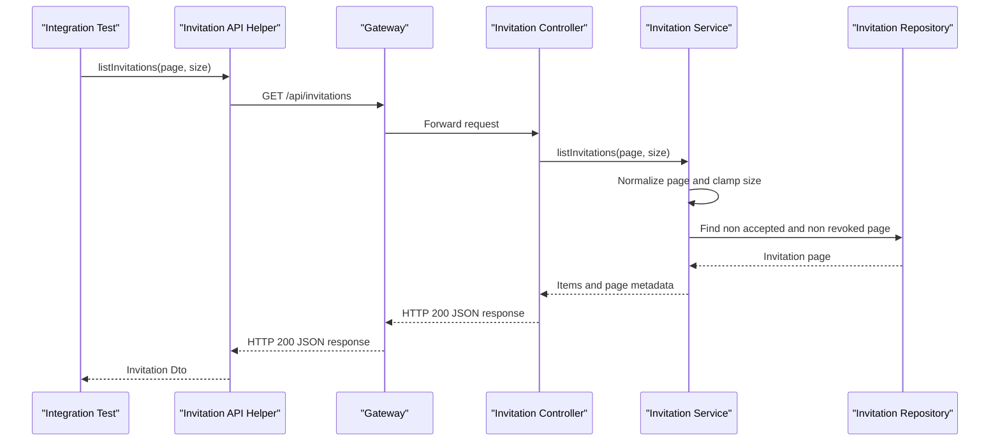
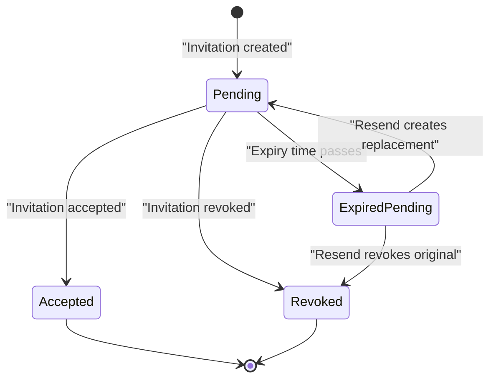

# Invitation Dto

Invitation Dto is the test-suite representation of one paginated REST response returned when the platform lists tenant invitations. It is provided by the `com.openframe.oss:openframe-test-service-core` library at version `7.0.11`, which this repository consumes. The DTO lets integration tests deserialize the page returned by `GET /api/invitations`, assert pagination metadata, and iterate through all invitations without coupling the tests to HTTP client JSON structures.

The implementation is defined in [InvitationPageResponse.java](https://github.com/flamingo-stack/openframe-oss-lib/blob/7a766f00e4f58b5d89db007b878ac8d6e0c344f4/openframe-test-service-core/src/main/java/com/openframe/test/data/dto/invitation/InvitationPageResponse.java).

## Responsibilities and Scope

The `InvitationPageResponse` DTO models a single offset-based invitation page:

- `items` contains the invitation records for the requested page.
- `page` is the zero-based page number actually returned.
- `size` is the effective page size.
- `totalElements` is the total number of invitations represented by the listing.
- `totalPages` is the number of pages available at the effective size.
- `hasNext` indicates whether another page can be requested.

It deliberately contains no API behavior, validation, pagination calculation, or persistence logic. Lombok generates the accessors, mutators, builder, and constructors. Jackson ignores unrecognized response properties, allowing tests compiled against this DTO to tolerate additive server-side fields.

## Data Contract

`items` uses the companion test-side `Invitation` DTO. Each item supplies the invitation identifier, email address, assigned roles, expiry timestamp, lifecycle status, and creation and update timestamps. The page wrapper conveys the collection-level metadata required to traverse a listing safely.

| Field | Java type | Meaning | Test usage |
|---|---|---|---|
| `items` | `List<Invitation>` | Invitations included in the current page | Locate and validate an invitation returned by the API. |
| `page` | `int` | Returned zero-based page index | Confirm page selection and detect normalized negative requests. |
| `size` | `int` | Returned page capacity | Confirm the server accepted or clamped the requested size. |
| `totalElements` | `long` | Total matching invitation count | Assert that created data participates in the listing. |
| `totalPages` | `int` | Number of pages at the effective size | Check boundary behavior for small page sizes. |
| `hasNext` | `boolean` | Whether a subsequent page exists | Control page-by-page traversal. |

## Architecture

The DTO is at the test boundary. The application API builds an equivalent server response, the gateway exposes it under the API prefix, and the test support library deserializes it for test assertions.



### Component Relationships

| Component | Relationship to Invitation Dto |
|---|---|
| Test-side `Invitation` | Supplies the element type within `items`. Defaults its role list to empty and its status to pending when built locally. |
| Test-side invitation API helper | Sends the paged request with `page` and `size` query parameters, expects HTTP `200`, and deserializes the body into Invitation Dto. |
| User invitations integration test | Exercises invitation creation, acceptance, revocation, pagination, and resend behavior; it uses `hasNext` to collect all listed pages. |
| API invitation controller | Handles the backing `GET /invitations` endpoint and forwards the requested page and size to the invitation service. |
| Invitation service | Applies offset pagination, sorts by creation time descending then identifier descending, excludes accepted and revoked records from the REST list, and constructs the server response. |
| Invitation repository | Retrieves the persisted invitation page used by the REST listing. |

## Listing Data Flow

The API helper requests a page through the gateway path. On the server, the invitation service constrains the page request and maps persisted invitations to API response items. Jackson then maps the returned JSON into Invitation Dto.



## Pagination Semantics

The REST API uses offset pagination. The service normalizes a negative page to `0`, clamps a requested size to at least `1`, and caps it at `1000`. Results use descending `createdAt` ordering with descending identifier as the deterministic tie-breaker. The list excludes invitations in accepted or revoked states. A pending invitation that has passed its expiry remains relevant to the REST listing; expiry does not itself remove the record from this endpoint.

The test suite uses the following traversal pattern conceptually:

```java
List<Invitation> all = new ArrayList<>();
InvitationPageResponse page;
int index = 0;
do {
    page = InvitationApi.listInvitations(index++, 100);
    all.addAll(page.getItems());
} while (page.isHasNext());
```

This strategy must use the response's `hasNext` value rather than derive termination from `totalPages`, since the server remains the authority for whether additional results are available.

## Invitation Lifecycle in Tests

Invitation Dto observes the listing portion of a wider invitation lifecycle. Tests create invitations, verify that pending invitations appear in listings, then revoke them and verify they are no longer returned. Acceptance and revocation are terminal with respect to the REST list.



The replacement created by a successful resend has a new identifier. Resend is allowed only for an expired pending invitation; attempting it for a fresh pending invitation is expected to be refused. The page DTO is therefore useful for asserting both visibility of pending records and removal after revocation.

## Maintenance Notes

- Keep the field names aligned with the REST response. The test helper relies on Jackson's default property mapping.
- Preserve `@JsonIgnoreProperties(ignoreUnknown = true)` when adding compatibility-sensitive tests, because it permits server-side additive changes without breaking older test clients.
- Treat `totalElements`, `totalPages`, and `hasNext` as related metadata that should be validated together when pagination behavior changes.
- Do not use this DTO for the GraphQL invitation connection. GraphQL uses cursor pagination and exposes connection edges and page information through a separate contract.
- Changes to invitation visibility should be verified across creation, listing, revocation, acceptance, and resend scenarios, particularly the rule that accepted and revoked invitations are excluded from the REST list.
