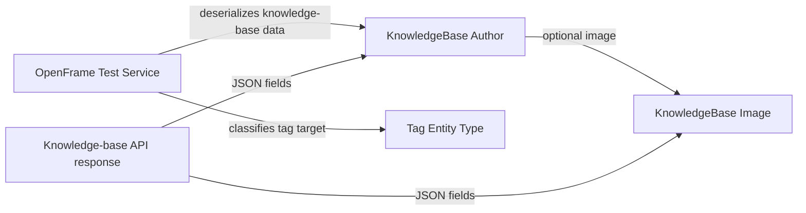
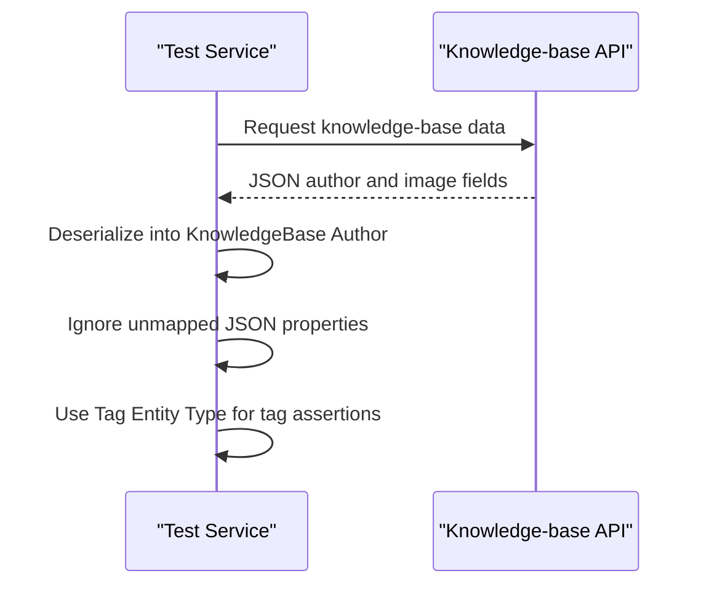

# Knowledgebase Dto

Knowledgebase Dto provides small, JSON-tolerant Java data-transfer types used by the OpenFrame test service when it consumes knowledge-base data. The module is supplied by the `com.openframe.oss:openframe-test-service-core` library and runs with this repository's OpenFrame test service. It models an article author, that author's optional image metadata, and the domain categories to which a tag can apply.

## Scope and Design

The types are deliberately transport-focused:

- **Forward-compatible deserialization:** `KnowledgeBaseAuthor` and `KnowledgeBaseImage` ignore JSON properties that are not currently modeled, allowing test clients to consume responses that add fields.
- **Convenient fixture construction:** Lombok supplies value accessors, a builder, and both no-argument and all-argument constructors for the two object DTOs.
- **Explicit tag domain:** `TagEntityType` constrains tag targets to devices, tickets, and knowledge articles.

## Architecture

The module does not implement API calls, persistence, or validation rules. It is a contract layer for test data. Knowledge-base endpoint handling and resource contracts are provided elsewhere in the platform.

## Components

### KnowledgeBase Author

[`KnowledgeBaseAuthor`](https://github.com/flamingo-stack/openframe-oss-lib/blob/7a766f00e4f58b5d89db007b878ac8d6e0c344f4/openframe-test-service-core/src/main/java/com/openframe/test/data/dto/knowledgebase/KnowledgeBaseAuthor.java) represents the author identity returned with knowledge-base content.

| Field | Type | Meaning |
|---|---|---|
| `id` | `String` | Author identifier. |
| `firstName` | `String` | Author given name. |
| `lastName` | `String` | Author family name. |
| `email` | `String` | Author email address. |
| `image` | `KnowledgeBaseImage` | Optional author image descriptor. |

Because it is annotated to ignore unknown JSON properties, additional author fields in a response do not prevent deserialization by existing tests.

### KnowledgeBase Image

[`KnowledgeBaseImage`](https://github.com/flamingo-stack/openframe-oss-lib/blob/7a766f00e4f58b5d89db007b878ac8d6e0c344f4/openframe-test-service-core/src/main/java/com/openframe/test/data/dto/knowledgebase/KnowledgeBaseImage.java) describes an image associated with an author.

| Field | Type | Meaning |
|---|---|---|
| `imageUrl` | `String` | Location of the image. |
| `hash` | `String` | Image hash supplied by the API contract. |

The DTO carries the values as received; it does not download media or calculate or validate the hash.

### Tag Entity Type

[`TagEntityType`](https://github.com/flamingo-stack/openframe-oss-lib/blob/7a766f00e4f58b5d89db007b878ac8d6e0c344f4/openframe-test-service-core/src/main/java/com/openframe/test/data/dto/knowledgebase/TagEntityType.java) is the closed set of supported tag targets:

| Value | Target |
|---|---|
| `DEVICE` | A managed device. |
| `TICKET` | A support ticket. |
| `KNOWLEDGE_ARTICLE` | A knowledge-base article. |

## Data Flow

## Maintenance Notes

- Preserve the JSON property names when evolving these DTOs because they form part of test response deserialization.
- Add an enum constant only when the corresponding API domain gains a supported tag target; callers that switch exhaustively over the enum may need updating.
- Keep `KnowledgeBaseImage` nested through `KnowledgeBaseAuthor.image` when the API continues to present author imagery as a structured object.
