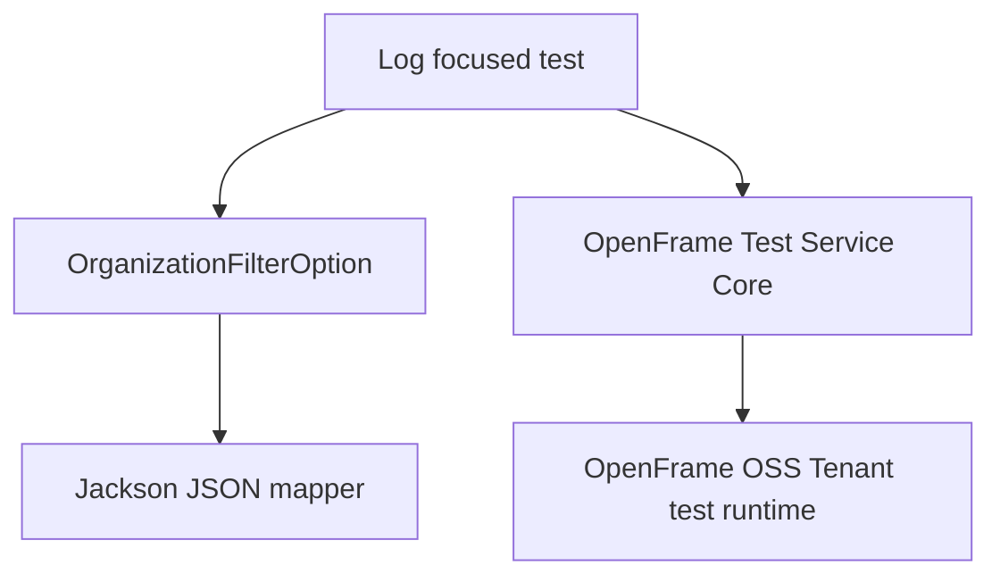
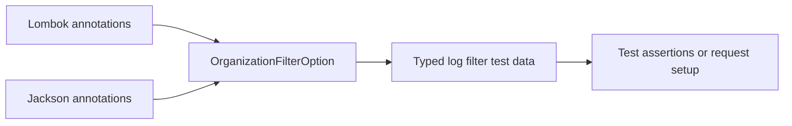
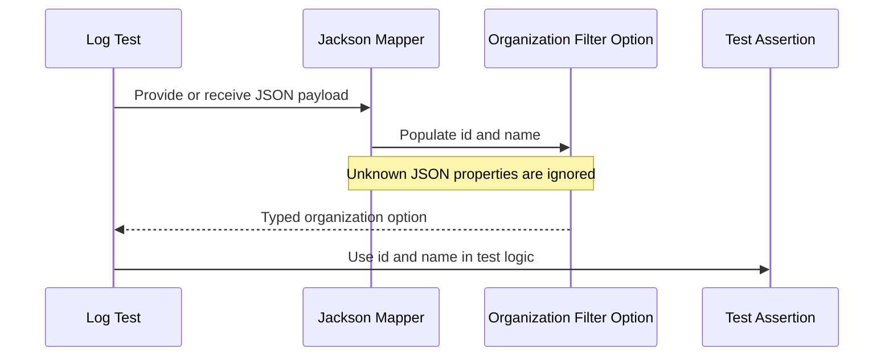

# Log Dto

Log Dto is a small test-data transfer object in the OpenFrame Test Service Core library. It represents one organization option that can be selected when filtering log data: a stable organization identifier and a display name. The OpenFrame OSS Tenant repository consumes this library as `com.openframe.oss:openframe-test-service-core` version `7.0.11`; the implementation is maintained in the OpenFrame OSS Library.

The source type is [`OrganizationFilterOption`](https://github.com/flamingo-stack/openframe-oss-lib/blob/7a766f00e4f58b5d89db007b878ac8d6e0c344f4/openframe-test-service-core/src/main/java/com/openframe/test/data/dto/log/OrganizationFilterOption.java). It is a test-side representation, rather than the production log-query contract or a persistence model.

## Responsibilities

- Carry an organization identifier in `id`.
- Carry the corresponding human-readable organization name in `name`.
- Support JSON deserialization that tolerates additional fields returned by an API.
- Provide concise construction and value-object access through Lombok-generated members.

## Type Contract

| Property | Java type | Meaning |
| --- | --- | --- |
| `id` | `String` | Identifier for the organization represented by the filter option. |
| `name` | `String` | Display name for that organization. |

A payload matching the declared contract has the following shape:

```json
{
  "id": "organization-id",
  "name": "Example Organization"
}
```

The class is annotated with `JsonIgnoreProperties(ignoreUnknown = true)`. Consequently, a response may add fields without preventing this DTO from being deserialized; only `id` and `name` are retained by this type.

## Generated Object API

`OrganizationFilterOption` is a mutable Java class. Lombok supplies the routine object API and construction paths:

- `@Data` generates accessors, mutators, and standard value methods such as `equals`, `hashCode`, and `toString`.
- `@Builder` supports named, fluent creation where a test needs to supply selected fields.
- `@NoArgsConstructor` supports frameworks and JSON mappers that instantiate first and populate properties afterward.
- `@AllArgsConstructor` supports direct construction with both declared properties.

No validation, normalization, ordering rule, or default value is implemented in this class. Callers therefore own any requirements about non-null identifiers, name formatting, and semantic uniqueness.

## Architecture Context

Log Dto belongs to the DTO layer of the OpenFrame Test Service Core artifact. It isolates test code from carrying unstructured organization-filter JSON while remaining deliberately independent of transport clients, storage, and production query logic.



The module has one implementation class and does not define services, repositories, endpoints, or scheduled processes. Its practical dependency surface is limited to Jackson annotations and Lombok code generation.



## Data Flow

When a log-oriented test receives or prepares organization filter options, the DTO provides a stable local shape for the values of interest.



### Deserialization Behavior

1. A JSON mapper creates the object through the no-argument constructor.
2. Recognized JSON properties populate `id` and `name` using generated setters.
3. Unrecognized properties are ignored because of the Jackson annotation.
4. The test can read the typed values through generated getters or compare instances using generated value methods.

This forward-tolerant behavior is useful when an upstream log-filter response evolves but the test only needs an organization identifier and display name.

## Maintenance Guidance

- Preserve the JSON property names unless all relevant producing and consuming test code changes together.
- Treat `id` as the identity field and `name` as display data; do not infer validation behavior from this DTO because it has none.
- Add a field only when tests require it. The ignore-unknown policy already allows server responses to evolve without immediately expanding the DTO.
- Keep changes compatible with builder use, JSON construction, and direct all-arguments construction.
- When production log-query behavior changes, validate the associated test expectations against the production API contracts rather than embedding production logic in this DTO.

## Scope Boundaries

Log Dto does not retrieve logs, query an organization directory, apply a filter, or verify access control. Those responsibilities remain with the API and test infrastructure that produce or consume organization-filter data. The type only models the two fields required by its test-side contract.
