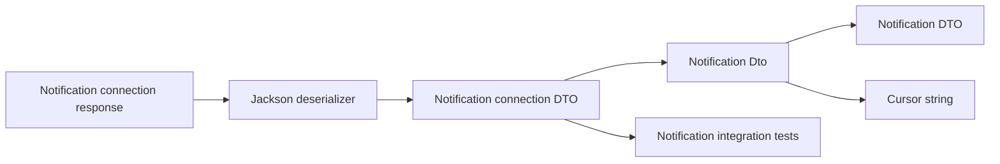
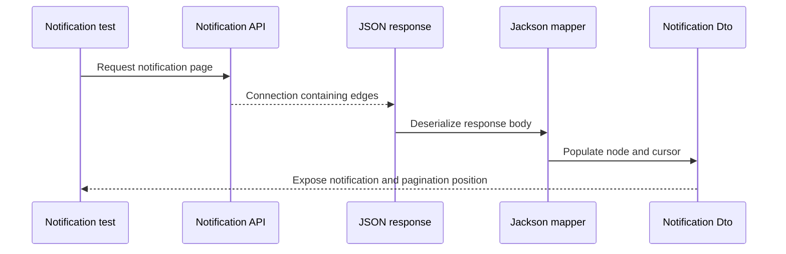
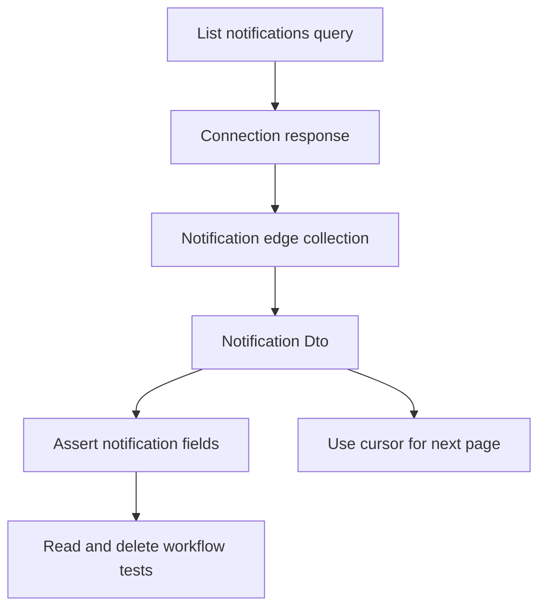
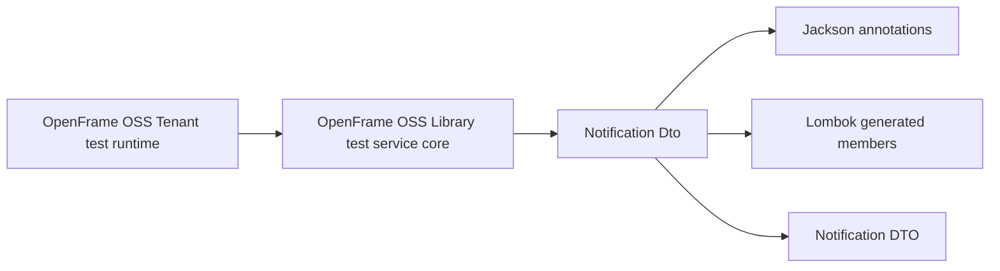

# Notification Dto

Notification Dto is a test-support data-transfer module in the `openframe-test-service-core` library. It models one cursor-based notification result as a pair of a notification payload and its pagination cursor. The OpenFrame OSS Tenant repository assembles this library into its test service; the implementation itself is supplied by OpenFrame OSS Library version `7.0.11`.

The module intentionally contains no request logic, GraphQL client, persistence code, or pagination algorithm. Its responsibility is to deserialize and carry the two fields that make an edge in a notification connection response.

## Source and Scope

The sole implementation is [`NotificationEdge.java`](https://github.com/flamingo-stack/openframe-oss-lib/blob/7a766f00e4f58b5d89db007b878ac8d6e0c344f4/openframe-test-service-core/src/main/java/com/openframe/test/data/dto/notification/NotificationEdge.java), from the OpenFrame OSS Library.

`NotificationEdge` has two properties:

| Property | Java type | Meaning |
|---|---|---|
| `node` | `Notification` | The notification returned for this position in the connection. |
| `cursor` | `String` | The opaque pagination position associated with that notification. |

The associated `Notification` test DTO carries the notification identifier, severity, title, description, creation time, read state, category, type, and a map of attributes. Keeping those payload fields in the node lets connection-oriented consumers separate notification data from pagination state.

## Architecture

The class is part of the test DTO layer rather than the production notification domain or persistence layers. A notification-facing API response is deserialized into connection data, whose edge records use Notification Dto to expose the payload and cursor to integration tests.

### Component Responsibilities

| Component | Responsibility |
|---|---|
| `NotificationEdge` | Represents exactly one connection edge and associates a notification with its cursor. |
| `Notification` | Represents the notification fields that tests inspect, including read state, category, severity, and attributes. |
| Jackson | Populates the DTOs from response JSON while tolerating fields newer than the test library. |
| Lombok | Generates accessors, mutators, builders, and both no-argument and all-argument constructors. |

## Serialization Contract

`NotificationEdge` uses `@JsonIgnoreProperties(ignoreUnknown = true)`. As a result, clients can safely deserialize responses that include fields not yet represented by this version of the test DTO. Known `node` and `cursor` fields remain mapped normally.

The class is annotated with Lombok `@Data`, `@Builder`, `@NoArgsConstructor`, and `@AllArgsConstructor`. This supports two complementary construction paths:

- Jackson can instantiate and populate an empty edge during response parsing.
- Tests and helper code can build an expected edge explicitly, or read and modify it through generated accessors.

The cursor is deliberately a string. Consumers should treat it as an opaque value returned by the API: it identifies a page position but does not define ordering semantics in the DTO itself.

## Data Flow

Notification Dto participates after a notification query has completed. It does not cause queries, mutate notification state, or calculate page boundaries.

For a paginated request, a consumer reads each edge's `node` to assert notification data and uses the returned `cursor` as the continuation value when requesting a later page. The edge itself does not validate, transform, or persist either value.

## Relationship to Notification Tests

The library's notification integration tests validate the higher-level notification workflow: listing inbox entries, filtering read and unread notifications, obtaining category counts, marking entries read, deleting entries, and updating notification settings. Notification Dto supports that workflow by preserving the response shape expected from cursor-based listings.

This separation is important for maintainers: changes to notification behavior belong in the API and service layers, while changes to the connection response contract may require a coordinated update to this DTO and its consuming test helpers.

## Maintenance Guidance

### Adding a response field

If the API adds a field directly to an edge, add a matching property to Notification Dto only when a test needs to inspect it. Unknown fields are currently ignored, so an API expansion alone does not break deserialization.

If the API adds a field to the notification payload, add it to the `Notification` DTO rather than to Notification Dto. The edge should remain limited to connection metadata and the node.

### Changing pagination behavior

Do not assign semantic meaning to the cursor in this class. If an API contract changes the cursor format, the edge type can remain a `String` provided it is still opaque to callers. A switch from cursor pagination to another response structure would require updating the containing connection DTO and its client mapping in addition to Notification Dto.

### Compatibility considerations

- Preserve the no-argument constructor for Jackson-based deserialization.
- Preserve `ignoreUnknown = true` unless tests must fail when the server response changes.
- Treat `node` and `cursor` as response-provided values; this module does not establish nullability or validation rules beyond the Java types.
- Changes here affect the `openframe-test-service-core` test artifact, not a production notification persistence model.

## Dependency and Boundary Summary

Notification Dto is therefore a narrow compatibility boundary between notification connection JSON and Java-based test assertions. It is lightweight by design: response transport structure stays in the edge, notification content stays in the node, and application behavior remains outside this module.
