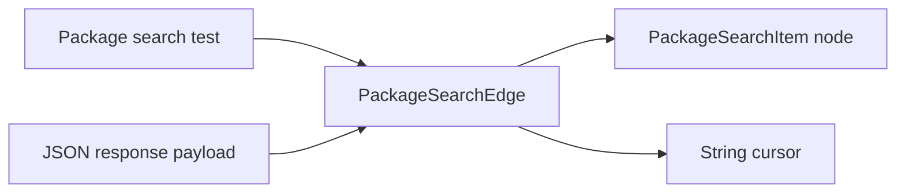
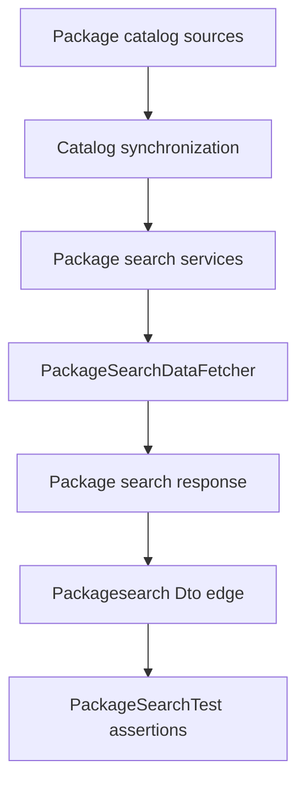
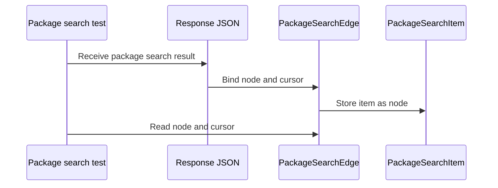

# Packagesearch Dto

Packagesearch Dto is a small test-data contract in the OpenFrame test service. It represents one cursor-addressable package-search result: a `PackageSearchItem` stored in `node` and the opaque pagination position stored in `cursor`. The contract is supplied by the OpenFrame OSS Library artifact `com.openframe.oss:openframe-test-service-core`, which this repository consumes at version `7.0.11`.

Its source of truth is [`PackageSearchEdge.java`](https://github.com/flamingo-stack/openframe-oss-lib/blob/7a766f00e4f58b5d89db007b878ac8d6e0c344f4/openframe-test-service-core/src/main/java/com/openframe/test/data/dto/packagesearch/PackageSearchEdge.java) in the OpenFrame OSS Library. The tenant repository assembles that library into its test-service runtime rather than defining this DTO locally.

## Purpose and Scope

The module gives package-search tests a typed representation of one result edge. It deliberately contains no query logic, transport client, validation rule, or persistence behavior. Its responsibilities are limited to:

- retaining the result item in `node`;
- retaining the associated pagination cursor in `cursor`;
- accepting compatible response payloads even when they contain fields not modeled by the test DTO; and
- providing standard Java data-object operations through Lombok.

The direct package-search behavior is implemented elsewhere in the platform. In particular, package-manager clients, catalog synchronization, and package search data fetching are separate concerns. Packagesearch Dto is the test-side boundary object used to consume and inspect an individual result in that flow.

## Component Model

`PackageSearchEdge` is the only component in this module. It is a Java class in the `com.openframe.test.data.dto.packagesearch` package.

| Member | Type | Role |
|---|---|---|
| `node` | `PackageSearchItem` | The package-search item represented by this edge. |
| `cursor` | `String` | The response-provided cursor associated with the item. The class does not interpret or generate this value. |

The implementation is annotated with:

- `@Data` to generate the conventional getters, setters, and value-style utility methods.
- `@Builder` to support fluent construction in tests.
- `@NoArgsConstructor` and `@AllArgsConstructor` to support empty and full construction paths.
- `@JsonIgnoreProperties(ignoreUnknown = true)` to make JSON deserialization forward-compatible with extra response fields.



## Dependencies and Boundaries

Packagesearch Dto depends directly on `PackageSearchItem`, which supplies the item-level representation. It also uses Jackson for JSON binding and Lombok for generated boilerplate. Neither dependency introduces runtime search behavior into the DTO itself.

At the system level, this test contract sits downstream of package-search service components and upstream of assertions in the OpenFrame test service. The module tree identifies the following surrounding responsibilities:

- `PackageSearchDataFetcher` exposes package-search results to the API layer.
- Package-manager clients for Brew, Chocolatey, and Winget provide source-specific package-search access.
- Catalog fetchers and writers synchronize searchable catalog data.
- `PackageSearchTest` consumes package-search DTOs during end-to-end verification.



The diagram describes the module's architectural position, not an invocation implemented in `PackageSearchEdge`: the class only maps the edge-shaped portion of the response.

## Data Contract and Deserialization

When a response is bound into this class, Jackson maps the `node` and `cursor` properties. Unknown JSON properties are ignored. This lets a test continue to deserialize an edge if the producer adds unrelated fields, while still exposing the fields the test needs for item inspection and cursor-based pagination checks.



## Construction Patterns

Use the no-argument constructor when a JSON mapper populates the object. Use the all-argument constructor or Lombok builder when creating fixture data manually. The following is illustrative Java construction based solely on the class API; it does not prescribe item fields.

```java
PackageSearchItem item = new PackageSearchItem();

PackageSearchEdge edge = PackageSearchEdge.builder()
    .node(item)
    .cursor("next-page-position")
    .build();
```

A caller should treat `cursor` as an opaque transport value. Because Packagesearch Dto has no cursor parsing or validation, pagination semantics remain owned by the API contract and the service that produced the response.

## Operational Characteristics

Packagesearch Dto is stateless and has no external I/O. It does not access a database, catalog source, network client, or configuration. Its only meaningful failure boundary is deserialization or caller-side use of incomplete data:

- Missing `node` or `cursor` values are representable because the class itself performs no validation.
- Additional JSON fields are intentionally tolerated.
- The item payload's structure is owned by `PackageSearchItem`, not by `PackageSearchEdge`.

This minimal behavior is appropriate for a response DTO: maintain pagination association without duplicating the package-search or catalog domain logic.

## Maintenance Guidance

Keep this type aligned with the edge-shaped package-search response consumed by tests. Add a member only when a test needs a stable response field. Preserve unknown-property tolerance unless the test suite is intentionally changed to reject response schema expansion. Changes to the meaning or format of `cursor` should be coordinated with the producing API and test expectations, rather than implemented as transformation logic in this DTO.

The source belongs to the OpenFrame OSS Library, so modifications should be made there and then consumed by this tenant repository through its pinned library version.
