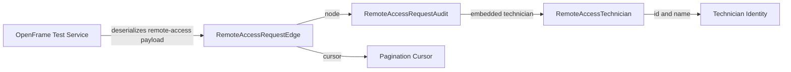
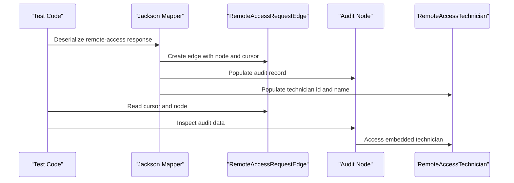

# Remoteaccess Dto

## Purpose

Remoteaccess Dto provides small, Jackson-compatible data-transfer objects used by the OpenFrame test service when it consumes remote-access data. The module is supplied by the `com.openframe.oss:openframe-test-service-core` library (version `7.0.11` in this repository) and is assembled at run time by this repository's `openframe-test` service.

It models two distinct portions of a remote-access response:

- a technician identity embedded in a session or audit record; and
- a cursor-bearing edge that wraps a remote-access audit record for paginated result traversal.

The module is intentionally a test-side representation. It does not authorize a technician, open a remote session, or make network calls. Those concerns remain with the services and remote-access integration under test.

## Source and Compatibility

The implementation lives in the OpenFrame OSS Library:

- [RemoteAccessRequestEdge](https://github.com/flamingo-stack/openframe-oss-lib/blob/7a766f00e4f58b5d89db007b878ac8d6e0c344f4/openframe-test-service-core/src/main/java/com/openframe/test/data/dto/remoteaccess/RemoteAccessRequestEdge.java)
- [RemoteAccessTechnician](https://github.com/flamingo-stack/openframe-oss-lib/blob/7a766f00e4f58b5d89db007b878ac8d6e0c344f4/openframe-test-service-core/src/main/java/com/openframe/test/data/dto/remoteaccess/RemoteAccessTechnician.java)

Both types are annotated with Jackson `JsonIgnoreProperties(ignoreUnknown = true)`. Test fixtures can therefore deserialize responses that contain additional server fields without failing solely because this module has not yet modeled them. Lombok supplies data accessors, a builder, and both no-argument and all-argument constructors.

## Architecture Overview

`RemoteAccessRequestAudit` is referenced by `RemoteAccessRequestEdge` as its `node` value. Its implementation is defined elsewhere in the same upstream remote-access DTO package and is not part of the two core components documented here. The edge preserves the audit object rather than duplicating audit fields, keeping pagination transport separate from the audit record's domain data.

## Components

### RemoteAccessRequestEdge

`RemoteAccessRequestEdge` represents one item in a cursor-based collection of remote-access request audit records.

| Field | Type | Responsibility |
|---|---|---|
| `node` | `RemoteAccessRequestAudit` | Holds the audit record represented by this collection item. |
| `cursor` | `String` | Carries the opaque pagination position associated with the item. |

The class is a DTO only: it owns no pagination behavior and does not interpret the cursor. Consumers should treat `cursor` as a server-provided value for continuing traversal rather than deriving ordering from it.

### RemoteAccessTechnician

`RemoteAccessTechnician` is the compact technician projection embedded in a remote-access session or audit row.

| Field | Type | Responsibility |
|---|---|---|
| `id` | `String` | Identifies the technician in the source response. |
| `name` | `String` | Carries the technician display name in the source response. |

Keeping this representation limited to identity fields avoids coupling test fixtures to a broader user model when validating remote-access behavior.

## Data Flow

The typical test-data flow is deserialization-oriented. An API or GraphQL response yields an edge, the edge exposes its audit node and pagination cursor, and the audit data can include the compact technician projection.

## Design Considerations

- **Forward-compatible fixtures:** Unknown JSON fields are ignored at both documented DTO boundaries, so additive API changes are less likely to break tests immediately.
- **Builder-friendly setup:** Lombok builders allow tests to construct focused fixtures without requiring a full remote-access response.
- **Separation of concerns:** The edge contains traversal metadata, while the technician object contains identity data. Audit semantics remain in the referenced audit DTO.
- **Nullability:** The classes do not declare validation annotations or explicit non-null constraints. Tests that depend on particular fields should provide and assert those values explicitly.

## Relationship to the Test Service

Remoteaccess Dto is part of the broader OpenFrame test-service-core DTO set. It supports remote-access policy and session test scenarios by giving test code stable shapes for technician and paginated audit-response data. The module does not replace the production remote-access implementation; it enables tests to deserialize and assert the data returned by that implementation.
