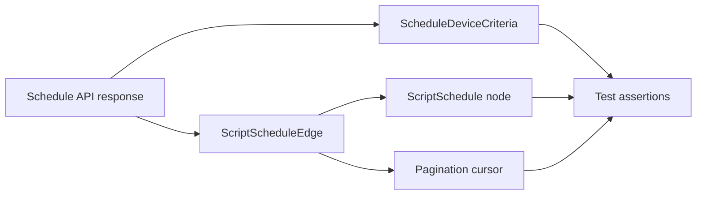
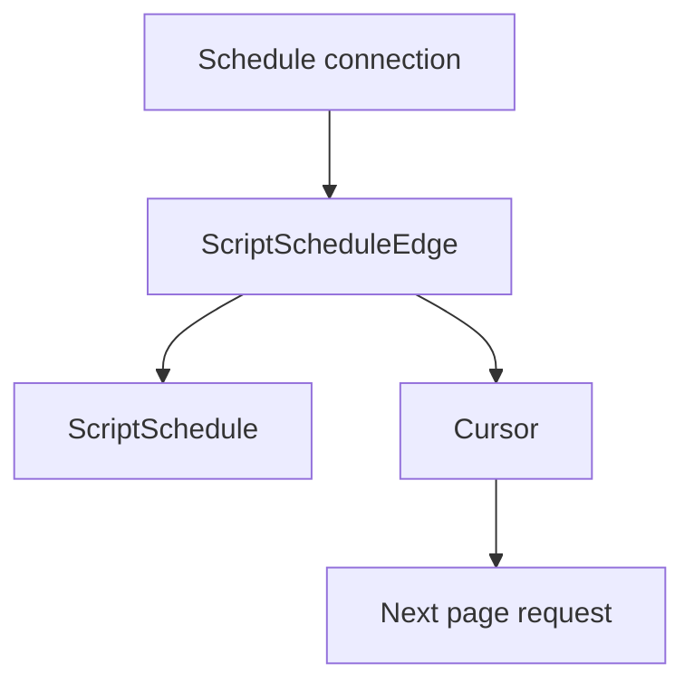
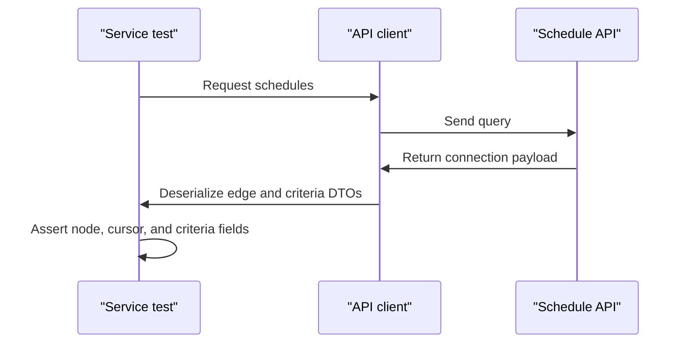

# Schedule Dto

Schedule Dto is the small set of Java test data-transfer objects used to deserialize and inspect script-schedule responses in OpenFrame service tests. It is supplied at runtime by the `com.openframe.oss:openframe-test-service-core` library, pinned by this repository to version `7.0.11`; its source is maintained in the OpenFrame OSS Library repository.

The module models two distinct response fragments:

- **Device selection criteria** for a criteria-based schedule, represented by `ScheduleDeviceCriteria`.
- **A paginated schedule result item**, represented by `ScriptScheduleEdge`, which wraps a schedule node and its pagination cursor.

Both types are deliberately permissive JSON fixtures: Jackson ignores unrecognized fields, allowing tests to focus on the fields they assert while remaining compatible with additional fields returned by the API.

## Architecture Overview

Schedule Dto is part of the `openframe-test-service-core` test-support library. It represents API response payloads rather than persistence entities, scheduling logic, or device-selection execution. Production scheduling, dispatch, and schedule-run handling belong to the platform services; this module provides stable, builder-friendly shapes for tests that validate those interfaces.

## Components

| Component | Responsibility |
|---|---|
| [`ScheduleDeviceCriteria`](https://github.com/flamingo-stack/openframe-oss-lib/blob/7a766f00e4f58b5d89db007b878ac8d6e0c344f4/openframe-test-service-core/src/main/java/com/openframe/test/data/dto/schedule/ScheduleDeviceCriteria.java) | Represents the stored device filter of a criteria schedule. Each supported list is a whitelist and an omitted or empty list imposes no restriction for that dimension. |
| [`ScriptScheduleEdge`](https://github.com/flamingo-stack/openframe-oss-lib/blob/7a766f00e4f58b5d89db007b878ac8d6e0c344f4/openframe-test-service-core/src/main/java/com/openframe/test/data/dto/schedule/ScriptScheduleEdge.java) | Models an edge in a schedule connection by pairing a `ScriptSchedule` node with an opaque cursor. |

## Device Criteria Contract

`ScheduleDeviceCriteria` contains three optional lists:

| Field | JSON field | Meaning when populated | Meaning when null or empty |
|---|---|---|---|
| `organizationIds` | `organizationIds` | Permit devices whose organization identifier is in the list. | Do not restrict selection by organization. |
| `deviceTypes` | `deviceTypes` | Permit the listed device types. | Do not restrict selection by device type. |
| `osTypes` | `osTypes` | Permit the listed operating-system types. | Do not restrict selection by operating-system type. |

The source documentation defines this object as the stored **Select Devices by Criteria** rule for a schedule whose selection mode is criteria-based. For a specific-device schedule, the criteria value itself is null. Consumers should therefore distinguish an absent criteria object from an object whose individual lists are empty: the former identifies the specific-device schedule form, while empty lists within a criteria object mean that dimension is unconstrained.

`@Data`, `@Builder`, `@NoArgsConstructor`, and `@AllArgsConstructor` provide ordinary Java-bean access, a fluent test-fixture builder, and constructor options. `@JsonIgnoreProperties(ignoreUnknown = true)` makes decoding forward-compatible when the response gains fields not represented here.

## Connection and Pagination Contract

`ScriptScheduleEdge` follows the common connection pattern:

- `node` holds the schedule summary represented by the edge. The referenced `ScriptSchedule` test DTO carries schedule metadata such as identifier, name, task type, run time, enabled state, supported platforms, and action and agent counts.
- `cursor` identifies the edge position for pagination. Treat it as an opaque value supplied back to the schedule-query interface; Schedule Dto does not parse, generate, or validate it.

As with `ScheduleDeviceCriteria`, `ScriptScheduleEdge` uses Lombok to support concise construction in tests and Jackson configuration to tolerate additive API changes.

## Data Flow in Tests

The module has no methods that call the API, execute schedules, select devices, or advance pagination. Its responsibility begins when test code deserializes a response and ends when the resulting objects are used for assertions or fixture composition.

## Integration Boundaries

- **Input boundary:** JSON schedule responses decoded by Jackson.
- **Test boundary:** Java tests use Lombok-generated builders, accessors, equality, and diagnostic string output.
- **Schedule summary boundary:** `ScriptScheduleEdge` refers to the companion `ScriptSchedule` test DTO, which defines the edge node payload.
- **Production boundary:** The client-core scheduling services and schedulers are responsible for dispatch and execution. Schedule Dto does not duplicate that behavior.

## Maintenance Notes

When schedule API fields change, preserve the semantic difference between a null criteria object and unconstrained lists inside an existing criteria object. Add new response fields only when tests need to assert them; ignored unknown properties already allow existing tests to decode expanded payloads. Changes to `node` or `cursor` should be evaluated together because both are required to verify a paginated schedule result.
