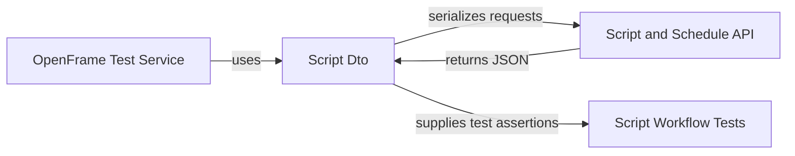
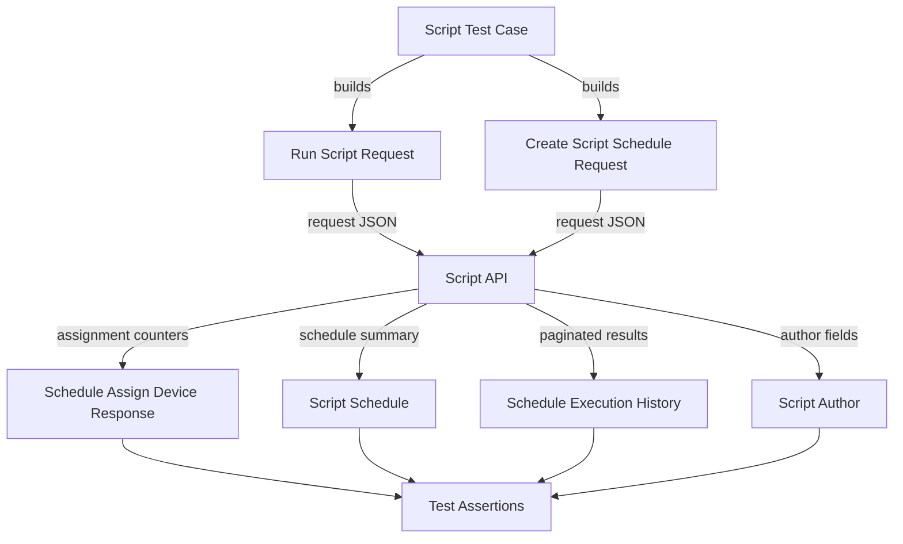
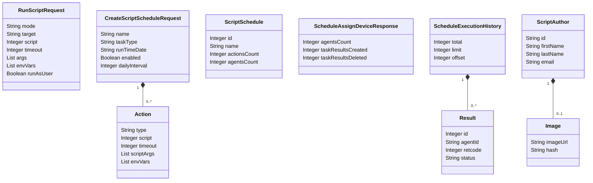

# Script Dto

## Purpose

Script Dto is a test-support contract module supplied by the `com.openframe.oss:openframe-test-service-core` library. It provides Jackson-mapped Java data-transfer objects for script execution and scheduling workflows used by the OpenFrame test service. The contracts model:

- ad hoc script-run requests, including execution context, arguments, environment variables, timeout, shell, and user-execution preference;
- creation of scheduled script tasks and their actions;
- summary data returned after assigning a schedule to devices;
- paginated schedule execution history and per-agent output; and
- the reduced author profile displayed with script data.

The module is deliberately a boundary layer. It contains no transport client, persistence logic, validation logic, or scheduling behavior. Lombok generates the usual accessors, builders, constructors, and value-oriented methods, while Jackson maps the external snake-case payload fields to Java camel-case properties. Every contract ignores unknown JSON fields, allowing test parsing to remain compatible when upstream responses add fields.

## Ownership and System Position

The source is delivered by the OpenFrame OSS Library dependency, pinned for this repository as `com.openframe.oss:openframe-test-service-core` version `7.0.11`. It runs as part of this repository's OpenFrame test service rather than being defined in the tenant repository.

At the test boundary, outbound objects describe an action to execute or schedule. Inbound objects capture the assignment counters, schedule summaries, author identity, and execution results returned by the script API. The DTOs retain the wire-oriented naming through explicit `@JsonProperty` annotations where the JSON name differs from the Java field.

## Contract Groups

| Group | Types | Role |
|---|---|---|
| Immediate execution | `RunScriptRequest` | Describes a script invocation, targets, execution environment, and run options. |
| Schedule definition | `CreateScriptScheduleRequest`, `CreateScriptScheduleRequest.Action` | Defines a scheduled task, supported platforms, cadence, and one or more script actions. |
| Assignment acknowledgement | `ScheduleAssignDeviceResponse` | Reports device and task-result counts after a schedule assignment changes. |
| Schedule read model | `ScriptSchedule` | Represents the schedule fields shown by script schedule queries. |
| Execution history | `ScheduleExecutionHistory`, `ScheduleExecutionHistory.Result` | Represents paginated task results for scheduled executions. |
| Script author view | `ScriptAuthor`, `ScriptAuthor.Image` | Represents the subset of author data selected for script listings. |

## Data Flow

## Core Contracts

### Run Script Request

[`RunScriptRequest`](https://github.com/flamingo-stack/openframe-oss-lib/blob/7a766f00e4f58b5d89db007b878ac8d6e0c344f4/openframe-test-service-core/src/main/java/com/openframe/test/data/dto/script/RunScriptRequest.java) models an immediate script run. It supports both execution metadata and targeting data:

- **Execution selection:** `mode`, `cmd`, `shell`, `customShell`, `script`, `timeout`, `patchMode`, and `monType`.
- **Targeting context:** `target`, `osType`, `client`, `site`, and the `agents` collection.
- **Inputs and execution policy:** `args`, `envVars`, `customField`, `collectorAllOutput`, `saveToAgentNote`, `offlineAgents`, and `runAsUser`.

The `custom_shell`, `custom_field`, `collector_all_output`, `save_to_agent_note`, `env_vars`, and `run_as_user` JSON properties are explicitly mapped. This makes the contract appropriate for testing API behavior that depends on the service's external JSON schema, not merely Java field naming.

### Create Script Schedule Request

[`CreateScriptScheduleRequest`](https://github.com/flamingo-stack/openframe-oss-lib/blob/7a766f00e4f58b5d89db007b878ac8d6e0c344f4/openframe-test-service-core/src/main/java/com/openframe/test/data/dto/script/CreateScriptScheduleRequest.java) describes a schedule to create. Its schedule-level fields are:

- `name` and `taskType` identify the task;
- `runTimeDate` and `dailyInterval` express its timing configuration;
- `taskSupportedPlatforms` scopes the schedule to platforms;
- `enabled` controls whether the schedule is active; and
- `actions` contains the executable work units.

Each nested `Action` specifies an action `type`, script identifier, display `name`, `timeout`, plus optional `scriptArgs` and `envVars`. The nested type is part of the same JSON contract and also ignores unknown response or request fields.

### Schedule Assignment Response

[`ScheduleAssignDeviceResponse`](https://github.com/flamingo-stack/openframe-oss-lib/blob/7a766f00e4f58b5d89db007b878ac8d6e0c344f4/openframe-test-service-core/src/main/java/com/openframe/test/data/dto/script/ScheduleAssignDeviceResponse.java) is the compact acknowledgement for a schedule-to-device assignment operation. It maps three counters:

- `agentsCount` from `agents_count`;
- `taskResultsCreated` from `task_results_created`; and
- `taskResultsDeleted` from `task_results_deleted`.

Tests can use these independent counts to distinguish the number of targeted agents from the number of execution records created or removed by an assignment update.

### Script Schedule

[`ScriptSchedule`](https://github.com/flamingo-stack/openframe-oss-lib/blob/7a766f00e4f58b5d89db007b878ac8d6e0c344f4/openframe-test-service-core/src/main/java/com/openframe/test/data/dto/script/ScriptSchedule.java) is a lightweight read model for a schedule. It includes the identifier, name, task type, configured run time, enabled status, supported platforms, action count, and agent count. Unlike the schedule-create contract, it exposes aggregate counts through `actionsCount` and `agentsCount`, which map from `actions_count` and `agents_count`.

### Schedule Execution History

[`ScheduleExecutionHistory`](https://github.com/flamingo-stack/openframe-oss-lib/blob/7a766f00e4f58b5d89db007b878ac8d6e0c344f4/openframe-test-service-core/src/main/java/com/openframe/test/data/dto/script/ScheduleExecutionHistory.java) represents a paginated history response. `total`, `limit`, and `offset` describe the page, while `results` holds one `Result` object per reported execution.

A result contains execution identity and context (`id`, `agentId`, `agentHostname`, `agentPlatform`, `organization`), outcome data (`retcode`, `stdout`, `stderr`, `status`, `syncStatus`), and timing data (`executionTime`, `lastRun`). The explicit wire mappings preserve field names such as `agent_id`, `execution_time`, and `sync_status`.

### Script Author

[`ScriptAuthor`](https://github.com/flamingo-stack/openframe-oss-lib/blob/7a766f00e4f58b5d89db007b878ac8d6e0c344f4/openframe-test-service-core/src/main/java/com/openframe/test/data/dto/script/ScriptAuthor.java) captures the script creator fields needed by script table assertions: `id`, `firstName`, `lastName`, `email`, and optional `image`. Its nested `Image` exposes `imageUrl` and `hash`.

## Relationship Summary

## Compatibility and Usage Notes

- The classes use `@JsonIgnoreProperties(ignoreUnknown = true)`. Test code can therefore deserialize a response that contains additional fields, but it cannot assert those new fields until the DTO is extended.
- Builders generated by Lombok are the natural way to create focused test payloads. Omitted boxed fields remain `null`, preserving the ability to test omitted versus explicitly supplied JSON values.
- These are test-service DTOs, not the agent-side script protocol. Agent execution messages and client execution behavior belong to the OpenFrame client and server runtime modules.
- Execution output is represented as `stdout` and `stderr` strings. Consumers should treat them as API result data rather than infer success from output alone; `retcode` and `status` provide distinct outcome indicators.
