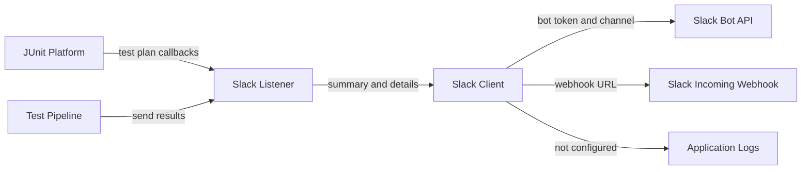
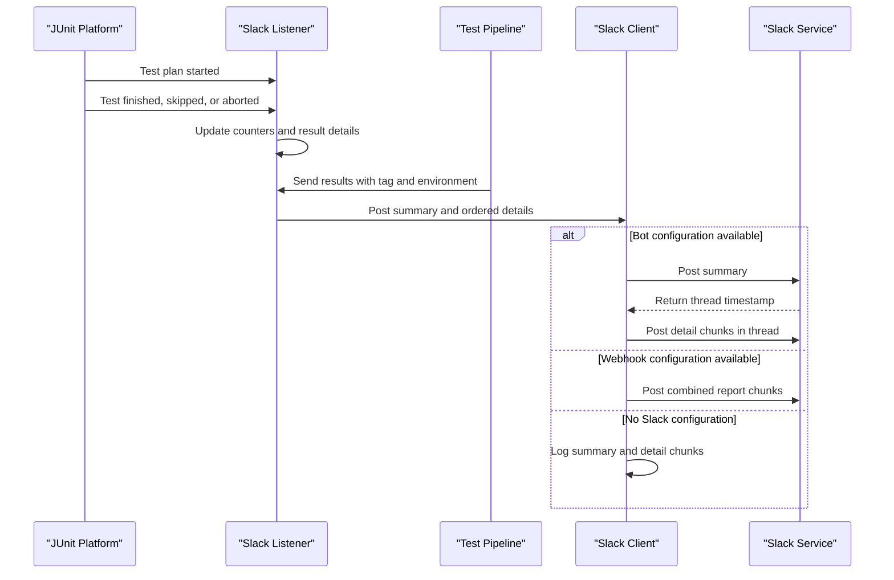

# Slack Integration

## Purpose

Slack Integration is a test-run notification adapter supplied by the **OpenFrame OSS Library** artifact `com.openframe.oss:openframe-test-service-core` and used at runtime by this repository's OpenFrame test service. It gathers JUnit Platform outcomes for a complete test plan, turns them into a concise environment report, and delivers the report to Slack.

The module is intentionally delivery-tolerant: when Slack credentials are absent, it writes the same report to application logs instead of preventing a test run from completing. It supports two delivery modes:

- **Bot API mode** when both a bot token and channel identifier are configured.
- **Incoming-webhook mode** when a webhook URL is configured and Bot API mode is unavailable.

When both are present, Bot API mode takes precedence. The implementation is in the OpenFrame OSS Library, not in this repository:

- [`SlackClient.java`](https://github.com/flamingo-stack/openframe-oss-lib/blob/7a766f00e4f58b5d89db007b878ac8d6e0c344f4/openframe-test-service-core/src/main/java/com/openframe/test/listener/SlackClient.java)
- [`SlackListener.java`](https://github.com/flamingo-stack/openframe-oss-lib/blob/7a766f00e4f58b5d89db007b878ac8d6e0c344f4/openframe-test-service-core/src/main/java/com/openframe/test/listener/SlackListener.java)

## Architecture

`SlackListener` owns the test-run state. It implements JUnit's `TestExecutionListener`, receives plan lifecycle and outcome callbacks, and posts exactly one report when its caller invokes `sendResults`. `SlackClient` owns transport selection and delivery mechanics. This separation keeps JUnit result accounting independent of Slack credentials and API failures.

## Components

### Slack Client

`SlackClient` is the output boundary for plain messages and full reports.

| Capability | Behavior |
| --- | --- |
| Construction | Supports bot token plus channel, webhook URL only, or all values through its three-argument constructor. |
| Transport choice | Uses Bot API only if both bot token and channel are nonblank. Otherwise it uses a nonblank webhook URL. If neither is configured, it logs the message. |
| Plain messages | `postMessage` sends one text message using the chosen transport. |
| Reports | `postThreadedReport` accepts a summary and detail text, splitting details into line-oriented chunks no larger than 3,000 characters. |
| Bot report layout | Posts the summary first, reads its Slack timestamp, then posts every detail chunk as a reply in that message thread. |
| Webhook report layout | Webhooks cannot attach replies to a discovered thread here. The client combines summary and details, chunks the combined text, and sends each chunk as an independent webhook message. |
| Failure handling | Logs Slack API, webhook status, and I/O failures. It does not propagate them to the test listener. |

The line-oriented chunker preserves whole lines whenever possible. A single line longer than the chunk limit is appended as one line by the current implementation, so callers should avoid producing excessively long individual result lines.

### Slack Listener

`SlackListener` aggregates execution results and formats the report. Its responsibilities are:

- Resetting state when JUnit signals a new test plan after a prior report was sent.
- Counting successful tests, failed executions, and skipped or aborted cases.
- Recording display-ready detail lines with Slack emoji markers.
- Treating aborted tests as skips rather than failures, including an assumption's explanatory message where available.
- Counting descendant test cases for skipped or aborted containers so totals remain comparable to the test plan inventory.
- Sorting details at reporting time: failures first, skips second, and passing tests last. Sorting is stable within each group.
- Selecting a report status marker: red when failures exist or no tests ran, green when at least one test passed and none failed, and yellow when only skips occurred.

## Test Result Flow

## Report Content and Classification

`sendResults(tag, domain, baseUrl)` creates a report with:

1. A `Test Report` heading and an overall status marker.
2. The environment. `localhost` is rendered as `https://localhost`; other values are formatted as a domain under the provided base URL.
3. The supplied tag.
4. Passed, failed, and skipped totals.
5. A threaded or chunked detail section when outcome entries exist.

A successful test contributes a `:white_check_mark:` line. A failure contributes a `:x:` line with the test or container description and the first line of its exception message. Skips and aborts contribute `:fast_forward:` lines. Failure and abort reasons are truncated to 300 characters after the first newline, keeping Slack entries compact and avoiding multi-line exception details in the report.

The listener also handles container-level outcomes. For example, a disabled test class or a class whose setup aborts is represented with the number of descendant test cases it prevented from running. This makes skipped totals reconcile with the planned test inventory more accurately than counting only individual callbacks.

## Concurrency and Lifecycle Guarantees

JUnit may invoke callbacks from parallel test workers. `SlackListener` uses atomic counters for totals and a `CopyOnWriteArrayList` for details, avoiding lost increments and unsafe list mutation. It records results as they arrive and only orders them during reporting, so it does not hold a lock while parallel workers write results.

The `reported` flag ensures a subsequent test plan clears state only after the previous run has been reported. `sendResults` sets this flag after delegating delivery to `SlackClient`. Because `SlackClient` catches transport exceptions internally, delivery errors are recorded in logs rather than escaping through the test pipeline.

## Operational Behavior

### Transport precedence

| Available configuration | Effective output |
| --- | --- |
| Bot token and channel identifier | Slack Bot API |
| Webhook URL only | Slack incoming webhook |
| Bot token or channel incomplete, webhook URL present | Slack incoming webhook |
| No complete bot configuration and no webhook URL | Application logs |

### Delivery semantics

- Bot mode provides a summary message followed by replies in the summary's Slack thread.
- Webhook mode sends independent messages because the client does not receive a thread timestamp through its webhook call path.
- A failed summary post in Bot API mode stops detail posting because there is no thread timestamp to target.
- A failed individual Bot API reply is logged, while subsequent chunks are still attempted.
- No result entries produce a red summary containing `No test results`.

## Integration Boundaries

This module uses the Slack Java SDK for Bot API and incoming-webhook calls and the JUnit Platform launcher API for execution events. It does not define test discovery, test selection, credential provisioning, or CI pipeline orchestration. Those concerns must provide the listener with a configured `SlackClient`, drive JUnit callbacks, and invoke `sendResults` after the run.

The module is part of the `openframe-test-service-core` library from the OpenFrame OSS Library, pinned for this repository through the `com.openframe.oss:openframe-test-service-core` dependency. It is therefore shared library behavior assembled by the tenant repository's test service rather than an HTTP endpoint or a standalone Slack application.

## Maintenance Notes

- Keep report lines short and newline-delimited so chunking remains predictable.
- Preserve the Bot API fallback order unless changing deployment expectations: Bot API mode is explicitly preferred over webhook mode.
- Any change to outcome counting should account for JUnit containers as well as individual tests, particularly when a disabled class or setup failure suppresses many tests.
- Slack formatting uses message markup and emoji tokens directly. Validate message changes against both bot and webhook delivery modes.
