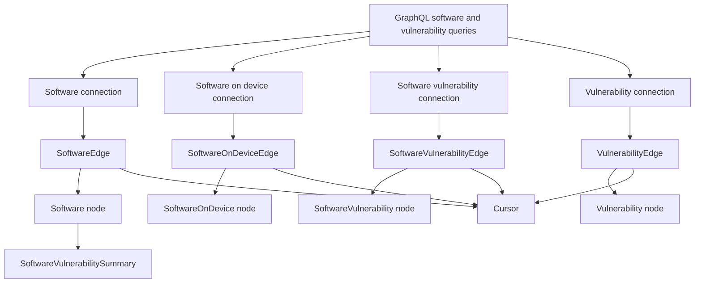
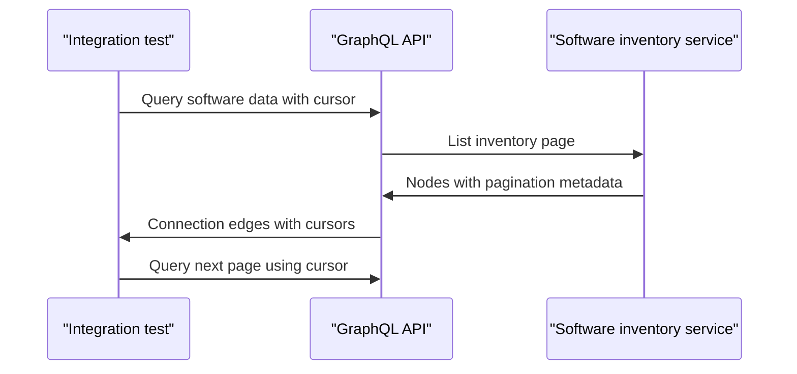

# Software Dto

Software Dto is a small test-support contract module from the `com.openframe.oss:openframe-test-service-core` library. It models cursor-paginated software inventory and vulnerability results that integration tests deserialize from the OpenFrame GraphQL API. The module is consumed at runtime by this repository's `openframe-test` service; its source is maintained in the OpenFrame OSS Library.

The five classes are intentionally transport-focused: Lombok provides mutable value-object accessors, builders, and both no-argument and all-argument constructors, while `@JsonIgnoreProperties(ignoreUnknown = true)` keeps test deserialization forward-compatible when the API adds fields.

## Responsibilities

- Represent one cursor-addressable item in software, device-installation, and vulnerability connections.
- Preserve the API cursor beside the response node so tests can continue pagination.
- Provide a compact software-level vulnerability roll-up for inventory assertions.
- Tolerate additional JSON fields without requiring immediate test DTO changes.

## Architecture

The test DTO connections pair `edges`, `pageInfo`, and `filteredCount`; each edge supplies the node and opaque cursor. The edge types documented here therefore sit between the connection wrappers and the domain payloads.

## Component Reference

| Component | Role | Payload carried by `node` |
| --- | --- | --- |
| [SoftwareEdge](https://github.com/flamingo-stack/openframe-oss-lib/blob/7a766f00e4f58b5d89db007b878ac8d6e0c344f4/openframe-test-service-core/src/main/java/com/openframe/test/data/dto/software/SoftwareEdge.java) | An item in a software inventory connection. | `Software`, including title identity, publisher, source, version status, device count, CPE match state, and vulnerability summary. |
| [SoftwareOnDeviceEdge](https://github.com/flamingo-stack/openframe-oss-lib/blob/7a766f00e4f58b5d89db007b878ac8d6e0c344f4/openframe-test-service-core/src/main/java/com/openframe/test/data/dto/software/SoftwareOnDeviceEdge.java) | An item in a software-to-device connection. | `SoftwareOnDevice`, containing the device, installed software version, and installation status. |
| [SoftwareVulnerabilityEdge](https://github.com/flamingo-stack/openframe-oss-lib/blob/7a766f00e4f58b5d89db007b878ac8d6e0c344f4/openframe-test-service-core/src/main/java/com/openframe/test/data/dto/software/SoftwareVulnerabilityEdge.java) | An item in the vulnerabilities associated with a software title. | `SoftwareVulnerability`, with CVE identifier, severity, CVSS score, affected version, and discovery timestamp. |
| [VulnerabilityEdge](https://github.com/flamingo-stack/openframe-oss-lib/blob/7a766f00e4f58b5d89db007b878ac8d6e0c344f4/openframe-test-service-core/src/main/java/com/openframe/test/data/dto/software/VulnerabilityEdge.java) | An item in the tenant or device vulnerability inventory. | `Vulnerability`, which additionally exposes EPSS probability, known-exploit status, affected software, remediation version, and affected-device count. |
| [SoftwareVulnerabilitySummary](https://github.com/flamingo-stack/openframe-oss-lib/blob/7a766f00e4f58b5d89db007b878ac8d6e0c344f4/openframe-test-service-core/src/main/java/com/openframe/test/data/dto/software/SoftwareVulnerabilitySummary.java) | A title-level vulnerability summary embedded in `Software`. | `highestSeverity` and `cveCount`. |

## Data Contracts

### Cursor edges

Each edge has the same structural contract:

- `node` is the typed item returned for the connection.
- `cursor` is the cursor associated with that item.
- Either field may be absent in a deserialized response because these are nullable Java reference fields; tests should assert the fields required by the scenario rather than presume a complete response.

The companion connection DTOs expose `nodes()` helpers that project non-null edge lists to node lists. `SoftwareConnection` also provides `ids()`, and `VulnerabilityConnection` provides `cveIds()`, allowing tests to compare stable identifiers without manually traversing edges.

### Vulnerability summary semantics

`SoftwareVulnerabilitySummary` is not a per-CVE record. It is the aggregate attached to a software title:

- `highestSeverity` communicates the title's most severe known CVE classification.
- `cveCount` gives the aggregate CVE count.
- The `Software.cveCount()` helper returns zero when the summary or its count is absent, giving tests a null-safe numeric assertion target.

Use `SoftwareVulnerabilityEdge` when an assertion needs the CVE records for one software title, and use `VulnerabilityEdge` when an assertion needs the broader vulnerability inventory and its remediation or exploit context.

## API Interaction

The API library's software and vulnerability data fetchers provide the server-side query pattern represented by these DTOs. Software queries support cursor pagination and return software inventory, devices for a software title, and vulnerabilities for a software title. Vulnerability queries return tenant-wide or device-specific vulnerabilities and devices affected by a CVE. Both fetchers are conditional on the software capability being enabled.

## Maintenance Notes

- These types are test DTOs, not persistence entities or API request models.
- Keep each edge aligned with its corresponding connection and payload type when API pagination contracts evolve.
- Preserve unknown-field tolerance unless compatibility requirements change; it allows older test artifacts to deserialize newer API responses.
- The source files belong to the OpenFrame OSS Library artifact `com.openframe.oss:openframe-test-service-core`, pinned for this repository at version `7.0.11`.
