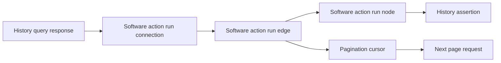
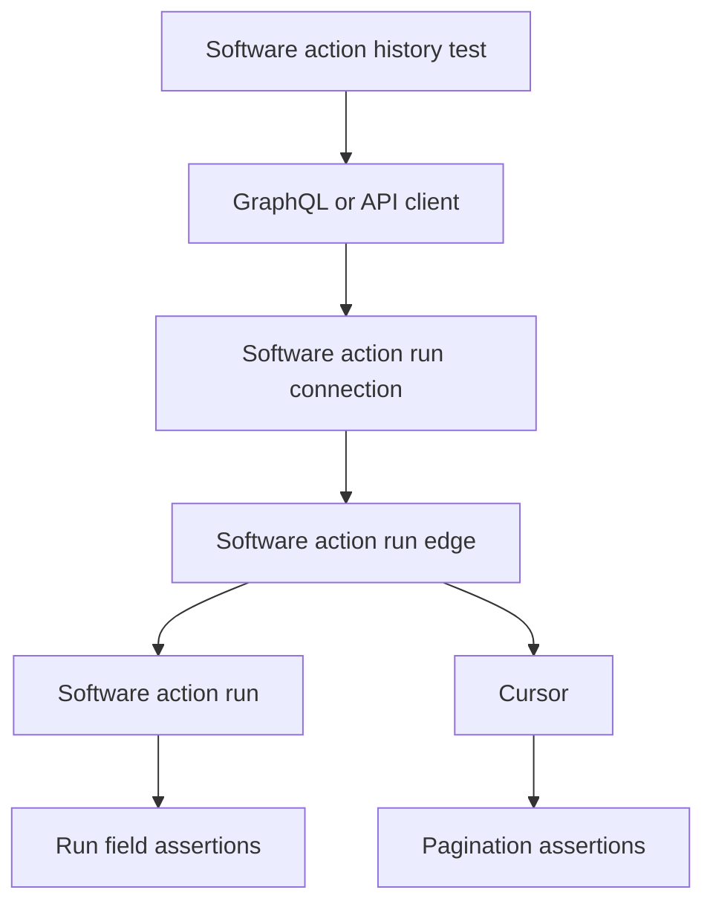
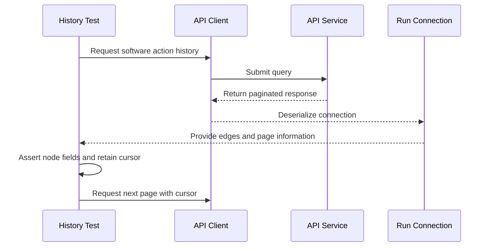

# Softwareaction Dto

Softwareaction Dto is a small test-support contract for one cursor-paginated software-action history item. It is supplied by the `com.openframe.oss:openframe-test-service-core` library, version `7.0.11`, which this repository consumes through its OpenFrame test service. The module models the boundary between a history-query response and tests that inspect individual software-action runs.

Its sole core type, `SoftwareActionRunEdge`, pairs a `SoftwareActionRun` payload with the pagination cursor that identifies that payload's position. It is a data-transfer object only: it does not query, persist, dispatch, or mutate software actions.

## Source and Scope

The implementation is in the OpenFrame OSS Library rather than this repository. See the verified [Software Action Run Edge source](https://github.com/flamingo-stack/openframe-oss-lib/blob/7a766f00e4f58b5d89db007b878ac8d6e0c344f4/openframe-test-service-core/src/main/java/com/openframe/test/data/dto/softwareaction/SoftwareActionRunEdge.java).

The module contains one class:

| Type | Role |
|---|---|
| `SoftwareActionRunEdge` | A cursor edge containing a software-action run node and its opaque cursor. |

The containing test-support artifact also defines the associated run and connection types. The run carries identity, execution, software, action, engine, status, machine-count, lifecycle-time, initiator, bundle, and schedule fields. The connection groups edges with page information and a filtered count; its `nodes()` helper derives a node-only list from its edges.

## Contract Shape

`SoftwareActionRunEdge` has two nullable properties:

| Property | Type | Meaning |
|---|---|---|
| `node` | `SoftwareActionRun` | The software-action execution record represented by this position in the result set. |
| `cursor` | `String` | The cursor returned with that record, used by the client when it continues pagination. |

The class uses Lombok to generate accessors, mutators, constructors, equality support, and a builder. Jackson ignores JSON properties that the class does not declare. This makes deserialization forward-compatible with response extensions, while the two declared properties remain the contract this DTO exposes.



## Component Relationships

The edge is the link layer in a connection-style response. It deliberately separates the run payload from pagination state: assertions can inspect the node's business fields, while pagination logic uses the cursor without treating it as an execution identifier.



### Neighboring Types

- `SoftwareActionRun` is the edge payload. Its `id` identifies the run, whereas `executionId` identifies the related execution. These should not be substituted for the edge cursor.
- `SoftwareActionRunConnection` owns an ordered list of edges, page metadata, and the filtered result count. It can expose the payloads through `nodes()` when cursor details are unnecessary.
- `PageInfo`, supplied by the connection contract, carries the pagination metadata separately from the per-item cursor.

## Data Flow

A typical test consumes the contract as follows:



1. A history test requests software-action runs through its API client.
2. The response deserializes into a connection containing `SoftwareActionRunEdge` entries.
3. Each edge provides the `node` for assertions about the run and the `cursor` for subsequent-page requests.
4. The test uses connection-level page information to determine whether another request is expected.

## Usage Guidance

### Build Test Data

Use the generated builder when constructing a minimal edge. Populate `node` with the run fixture relevant to the assertion and provide a cursor only when the test exercises pagination.

```java
SoftwareActionRunEdge edge = SoftwareActionRunEdge.builder()
    .node(run)
    .cursor("cursor-for-next-page")
    .build();
```

### Preserve Pagination Semantics

Treat `cursor` as an opaque continuation token. Do not derive business meaning from it, compare it to `id` or `executionId`, or reconstruct it in production-facing logic. Those values serve distinct purposes:

- `id` identifies the software-action run.
- `executionId` relates a run to its execution context.
- `cursor` identifies the edge position in a paginated result.

### Handle Evolving Responses

Unknown JSON fields are ignored during deserialization. Tests that need newly introduced response fields must add explicit properties to the corresponding DTO rather than relying on ignored data. Conversely, this behavior permits older test clients to parse responses that contain additive server fields.

## Boundaries and Maintenance

Softwareaction Dto is intentionally presentation-oriented and has no validation or lifecycle behavior. Keep business rules in the software-action service and history-query layers, and keep this class aligned with the response shape they expose.

When the response contract changes:

1. Update `SoftwareActionRunEdge` when the edge itself gains or loses a field.
2. Update `SoftwareActionRun` for payload-field changes.
3. Update `SoftwareActionRunConnection` for collection or page-level changes.
4. Add or revise history tests to cover deserialization and cursor behavior.

Because this code belongs to the `openframe-test-service-core` library, coordinate such changes with the library version consumed by this repository.
