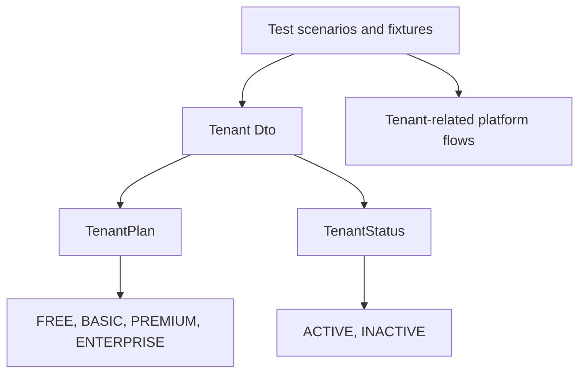
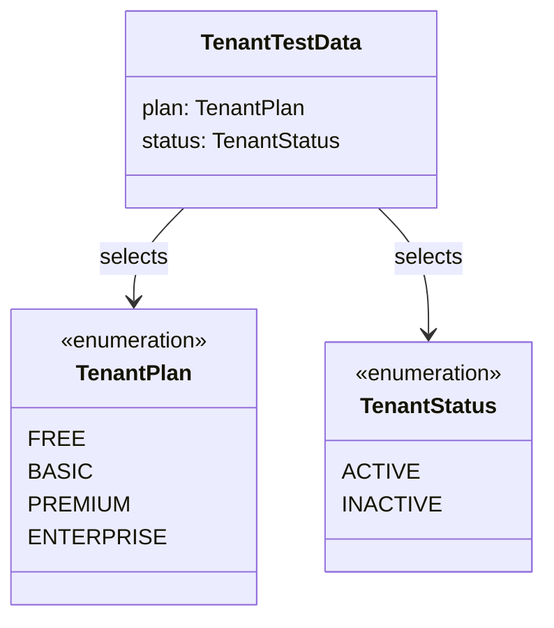

# Tenant Dto

Tenant Dto defines the small, closed vocabulary used by the OpenFrame test-service DTO layer to describe a tenant's commercial tier and operational availability. It contains two Java enumerations:

- `TenantPlan` identifies the subscription tier: `FREE`, `BASIC`, `PREMIUM`, or `ENTERPRISE`.
- `TenantStatus` identifies whether a tenant is `ACTIVE` or `INACTIVE`.

The module is supplied by the `com.openframe.oss:openframe-test-service-core` library at version `7.0.11`, which is consumed by this repository. Its source is maintained in the OpenFrame OSS Library rather than in this repository.

## Purpose and Scope

These types make tenant-oriented test data explicit and type-safe. Instead of scattering arbitrary plan and status strings through test fixtures, callers select a member of a finite enum. This provides a stable representation for test DTO construction, assertions, and test scenarios that need to distinguish plan tier from tenant availability.

Tenant Dto deliberately does not implement subscription rules, persistence, tenant lifecycle transitions, authorization, or provisioning. Those responsibilities belong to the platform services and their domain-specific modules. The enums only define values that test code can carry and compare.

## Architecture Overview



The two enums are independent dimensions:

- A plan answers which tier is represented by the test data.
- A status answers whether the represented tenant is operationally active.

Consequently, any plan constant can be paired with either status constant when a scenario needs to model that combination. The module itself does not designate any pairing as invalid or impose transition rules.

## Components

### Tenant Plan

[`TenantPlan`](https://github.com/flamingo-stack/openframe-oss-lib/blob/7a766f00e4f58b5d89db007b878ac8d6e0c344f4/openframe-test-service-core/src/main/java/com/openframe/test/data/dto/tenant/TenantPlan.java) is an enum for tenant subscription and plan tiers.

| Value | Meaning in test data |
| --- | --- |
| `FREE` | Represents the free tier. |
| `BASIC` | Represents the basic tier. |
| `PREMIUM` | Represents the premium tier. |
| `ENTERPRISE` | Represents the enterprise tier. |

Use this enum when a test must state the tier under which a tenant is evaluated. Because it is an enum, adding a new tier requires an intentional source change and recompilation of code that exhaustively handles its members.

### Tenant Status

[`TenantStatus`](https://github.com/flamingo-stack/openframe-oss-lib/blob/7a766f00e4f58b5d89db007b878ac8d6e0c344f4/openframe-test-service-core/src/main/java/com/openframe/test/data/dto/tenant/TenantStatus.java) is an enum for tenant status values.

| Value | Meaning in test data |
| --- | --- |
| `ACTIVE` | Represents a tenant that is active. |
| `INACTIVE` | Represents a tenant that is inactive. |

Use this enum where a fixture or assertion needs to distinguish active from inactive tenant cases. It carries no dates, actor information, reason codes, or transition behavior; tests requiring those details must obtain them from the relevant platform contract.

## Data Model



`TenantTestData` in the diagram is a conceptual test-data composition, not a class defined by this module. The diagram shows how consuming test code can combine the independent enum dimensions.

## Usage Guidance

Use enum constants directly when creating test DTOs or making assertions. Avoid encoding the values as free-form strings unless an external protocol specifically requires a string representation.

```java
TenantPlan plan = TenantPlan.PREMIUM;
TenantStatus status = TenantStatus.ACTIVE;

assertEquals(TenantStatus.ACTIVE, status);
```

When tests must cover entitlement-like behavior and lifecycle-like behavior separately, vary one enum at a time. For example, compare plan-specific behavior while retaining `ACTIVE`, then compare active and inactive handling while retaining a chosen plan. This keeps scenario intent clear without attributing business rules to the DTO module.

## Maintenance Notes

- Treat the enum names as part of the test-service DTO contract. Renaming or removing a value can break consuming test sources and serialized test data.
- Adding a value requires reviewing switch expressions, parameterized tests, fixture builders, and assertions that enumerate all known plan or status values.
- Do not infer tenant capabilities from the declaration order. The source defines named constants, not ranking or transition semantics.
- Keep production lifecycle and billing logic outside this module; Tenant Dto remains a focused type vocabulary for test code.

## Source Ownership

Both components are provided by OpenFrame OSS Library artifact `com.openframe.oss:openframe-test-service-core`, pinned by this repository to version `7.0.11`.

- [Tenant Plan source](https://github.com/flamingo-stack/openframe-oss-lib/blob/7a766f00e4f58b5d89db007b878ac8d6e0c344f4/openframe-test-service-core/src/main/java/com/openframe/test/data/dto/tenant/TenantPlan.java)
- [Tenant Status source](https://github.com/flamingo-stack/openframe-oss-lib/blob/7a766f00e4f58b5d89db007b878ac8d6e0c344f4/openframe-test-service-core/src/main/java/com/openframe/test/data/dto/tenant/TenantStatus.java)
