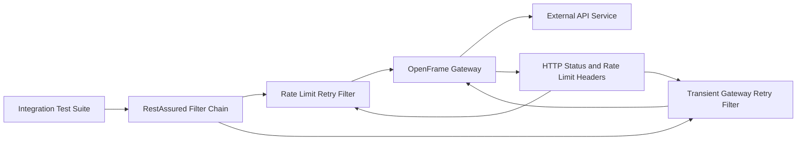
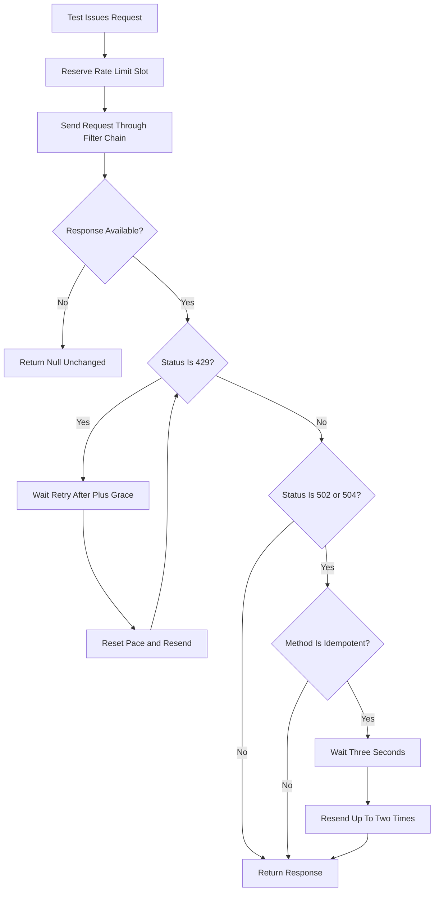

# Test Helpers

Test Helpers is a small resilience layer for the OpenFrame integration-test suite. It provides two RestAssured filters from the `com.openframe.oss:openframe-test-service-core` library that make test outcomes more representative of application behavior: one manages gateway API-key rate limiting, and the other retries narrowly defined gateway transport failures.

The module is supplied by [OpenFrame OSS Library](https://github.com/flamingo-stack/openframe-oss-lib) and runs with this repository's OpenFrame test service. It intentionally operates at the HTTP-response layer, where a conventional HTTP-client retry handler cannot interpret a completed `429`, `502`, or `504` response.

## Responsibilities

- Pace External API calls against the gateway's per-minute API-key allowance.
- Retry rate-limited requests after the gateway-provided retry delay.
- Retry only idempotent requests that receive a transient gateway `502` or `504`.
- Preserve failures that must remain visible to tests, including semantic `503` responses and failed non-idempotent requests.
- Preserve a missing response as `null` instead of causing a filter-side null-pointer failure that hides the underlying connection problem.

## Architecture Overview

The filters have distinct failure domains:

| Filter | Trigger | Safety boundary | Outcome |
|---|---|---|---|
| `RateLimitRetryFilter` | `429 Too Many Requests` | A gateway rate-limit rejection occurs before the request reaches the service, so a resend is safe even for a non-idempotent method. | Paces requests, waits for `Retry-After` when necessary, then retries up to four times. |
| `TransientGatewayRetryFilter` | `502 Bad Gateway` or `504 Gateway Timeout` | A gateway failure does not prove the service did not receive the request, so retries are restricted to idempotent methods. | Waits three seconds and retries at most twice. |

## Request Processing

## Components

### Rate Limit Retry Filter

[`RateLimitRetryFilter`](https://github.com/flamingo-stack/openframe-oss-lib/blob/7a766f00e4f58b5d89db007b878ac8d6e0c344f4/openframe-test-service-core/src/main/java/com/openframe/test/helpers/RateLimitRetryFilter.java) keeps the External API suite inside the gateway's API-key budget.

#### Pacing model

The filter maintains a static scheduling state guarded by a shared lock. This is important because the rate limit belongs to an API key, not to a RestAssured request specification or test thread. Each request reserves the next time slot before it is sent. The slot interval is computed from the current per-minute limit, multiplied by a 1.10 headroom factor and bounded by a 10 millisecond minimum.

Until the gateway reports a limit, the filter assumes five requests per minute. After each response, it reads `X-RateLimit-Limit-Minute`; a positive changed value updates the shared limit and resets the schedule so that the new rate takes effect immediately. It also observes the remaining minute budget for diagnostic logging.

#### Rate-limit recovery

On `429`, the filter retries up to four times. For each retry it:

1. Reads `Retry-After`, using 60 seconds if the header is absent or malformed.
2. Adds a two-second grace period to avoid clock-skew and fixed-window-boundary failures.
3. Sleeps for the resulting duration.
4. Resets the pacing schedule and resends the original request.

When retries are exhausted, diagnostics distinguish the exhausted budget using the response headers:

- A daily budget exhaustion cannot be repaired by waiting for a minute window.
- An hourly budget exhaustion cannot be repaired by the 60-second retry delay.
- A minute budget exhaustion indicates that the configured per-minute allowance is too small for the suite.

The filter deliberately accepts retries for all HTTP methods. Rate-limit rejection happens at the gateway filter before the downstream service processes the request, so a rejected request has not applied an application-level side effect.

### Transient Gateway Retry Filter

[`TransientGatewayRetryFilter`](https://github.com/flamingo-stack/openframe-oss-lib/blob/7a766f00e4f58b5d89db007b878ac8d6e0c344f4/openframe-test-service-core/src/main/java/com/openframe/test/helpers/TransientGatewayRetryFilter.java) handles intermittent gateway-layer failures that appear after a connection is established. It complements, rather than replaces, the HTTP client's transport-exception retries.

The filter treats only `502` and `504` as transient. It explicitly excludes `503`, because the External API can use that status for meaningful backend failures such as Pinot query and database errors; automatically retrying those responses would obscure a real regression.

Only `GET`, `HEAD`, `OPTIONS`, `PUT`, and `DELETE` are eligible. `POST` and `PATCH` are returned unchanged because a gateway error cannot establish whether the downstream service acted on the request. Eligible requests are retried at most twice, with a fixed three-second backoff between attempts.

## Operational Behavior and Failure Semantics

The filters preserve observability rather than converting all failures to success:

- Interrupted sleeps restore the thread interrupt flag and return the latest response without another retry.
- A request that produces no response is returned as `null`; this preserves the original connection failure for the calling framework rather than replacing it with a misleading error in helper code.
- Invalid rate-limit headers are ignored. Gateway header shape is not treated as a test assertion.
- Responses outside the narrow retry criteria pass through unchanged, allowing the test suite to assert application behavior accurately.

## Placement in the Test System

Test Helpers belongs to the `openframe-test-service-core` artifact, version `7.0.11`, consumed by OpenFrame OSS Tenant. It sits between test scenarios and the tenant gateway, shielding tests from known infrastructure-level variability without weakening application-level assertions. Authentication flows, page objects, DTO fixtures, and the test runner remain separate parts of the broader test-service module; this module owns only HTTP resilience policy.

## Maintenance Guidance

When changing either filter, preserve these constraints:

- Keep shared pacing state synchronized because parallel test threads may use the same API key.
- Do not broaden gateway-status retries without showing that the status cannot carry application meaning.
- Do not retry non-idempotent methods after ambiguous gateway failures.
- Keep rate-limit retries separate from transport exception retries, since HTTP client retry handlers do not receive completed HTTP responses.
- Retain interrupt handling so test cancellation and runner shutdown remain responsive.
