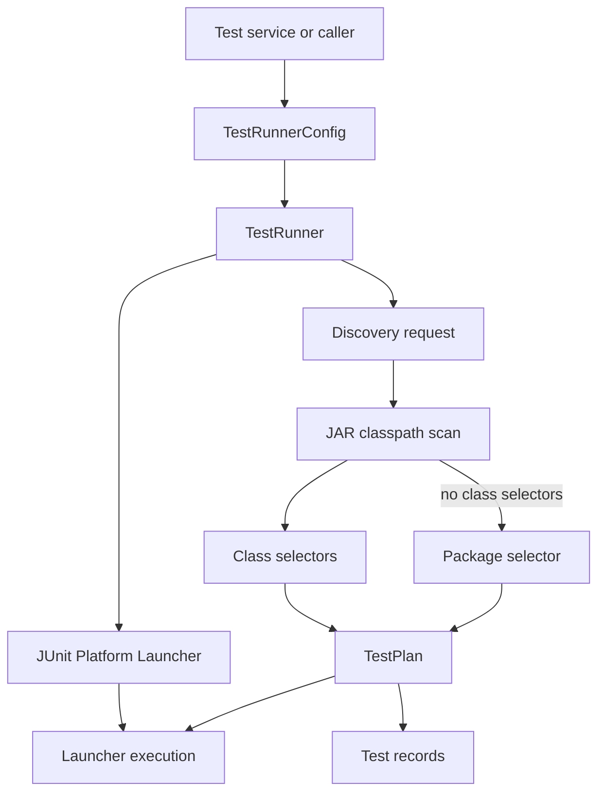
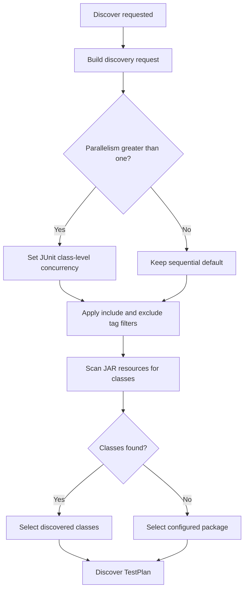
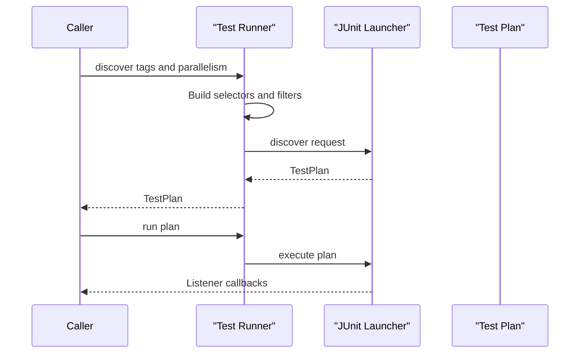

# Test Runner Core

Test Runner Core is the programmatic JUnit Platform adapter supplied by the `com.openframe.oss:openframe-test-service-core` library. It builds discoverable test plans for a configured package, optionally filters them by tags, executes them through a JUnit `Launcher`, and exposes a compact inventory of discovered test cases. The OpenFrame OSS Tenant repository runs this library through its test service; the implementation itself is maintained in the OpenFrame OSS Library.

## Responsibilities

- Construct and configure a JUnit Platform launcher with caller-provided execution listeners.
- Discover test classes from JAR-backed classpath resources under the configured package, with package selection as a fallback.
- Include and exclude tests by JUnit tag.
- Preserve sequential execution by default while allowing explicitly requested class-level parallelism.
- Execute a caller-supplied request or previously discovered `TestPlan`.
- Convert a plan's test identifiers into lightweight `Test` records for listing or reporting.

## Architecture



The runner has three distinct phases:

1. **Configuration and construction:** `TestRunnerConfig` supplies the package to search and execution listeners. `TestRunner` creates a `Launcher` and registers those listeners when constructed.
2. **Discovery:** the runner creates a `LauncherDiscoveryRequest`, applies tag filters and optional concurrency parameters, then asks JUnit to produce a `TestPlan`.
3. **Execution or inspection:** callers can execute a request directly, execute a discovered plan later, or list the plan's test identifiers without running them.

## Core Components

| Component | Role |
| --- | --- |
| [`TestRunnerConfig`](https://github.com/flamingo-stack/openframe-oss-lib/blob/7a766f00e4f58b5d89db007b878ac8d6e0c344f4/openframe-test-service-core/src/main/java/com/openframe/test/runner/TestRunnerConfig.java) | Holds the target test package and the JUnit execution listeners to register with the launcher. Its builder supports fluent construction. |
| [`TestRunner`](https://github.com/flamingo-stack/openframe-oss-lib/blob/7a766f00e4f58b5d89db007b878ac8d6e0c344f4/openframe-test-service-core/src/main/java/com/openframe/test/runner/TestRunner.java) | Builds requests, scans JAR classpath entries for concrete top-level classes, discovers and executes plans, and lists tests with their tags. |
| [`Test`](https://github.com/flamingo-stack/openframe-oss-lib/blob/7a766f00e4f58b5d89db007b878ac8d6e0c344f4/openframe-test-service-core/src/main/java/com/openframe/test/runner/Test.java) | A Lombok-generated data carrier containing the JUnit display name and the set of tags for one discovered test identifier. |

## Discovery and Selection

`TestRunner` derives a resource path from `testPackage` by replacing dots with slashes. It then queries the context class loader for resources at that path. For JAR resources, it enumerates entries below the path and turns each top-level `.class` entry into a JUnit class selector. Nested classes are deliberately skipped because their names contain a dollar sign.

If classpath scanning produces no class selectors, the runner falls back to JUnit's package selector. This fallback also covers non-JAR resource types, which the explicit scanner logs but does not enumerate.

Tag filters are optional:

- Supplying tags to `run(String... tags)` or `discover(String... tags)` creates an include filter.
- The overload accepting include and exclude arrays can apply both filters to a single request.
- An empty or absent array does not add its corresponding filter.



## Execution Model

The default constant, `TestRunner.SEQUENTIAL`, is `1`. Therefore, the standard discovery overload retains one-at-a-time execution for every existing caller.

The `discover(includeTags, excludeTags, parallelism)` overload enables concurrency only when `parallelism` is greater than one. It configures JUnit Jupiter to run **classes** concurrently with a fixed maximum parallelism, while methods within each class remain on the class thread. This design protects suites whose cases build on prior work or depend on thread-local state, but parallel operation remains opt-in and is appropriate only for isolated test classes.



### Supported Entry Points

| Method family | Behavior |
| --- | --- |
| `run(String... tags)` | Builds an include-tag request, discovers it, then executes the resulting plan. |
| `run(LauncherDiscoveryRequest request)` | Discovers and executes a caller-built request. |
| `run(TestPlan testPlan)` | Executes an already discovered plan, allowing discovery and execution to occur separately. |
| `discover(...)` | Produces a plan from tags, explicit filters and parallelism, or a caller-built request. |
| `list(TestPlan testPlan)` | Returns `Test` values for test identifiers beneath the first plan root, including each identifier's display name and tags. |

## Configuration Contract

`TestRunnerConfig` contains two values:

| Field | Meaning |
| --- | --- |
| `testPackage` | Java package used for JAR scanning and the package-selector fallback. |
| `testListeners` | JUnit `TestExecutionListener` instances registered with the launcher at runner construction time. |

A caller can use the provided builder:

```java
TestRunnerConfig config = TestRunnerConfig.builder()
        .testPackage("com.openframe.test.tests")
        .testListeners(listener)
        .build();

TestRunner runner = new TestRunner(config);
runner.run("smoke");
```

The runner delegates lifecycle reporting to registered JUnit listeners. Callers should therefore provide listeners suited to their reporting, failure handling, and output needs.

## Operational Considerations

- **Classpath layout affects discovery.** Explicit class scanning recognizes JAR URLs. Other resource protocols do not produce class selectors and rely on package selection instead.
- **Class loading is best effort.** A class that cannot be loaded because it is absent or has a missing definition is logged and skipped during scanning rather than aborting the entire scan.
- **The execution request carries concurrency settings.** A plan discovered with parallelism settings retains those request parameters when later passed to `run(TestPlan)`.
- **Listing is plan based.** `list` does not discover tests itself and does not execute them; it projects test identifiers already present in the supplied plan.
- **Parallelism is a suite-level safety decision.** The runner enforces no global isolation policy. Callers must choose sequential operation for suites sharing fixtures, browser state, or other mutable resources.

## Relationship to the Test Service

Test Runner Core is one small part of the OpenFrame test-service library. Authentication flows, DTOs, UI page objects, retry helpers, notifications, and feature-specific test classes provide the actual test behavior. This module is the neutral orchestration layer that turns those test classes into filtered, executable JUnit plans without embedding product-domain logic.