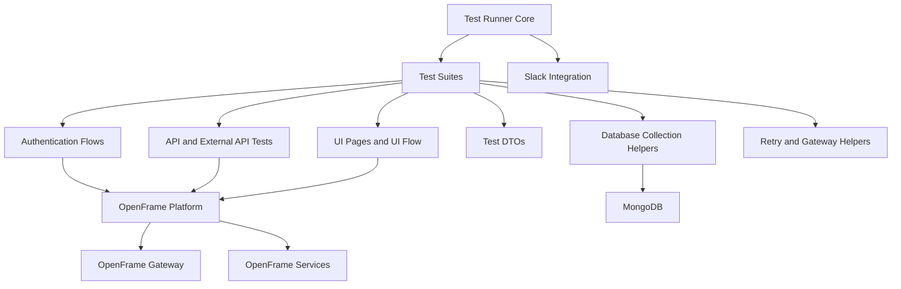
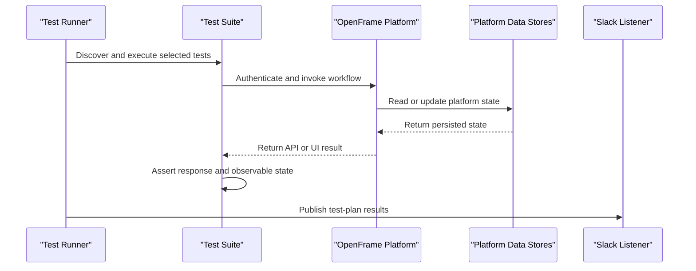
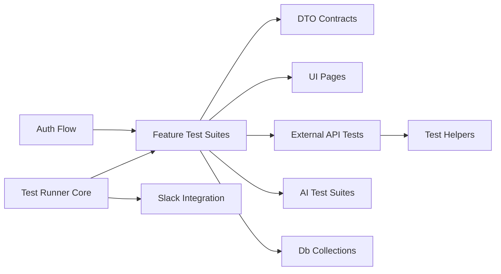

# Test Service Core

Test Service Core is the shared integration-test library used by the OpenFrame test service. It is published as `com.openframe:openframe-test` and depends on the upstream `com.openframe.oss:openframe-test-service-core` library version `7.0.11`.

The module provides the reusable infrastructure and test suites used to validate OpenFrame workflows across authentication, APIs, browser UI, device management, automation, remote access, AI assistants, and external integrations. It is a test-support layer, not a production request-serving component.

## Purpose

Test Service Core enables end-to-end and integration tests to:

- Authenticate users and agents in OSS and SaaS deployment modes.
- Drive API, GraphQL, External API, and browser workflows.
- Deserialize platform responses into test-focused DTOs.
- Validate persisted tenant and organization data through test collection helpers.
- Exercise device, script, software, ticket, notification, knowledge-base, and remote-access flows.
- Run and filter JUnit test plans programmatically.
- Publish test-run summaries through Slack when configured.
- Apply narrowly scoped retry behavior for rate limits and transient gateway failures.

## Architecture

The module separates test orchestration from test behavior:

- **Test Runner Core** discovers, filters, lists, and executes JUnit tests.
- **Authentication Flows** establish test credentials across deployment modes.
- **DTOs and database helpers** provide typed response models and persisted-state assertions.
- **UI pages** encapsulate Playwright browser actions and readiness checks.
- **Feature test suites** validate observable behavior through platform APIs, browser sessions, agents, and independent verification channels.
- **Slack Integration** reports test-plan outcomes without making notification delivery a prerequisite for test completion.

## Test Execution Flow

## Core Components

| Area | Responsibilities | Component documentation |
|---|---|---|
| Authentication | Drives tenant discovery, redirect-based login, credential submission, and token-cookie extraction for OSS and SaaS flows. | Auth Flow |
| Database helpers | Reads organization and tenant documents for setup and persisted-state assertions. | Db Collections |
| Test DTOs | Represents API and GraphQL responses for AI, devices, scripts, schedules, software, tickets, notifications, time tracking, and external APIs. | AI DTO, Device DTO, Script DTO, Ticket DTO, Software DTO, and related DTO documentation |
| HTTP resilience | Handles API-key rate-limit pacing and safe retries of transient gateway failures. | Test Helpers |
| Test reporting | Collects JUnit outcomes and sends reports through Slack Bot API, webhooks, or logs. | Slack Integration |
| Browser automation | Provides Playwright page objects for login, devices, scripts, monitoring, remote desktop, remote shell, and file management. | UI Pages and UI Flow |
| Test orchestration | Discovers JUnit classes, applies tag filters, supports optional class-level parallelism, and executes test plans. | Test Runner Core |
| General platform tests | Covers administration, users, onboarding, devices, policies, scripts, software, tickets, notifications, and support workflows. | General Tests |
| AI tests | Validates Mingo administrative-assistant and Fae client-assistant behavior, safety boundaries, targeting, conversation lifecycle, and tool effects. | AI Tests Mingo and AI Tests Fae |
| External API tests | Validates API-key authentication, pagination, customers, devices, logs, tools, tickets, and knowledge-base workflows. | External API Tests |

## Component Relationships

## Test Areas

Test Service Core groups its scenarios into several focused areas:

- **General Tests** — platform workflow coverage for users, organizations, devices, policies, scripts, software, tickets, logs, notifications, tags, and time tracking.
- **AI Tests Fae** — client-scoped assistant behavior, machine-bound targeting, safety, session handling, and ticket reopening.
- **AI Tests Mingo** — administrator assistant workflows, device operations, entity mutations, Fleet MDM interactions, safety controls, compaction, and model switching.
- **External API Tests** — public API-key-protected API behavior and lifecycle cleanup.
- **UI Pages and UI Flow** — Playwright-based browser automation for frontend workflows.
- **Test Runner Core** — JUnit discovery, execution, tag selection, and reporting integration.

## Boundaries

Test Service Core does not implement the production API, gateway, authorization server, client agent, or persistence services. Instead, it validates those components through their externally observable behavior.

The surrounding tenant deployment provides the services and infrastructure under test, including:

- Gateway routing to API, authorization, client, and frontend services.
- MongoDB, Redis, Cassandra, Kafka, NATS, and Pinot data services.
- OpenFrame API, authorization server, client, management, stream, external API, and gateway services.
- Fleet MDM and MeshCentral integrations used by device and remote-access workflows.

## Maintenance Notes

- Keep test DTOs aligned with their API response contracts while preserving unknown-field tolerance where present.
- Preserve explicit readiness checks in browser flows; navigation alone does not guarantee the application is usable.
- Keep gateway retries restricted to rate-limit responses and safe idempotent transient-failure cases.
- Use independent verification for mutations, particularly AI-driven machine or platform changes.
- Maintain test cleanup for created tenant resources to avoid residue in shared environments.
- Treat test tags and runner configuration as part of the suite-selection contract.